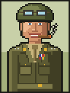
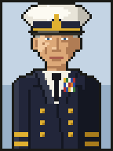
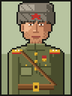
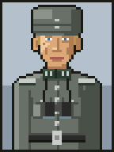

# Topic Doc 06: Commanders

**Status:** designed (v2) on 2026-11-15, not built. Portraits drawn. Names and numbers are provisional.
**Last updated:** 2026-11-15
**Depends on:** 00-master-design.md §7, 01-units.md, 02-terrain.md, 03-combat.md (§6 veterancy), 04-economy-production.md §5 (repair), 05-supply-transport.md, 08-art-pipeline.md, 11-tech-setup.md (milestone 13, CO hooks; §3c controls).

---

## 1. Commanders are fictional

Every commander is an original character. No real person is named or portrayed.

### Why

Decided on 2026-11-15 after weighing three options: real generals under rules, fictional commanders, and formations in place of people.

- A commander here is a character with a portrait and a personality, which is a warmer treatment than a line of stats. Giving that treatment to real Axis officers risks glamorizing them, and the "honorable professional" image of several is partly wartime and postwar propaganda.
- Real commanders on every side carry controversy, the Allies and the Soviet Union included. Each new name would need its record checked and a judgment made.
- Estates of some real commanders license their names and likenesses.
- The maps already carry the history. The commanders don't have to.

Real names thinly disguised (same initials, sound-alike names) were rejected: the person stays recognizable, so the controversy stays, and it looks like hiding it.

### Rules for writing a commander

1. **Unrelated name.** No shared initials with, and no sound-alike of, a real commander. Check that the name doesn't belong to a notable real figure of the war.
2. **No one-to-one stand-in.** A commander may draw on how real armies fought, but not on one person's career. Blend traits, or invent them.
3. **Style, not biography.** The description says how they fight. It names no real battles, units, ranks held or dates.
4. **Original portrait.** Never drawn from a photo of a real person.
5. **Military characters only.** No political leaders, no party or SS-style organizations, and no Nazi or political symbols (00-master-design §6).
6. **Every nation gets the same treatment**: the same tone and the same care, in the writing and in the portrait.

## 2. How a commander works

- There are **eight commanders: one from each nation, and a second American for the navy** (§3). The first roster had two per nation; on 2026-11-15 the developer asked for fewer, so each pair was merged into one, and on 2026-11-16 asked for the American admiral back as a naval specialist.
- **A commander serves a side, not a nation.** A player may fight under any commander from their own side: any of the five Allied commanders for an Allied nation, any of the three Axis commanders for an Axis nation. A commander never serves the other side. Two players on one side may pick the same commander.
- **"No commander" is always a choice**, and it is the default. A player with no commander has no bonus and no drawback, so a battle where nobody picks one plays exactly as the game did before commanders.
- A commander has **bonuses and one drawback**, all always on. They are entries in the modifier layer (`GameState.modifiers`), so a commander is data with no logic.
- Bonuses and drawbacks are built on unit classes and terrain that every nation shares, so a commander works for any nation on their side.
- Unit stats stay identical between nations (00-master-design §6). Commanders are the only thing that makes two armies fight differently.

Unit classes used below:
- **Tanks**: Light, Medium and Heavy Tank.
- **Foot soldiers**: Infantry and Assault Infantry.
- **Indirect fire**: Mortar, Artillery and Rocket Artillery.

## 3. Roster (v2)

All numbers are starting points for balancing.

### Allies

| | Commander | Style | Bonuses | Drawback |
|---|---|---|---|---|
|  | **Walt Harlan** United States | Never stops moving, and keeps his machines running. Would sooner attack again than wait for the guns | Tanks +1 move. Every unit repairs 1 extra HP per turn on a property that repairs it | Indirect fire −10% attack |
|  | **Dale Calloway** United States | A patient admiral. Keeps his ships moving and brings them home | Ships +1 move and +10% defense | Tanks −10% attack |
|  | **Hugh Ashdown** United Kingdom | Methodical. Attacks only after the guns have done their work, and then with infantry | Indirect fire +15% attack. Foot soldiers +10% attack | Tanks −1 move |
|  | **Luc Tremblay** Canada | An inventor who carries his infantry forward under armor. His troops learn fast | Halftracks +1 move. Units reach Veteran at 2 kills and Elite at 5 (03-combat §6: normally 3 and 9) | Air units −10% attack |
|  | **Stepan Morozov** Soviet Union | Wins by weight of numbers, and fights for a city street by street | All units cost 10% less. Foot soldiers +20% attack in Cities | All units −10% defense |

### Axis

| | Commander | Style | Bonuses | Drawback |
|---|---|---|---|---|
|  | **Konrad Falk** Germany | Bold, fast strikes that outrun his supply columns | Tanks and Tank Destroyers +15% attack when they start the fight. Recon +1 move | All units carry 20% less fuel and ammo |
|  | **Aldo Ferrante** Italy | A patient defender. Lets the ground do the work and makes an attacker pay for every step | All units +15% defense on Hills, Ridges and Cities. All units +20% damage on counterattacks | All units −10% attack when they start the fight |
|  | **Kenji Arakawa** Japan | Strikes first from the air, and digs in deep on the ground | Dive Bombers and Torpedo Bombers +1 move and +10% attack. Land units on Bunkers and Hills take 25% less damage from indirect fire, ships and bombers | Tanks −1 move |

### What the merge dropped

From the first roster of 14: cheaper foot movement on Hills and Rivers, the Halftrack defense and Assault Infantry bonuses, the Rocket Artillery bonus, city defense, foot soldiers' bonus against vehicles with the faster Transport Aircraft, and every vision bonus. Vision does nothing until the game has fog of war (00-master-design §5), so no commander is built on it. Calloway is the only naval specialist.

## 4. Portraits

Each commander has a 48 × 64 pixel portrait from the waist up, drawn in code by `tools/art/commanders.mjs` and saved in `docs/art/commanders/`: `<id>.png`, `<id>-x3.png` at three times the size for this doc, and `<id>-head.png`, a 32 × 32 crop of the head for the turn bar.

The portraits are also a chance to show **an officer's uniform of each nation**, in its real colors and not the nation's map color. The panel behind each figure carries a light shade of the map color.

| Commander | Uniform |
|---|---|
| Walt Harlan | US Army: steel helmet with goggles pushed up, the short olive drab field jacket with a waistband, khaki shirt and tie, brass collar discs, ribbons. A cigar |
| Dale Calloway | US Navy: white-topped cap with a gold chin strap and badge, the double-breasted blue-black coat with gold buttons and gold lace on the cuffs, white shirt, black tie, ribbons |
| Hugh Ashdown | British Army: khaki service dress, a staff officer's cap with a red band, red collar patches, brass buttons, pleated pockets, a brown leather belt with a cross strap, ribbons |
| Luc Tremblay | Canadian Army: the khaki battledress blouse, the armoured corps' black beret, shirt and tie. Glasses |
| Stepan Morozov | Red Army: fur cap, the khaki tunic with a standing collar, gold shoulder boards edged in red, a gold star medal, leather belt and cross strap |
| Konrad Falk | German Army: field grey tunic with a dark green collar and plain silver collar bars, soft field cap, silver shoulder cords, black belt, a scarf and field glasses |
| Aldo Ferrante | Italian Army, mountain troops: grey-green tunic, the felt hat with a tall feather, green collar flames, brown belt and cross strap, ribbons |
| Kenji Arakawa | Japanese Army: khaki tunic with a turned-down collar and red collar patches, field cap with a plain gold star, brown belt and cross strap |

- **No Nazi or political symbols** (00-master-design §6). The German uniform has no eagle on the cap or the chest and no other emblem; the Italian has no fasces; the Japanese cap star and the Soviet red star are the armies' own plain markings, as on the units.
- Nothing is drawn from a photo or a real person (§1 rule 4). Where a look is tied to one famous commander, it is avoided or mixed.
- Medal ribbons are made-up color bars, not real decorations.
- When built, the portraits join the art pack (08-art-pipeline §13) so a pack can replace them.

## 5. Where commanders show in the game

### Picking a commander

On the map select screen each player has a commander choice next to their "Computer plays …" box: **No commander** (the default), then the commanders of that player's side with their portraits. The computer's players get the same choice.

### The turn bar

The head of the current player's commander portrait (the 32 × 32 crop) sits **in the turn bar beside their flag** (the HUD with the flag, day and funds), and changes with the flag when the turn passes. A player with no commander shows the flag alone.

### The Commanders screen

The turn menu (11-tech-setup §3c) gains a third item, above the other two:

| Turn menu |
|---|
| COMMANDERS |
| RESIGN |
| END TURN |

**COMMANDERS** opens a screen that lists every commander, Allies then Axis, with **the current player's own commander already selected**. If they have none, the first in the list is selected and a line says they are playing without a commander.

- The list shows each head and name. Commanders in this battle are marked with the flag of each player who has them.
- The selected commander's details fill the rest of the screen: the full portrait from the waist up, name, nation and side, style, each bonus and the drawback, in the same words as §3.
- Arrow keys or a click move through the list. X, Esc or a click outside closes it.
- Opening it uses no action and doesn't end the turn. It is also offered while watching the computer's turn.

## 6. What the engine needs first

Nothing is built. Milestone 13 (CO hooks, 11-tech-setup) is still to do, and this roster needs all of it and a little more:

- **A commander per player** in `GameState`, optional, and the rule that it must be from the player's side.
- **Scopes that depend on the target**: "damage taken from indirect fire, ships and bombers".
- **Scopes that depend on who started the fight**: "when they start the fight", "on counterattacks".
- **Scopes that depend on the terrain the unit stands on**: "in Cities", "on Bunkers and Hills".
- **New modifiable values**: fuel and ammo capacity, the repair amount on a property, the kill counts for veterancy levels. Move, attack, defense, cost, vision and terrain move cost already go through the modifier layer.

## 7. Open questions

- **Commander powers.** The original's commanders also have a power that charges up and is set off by the player. Not designed; this doc covers the always-on effects only.
- **Whether a scenario can fix or forbid commanders.**
- **Whether a commander changes how the computer plays** (00-master-design §15).
- **Balance.** Nothing here has been played. `npm run selfplay` with each commander against each other, and against no commander, is the first check once built.
- **Final names.** The names in §3 are placeholders that pass the rules in §1.
