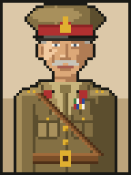
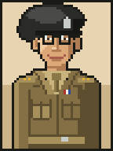
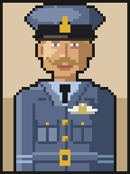
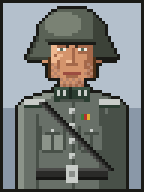
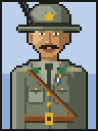
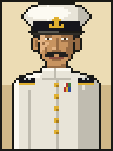
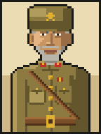
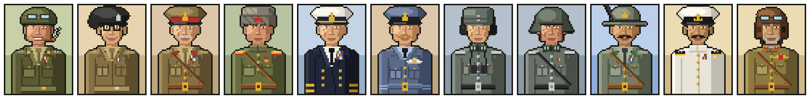

# Topic Doc 06: Commanders

**Status:** rules built on 2026-11-16 (milestone 13); the screens in §5 are not built yet. Portraits drawn. Names and numbers are provisional.
**Last updated:** 2026-11-20
**Depends on:** 00-master-design.md §7, 01-units.md, 02-terrain.md, 03-combat.md (§6 veterancy), 04-economy-production.md §5 (repair), 05-supply-transport.md, 08-art-pipeline.md, 11-tech-setup.md (milestone 13, CO hooks; §3c controls).

---

## 1. Commanders are fictional

Every commander is an original character. No real person is named or portrayed.

### Why

Decided on 2026-11-15 after weighing three options: real generals under rules, fictional commanders, and formations in place of people.

- A commander here is a character with a portrait and a personality, which is a warmer treatment than a line of stats. Giving that treatment to real Axis officers risks glamorizing them, and the "honorable professional" image of several is partly wartime and postwar propaganda.
- Real commanders on every side carry controversy, the Allies and the Soviet Union included. Each new name would need its record checked and a judgment made.
- Estates of some real commanders license their names and likenesses.
- The maps already carry the history. The commanders don't have to.

Real names thinly disguised (same initials, sound-alike names) were rejected: the person stays recognizable, so the controversy stays, and it looks like hiding it.

### Rules for writing a commander

1. **Unrelated name.** No shared initials with, and no sound-alike of, a real commander. Check that the name doesn't belong to a notable real figure of the war.
2. **No one-to-one stand-in.** A commander may draw on how real armies fought, but not on one person's career. Blend traits, or invent them.
3. **Style, not biography.** The description says how they fight. It names no real battles, units, ranks held or dates.
4. **Original portrait.** Never drawn from a photo of a real person.
5. **Military characters only.** No political leaders, no party or SS-style organizations, and no Nazi or political symbols (00-master-design §6).
6. **Every nation gets the same treatment**: the same tone and the same care, in the writing and in the portrait.

## 2. How a commander works

- There are **eleven commanders: six Allied and five Axis** (§3). The first roster had two per nation; on 2026-11-15 the developer asked for fewer, so each pair was merged into one, and on 2026-11-16 asked for the American admiral back as a naval specialist. On 2026-11-20 the developer asked for a specialist in each of four branches on each side, so three were added: a British airman, a German infantry officer and a Japanese admiral.
- **Every commander comes from a branch: Tanks, Infantry, Naval or Air.** Each side has at least one of each. The branch shows in their uniform (§4) and is named on the screens beside their nation (§5).
- **A commander serves a side, not a nation.** A player may fight under any commander from their own side: any of the five Allied commanders for an Allied nation, any of the three Axis commanders for an Axis nation. A commander never serves the other side. Two players on one side may pick the same commander.
- **"No commander" is always a choice**, and it is the default. A player with no commander has no bonus and no drawback, so a battle where nobody picks one plays exactly as the game did before commanders.
- A commander has **bonuses and one drawback**, all always on. They are modifiers in the modifier layer, so a commander is data with no logic (§6).
- Bonuses and drawbacks are built on unit classes and terrain that every nation shares, so a commander works for any nation on their side.
- Unit stats stay identical between nations (00-master-design §6). Commanders are the only thing that makes two armies fight differently.

Unit classes used below:
- **Tanks**: Light, Medium and Heavy Tank.
- **Foot soldiers**: Infantry and Assault Infantry.
- **Indirect fire**: Mortar, Artillery and Rocket Artillery.

## 3. Roster (v3)

All numbers are starting points for balancing.

### Allies

| | Commander | Style | Bonuses | Drawback |
|---|---|---|---|---|
|  | **Walt Harlan** Tanks · United States | Never stops moving, and keeps his machines running. Would sooner attack again than wait for the guns | Tanks +1 move. Every unit repairs 1 extra HP per turn on a property that repairs it | Indirect fire −10% attack |
|  | **Dale Calloway** Naval · United States | A patient admiral. Keeps his ships moving and brings them home | Ships +1 move and +10% defense | Tanks −10% attack |
|  | **Hugh Ashdown** Infantry · United Kingdom | Methodical. Attacks only after the guns have done their work, and then with infantry | Indirect fire +15% attack. Foot soldiers +10% attack | Tanks −1 move |
|  | **Luc Tremblay** Tanks · Canada | An inventor who carries his infantry forward under armor. His troops learn fast | Halftracks +1 move. Units reach Veteran at 2 kills and Elite at 5 (03-combat §6: normally 3 and 9) | Air units −10% attack |
|  | **Stepan Morozov** Infantry · Soviet Union | Wins by weight of numbers, and fights for a city street by street | All units cost 10% less. Foot soldiers +20% attack in Cities | All units −10% defense |
|  | **Rhys Penhallow** Air · United Kingdom | Wins the sky first, then lets the army walk in under it | Air units +10% attack and +10% defense. Fighters +1 move | Ships −10% attack |

### Axis

| | Commander | Style | Bonuses | Drawback |
|---|---|---|---|---|
|  | **Konrad Falk** Tanks · Germany | Bold, fast strikes that outrun his supply columns | Tanks and Tank Destroyers +15% attack when they start the fight. Recon +1 move | All units carry 20% less fuel and ammo |
|  | **Jakob Wendt** Infantry · Germany | Trusts the rifleman. Digs in, holds on, and gives ground a step at a time | Foot soldiers +15% attack and +15% defense. Mortar Teams +1 move | Air units cost 10% more |
|  | **Aldo Ferrante** Infantry · Italy | A patient defender. Lets the ground do the work and makes an attacker pay for every step | All units +15% defense on Hills, Ridges and Cities. All units +20% attack on counterattacks | All units −10% attack when they start the fight |
|  | **Isao Kuramochi** Naval · Japan | A night-fighting admiral. Closes fast and fires first | Ships +20% attack when they start the fight. Submarines and Torpedo Boats +1 move | Foot soldiers −10% attack |
|  | **Kenji Arakawa** Air · Japan | Strikes first from the air, and digs in deep on the ground | Dive Bombers and Torpedo Bombers +1 move and +10% attack. Land units on Bunkers and Hills +25% defense against indirect fire, ships and bombers (a Bomber, Dive Bomber or Torpedo Bomber) | Tanks −1 move |

### What the merge dropped

From the first roster of 14: cheaper foot movement on Hills and Rivers, the Halftrack defense and Assault Infantry bonuses, the Rocket Artillery bonus, city defense, foot soldiers' bonus against vehicles with the faster Transport Aircraft, and every vision bonus. Vision did nothing until fog of war arrived as an option on 2026-11-17 (19-fog-of-war), so no commander is built on it yet.

Ferrante is counted as Infantry for his mountain troops' uniform, though his bonuses cover every unit; Wendt is the Axis infantry specialist. Tremblay is counted as Tanks for the armoured corps he comes from.

## 4. Portraits

Each commander has a 48 × 64 pixel portrait from the waist up, drawn in code by `tools/art/commanders.mjs` and saved in `docs/art/commanders/`: `<id>.png`, `<id>-x3.png` at three times the size for this doc, and `<id>-bust.png`, the top 48 × 48 (head, shoulders and chest) for lists.

The portraits are also a chance to show **an officer's uniform of each nation and branch**, in its real colors and not the nation's map color. A head alone was too hard to tell apart (the developer, 2026-11-20), so the small portraits show the shoulders and chest too, and **the uniform names the branch at a glance**: sailors in navy blue or whites, airmen in flying helmets or air force blue with wings, tank officers with tanker headgear, infantry in steel helmets, field caps or service dress. The panel behind each figure carries a light shade of the map color.

| Commander | Uniform |
|---|---|
| Walt Harlan | US Army, tanks: steel helmet with goggles pushed up, the short olive drab field jacket with a waistband, khaki shirt and tie, brass collar discs, ribbons. A cigar |
| Dale Calloway | US Navy: white-topped cap with a gold chin strap and badge, the double-breasted blue-black coat with gold buttons and gold lace on the cuffs, white shirt, black tie, ribbons |
| Hugh Ashdown | British Army, infantry: khaki service dress, a staff officer's cap with a red band, red collar patches, brass buttons, pleated pockets, a brown leather belt with a cross strap, ribbons |
| Luc Tremblay | Canadian Army, armoured corps: the khaki battledress blouse, the armoured corps' black beret, shirt and tie. Glasses |
| Stepan Morozov | Red Army, infantry: fur cap, the khaki tunic with a standing collar, gold shoulder boards edged in red, a gold star medal, leather belt and cross strap |
| Rhys Penhallow | Royal Air Force: blue-grey service dress with a cloth belt, peaked cap with a black band and a plain gold badge, light blue shirt and black tie, white pilot's wings, pale blue rank rings on the cuffs. A handlebar moustache |
| Konrad Falk | German Army, tanks: field grey tunic with a dark green collar and plain silver collar bars, soft field cap under a tank crew headset with a throat microphone, silver shoulder cords, black belt, field glasses |
| Jakob Wendt | German Army, infantry: steel helmet with no decal, field grey tunic with a dark green collar and plain silver collar bars, silver shoulder cords, black belt and cross strap, ribbons. Stubble |
| Aldo Ferrante | Italian Army, mountain troops: grey-green tunic, the felt hat with a tall feather, green collar flames, brown belt and cross strap, ribbons |
| Isao Kuramochi | Japanese Navy: the white summer tunic with a standing collar and five gold buttons, black shoulder boards with gold edges, white-covered cap with a black band and a plain gold anchor, ribbons |
| Kenji Arakawa | Japanese Army air service: khaki tunic with a turned-down collar and red collar patches, a leather flying helmet with goggles, gold aircrew wings, brown belt and cross strap |

- **No Nazi or political symbols** (00-master-design §6). The German uniform has no eagle on the cap or the chest and no other emblem; the Italian has no fasces; the Japanese cap star and the Soviet red star are the armies' own plain markings, as on the units.
- Nothing is drawn from a photo or a real person (§1 rule 4). Where a look is tied to one famous commander, it is avoided or mixed.
- Medal ribbons are made-up color bars, not real decorations.
- When built, the portraits join the art pack (08-art-pipeline §13) so a pack can replace them.

## 5. Where commanders show in the game

Built 2026-11-16. The words on these screens come from the commander data (`src/engine/data/commanders.ts`); the portraits and display names come from the art pack (`commanderPortraits`, `commanderNames`, 08-art-pipeline §13). The game's copies of the portraits are in `public/assets/commanders/`, written by `tools/art/commanders.mjs`.

### Picking a commander

A new game is two screens, and both work from the keyboard alone (the developer's request, 2026-11-16; the first build put everything on the map select, where the commander choice couldn't be reached sensibly without a mouse):

1. **Choose a map.** Up and Down walk the list, Z picks the map and moves on, X goes back to the title.
2. **Players and commanders.** Each player has a commander choice and a "Computer plays …" box, followed by the game options and Start. The focus starts on the first player's commander.

On the players screen:

- **Left and Right change the commander in focus**: **No commander** (the default), then the commanders of that player's side in roster order (§3). Z or a click steps forward too. The computer's players get the same choice.
- The choice shows the commander's bust, name, and branch and nation ("Naval · Japan").
- Under each choice, one line gives the chosen commander's bonuses and drawback.
- Up and Down walk every control. Up from the first commander wraps round to Start, so a game with no changes is Z, Up, Z.
- X goes back to the maps and keeps what was chosen. Choices are also kept when you come back after a game. On a map where that player is on the other side, the choice is dropped.
- For testing, `?commanders=harlan,falk` in the address gives the players those commanders in player order (11-tech-setup §7). A commander of the other side is ignored.

### The turn bar

The current player's commander portrait sits **in the turn bar to the left of their flag** (the HUD with the flag, day and funds), and changes with the flag when the turn passes. It is the full portrait from the waist up at its own size, 48 × 64, **as tall as the flag row and the funds row together** (the developer's request, 2026-11-16; the head alone was shown until 2026-11-20, when the developer found it too hard to tell commanders apart by face). On a phone the status bar is a single row, so the bust is shown as tall as that row, 32 × 32. A player with no commander shows the flag alone.

### The Commanders screen

The turn menu (11-tech-setup §3c) gains a third item, above the other two:

| Turn menu |
|---|
| COMMANDERS |
| RESIGN |
| END TURN |

**COMMANDERS** opens a screen that lists every commander, Allies then Axis, with **the current player's own commander already selected**. If they have none, the first in the list is selected and a line says they are playing without a commander.

- The list shows each bust, name, and branch and nation. Commanders in this battle are marked with the flag of each player who has them.
- The selected commander's details fill the rest of the screen: the full portrait from the waist up, name, branch, nation and side, who they command in this battle, style, each bonus and the drawback, in the same words as §3.
- Arrow keys or a click move through the list. X, Esc, the Close button or a click outside closes it.
- Opening it uses no action and doesn't end the turn. Closing it comes back to the turn menu with COMMANDERS highlighted, not END TURN, so a stray Z can't end the turn.
- It can also be opened at any time, **including while watching the computer's turn**, with the medal button in the turn bar or the C key. Opened while the computer moves, it selects the commander of the person watching (the last human to play), not the computer's.

## 6. How the engine does it (built 2026-11-16, milestone 13)

The rules are built and tested (`tests/commanders.test.ts`). The screens in §5 are not, so a commander can't be picked in the game yet.

- **Data.** `src/engine/data/commanders.ts` holds each commander: name, nation, branch, the words of §3, and a list of effects. The branch has no effect on the rules; the effects do the work. An effect is a modifier without a source or a player.
- **A commander per player.** `Player.commander` is optional; missing means no commander. `createGame` takes it per player and refuses a commander from the other side.
- **Derived, not stored.** The engine turns each player's commander into modifiers for that player alone, at lookup time, as it does for weather. `GameState.modifiers` keeps only scenario modifiers, so a saved game holds just who commands whom.
- **Percentages add.** "+15% attack" adds 15 to the attack value of the damage formula (03-combat §1), which starts at 100, as veterancy does. A Veteran under a +15% commander attacks at 125. Defense works the same way.
- **New scopes** in the modifier layer:
  - *who started the fight*: `started` for the unit that attacked, `answered` for the one attacked. A unit's attack while `answered` is its counterattack.
  - *the opponent*: its unit type or its category.
  - These only match while a fight is being worked out, so the unit panel's Attack and Defense rows show the values without them.
- **New modifiable values**: the HP repaired on a property (`repairHp`), and the kills for Veteran and Elite (`veteranKills`, `eliteKills`).
- **The forecast and the fight use the same lookups**, so a forecast still promises exactly what happens.

Rulings made while building:

- **A garrisoned bunker defends as its holder would.** An attack on soldiers in a bunker hits the bunker (03-combat §4). The bunker's defense takes its holder's commander into account, against that attacker, so Arakawa's soldiers in a bunker get his bonus against shelling. The soldiers' own veterancy still doesn't count for the bunker. An empty bunker belongs to nobody and gets nothing.
- **"In Cities" means the City terrain**, not factories, airfields, ports or HQs.
- **Harlan's extra repair is on properties only.** Aircraft aboard a Carrier still repair 1 HP.
- **Falk's units start with what they can carry**: a Medium Tank starts with 24 fuel and 7 ammo, not 30 and 9. A smaller amount a scenario sets for a unit is kept, but never more than the unit can carry.
- **Morozov's lower cost also lowers his repair bills**, since a repair costs a tenth of the unit's price per HP (04-economy §5).
- **Tremblay's units can be promoted on the spot** when he takes over a unit with enough kills already; there is no way to change commander mid-game, so this only matters for a scenario's starting units.
- **Luck modifiers** (03-combat §7) were part of milestone 13's plan. No commander uses luck, so they are not built.

`npm run selfplay -- --commanders` plays the computer against itself with every player under a commander.

## 7. Open questions

- **Commander powers.** The original's commanders also have a power that charges up and is set off by the player. Not designed; this doc covers the always-on effects only.
- **Whether a scenario can fix or forbid commanders.** Answered for the Campaign (22-campaign §3, 2026-11-20): each mission fixes the computer's commanders and leaves the player's choice open. Skirmish still leaves every choice to the players.
- **Whether a commander changes how the computer plays** (00-master-design §15).
- **Balance.** Nothing here has been played. `npm run selfplay` with each commander against each other, and against no commander, is the first check once built.
- **Final names.** The names in §3 are placeholders that pass the rules in §1.
