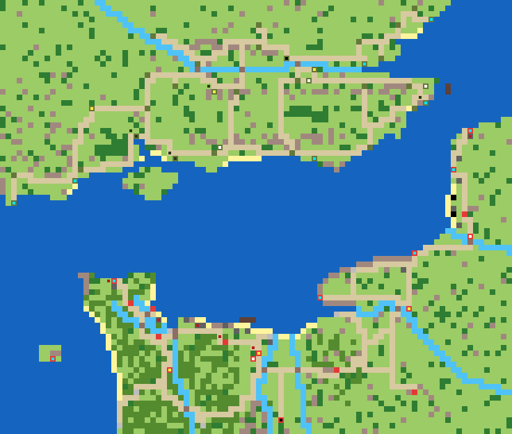

# Topic Doc 10: Normandy Scenarios

**Status:** first theater map built (v0), ahead of phase 4 at the developer's request. Balance untested.
**Last updated:** 2026-11-07
**Depends on:** 00-master-design.md §8, 01-units.md, 04-economy-production.md, 05-supply-transport.md.

---

## 1. The Normandy theater map (`normandy`)

Army green properties are Allied, red German, grey neutral. The inner mark shows the kind: yellow factory, white airfield, cyan port, black HQ. Dark squares are starting units.

### Area and scale

- **92 × 78 squares**: southern England from Dorset to Suffolk, the Channel, and northern France from the Cotentin to Calais.
- The shape follows the real coastlines, but **scale isn't uniform**. Normandy and the Solent get the most squares (about 3 km a square). Inland England, Kent and the Pas-de-Calais are squeezed, and the Channel is narrowed so a crossing takes a few turns, not ten.
- Crossing times with a Landing Craft (6 moves): the Isle of Wight to the Cotentin is about 14 squares, Portsmouth to Omaha about 30 (5 turns).
- **The Channel is wider than Rocket Artillery range** (5): no land square on the English side is within 5 squares of the French mainland, so rockets can't fire from coast to coast. The narrowest gap is the Strait of Dover. Battleships (range 6) in mid-Channel can still reach a coast.

### Places

| | Allies (England) | Germany (France) | Neutral (France) |
|---|---|---|---|
| HQ | London | Falaise | |
| Factories | Woolwich, Aldershot, Salisbury | Caen, Saint-Lô, Rouen | |
| Ports | Southampton, Portsmouth, Portland, Poole, Newhaven, Dover, Tilbury, Felixstowe | Cherbourg, Le Havre, Dieppe, Boulogne, Calais, St Helier (Jersey) | |
| Airfields | Tangmere, Biggin Hill, Manston | Carpiquet, Abbeville | |
| Cities | 21, from Dorchester to Ipswich | Carentan, Sainte-Mère-Église, Valognes, Bayeux, Lisieux, Évreux, Montreuil | Isigny, Coutances, Granville, Vire, Fécamp, Honfleur, Ouistreham |

- **Income:** the Allies own 36 properties (36,000 a day), Germany 19. England's cities pay for the invasion; the Germans have to make a thin force go far.
- The German HQ is at **Falaise**, south of Caen, where the real campaign ended. Factories and HQs are our choice, not history.

### Terrain

- **Beaches:** most of the Normandy coast is sand, as it really was. The five D-Day sectors were the planners' choice, not the only places to land. On the map: Utah and the east Cotentin north to Saint-Vaast (about 7 squares), Omaha (3), Gold, Juno and Sword (about 9 together, to the mouth of the Orne), Cabourg to Deauville east of the Orne, and the west Cotentin. Elsewhere in France: the Pas-de-Calais coast, where the Germans expected the landing. England has beaches at Stokes Bay, Studland, Bognor, Hythe and Clacton for loading.
- **Cliffs** (Hills on the shore) where no one lands: Pointe du Hoc to the west end of Omaha, Port-en-Bessin to Arromanches between Omaha and Gold, Dover, Beachy Head, the Pays de Caux and Cap de la Hague. The Baie des Veys between Utah and Omaha is open water.
- **Atlantic Wall:** Bunkers stand behind each beach, never on the sand. Two stand on clifftops: **Pointe du Hoc**, with a cliff beside it and Omaha just east, and the **Longues battery** between Omaha and Gold. More bunkers guard Cherbourg, Le Havre and Dieppe, and the Pas-de-Calais has the most, plus Obstacles.
- **Bocage** covers the Cotentin and the land around Saint-Lô and Bayeux. The **Caen plain** is open tank country. Hills south of Caen (Suisse Normande) and in the Pays d'Auge.
- **Rivers:** the Douve and Merderet around Carentan and Sainte-Mère-Église (the flooded valleys), the Vire, Orne, Dives, Seine and Somme in France; the Thames in England. Roads cross them on bridges.
- **Reefs:** the Rochers du Calvados off Gold and Juno, and the Goodwin Sands off Deal.
- Forests: the New Forest, the Weald, Epping, Cerisy, Brotonne and Lyons.

### Starting forces (deliberately small)

- **Allies** (US nation for art; 10,000 funds): a Landing Craft at Southampton, a Destroyer at Portsmouth, three Infantry (Southampton, Portsmouth, Dover) and a Medium Tank near Aldershot.
- **Germany** (8,000 funds): Infantry in the bunkers at Utah, Omaha and Calais and near Cherbourg, a Medium Tank near Caen and Artillery near Bayeux.

### Build lists

- Allies: every land unit except the Heavy Tank, including Rocket Artillery; all air and naval units.
- Germany: every land unit; Fighter, Bomber, Transport Aircraft, Destroyer, Submarine and Torpedo Boat. No Battleship or Landing Craft (01-units §7a, the availability rule).

### Victory

- **Capture the enemy HQ** only. Rout is off, because on a map this size a side can lose every unit and still rebuild from its factories. Resign is always available.

### How it's made

- `tools/maps/normandy.mjs` generates the scenario file from real longitude/latitude points for coastlines, rivers and towns. Roads are routed between towns along the cheapest path, so they follow valleys and cross rivers only where they must. Rerun it after editing; `tools/maps/overview.mjs normandy` redraws the picture above.
- Tests (`tests/scenario.test.ts`, "Normandy") check the size, that England and France aren't joined by land, the rocket gap, the income lead, the small starting forces, the beach count, the clifftop bunkers and the victory rule.

## 2. Known gaps

- Normandy's coast runs east–west and each square is about 3 km wide, so each D-Day sector is only 3–4 squares. Landing Craft can currently load and unload anywhere; the Beach-or-Port rule (05-supply-transport §8) arrives with milestone 11. Naval daily fuel and sinking arrive with milestone 10.
- There's no minimap yet, so finding your way around a map this size relies on scrolling (00-master-design §12).
- Balance is a first guess: Allied income, German starting funds and the bunker count will need playtesting.
- Future Normandy scenarios (D-Day itself with a large starting force, the Cotentin, Caen) can reuse this generator with different units and owners.
