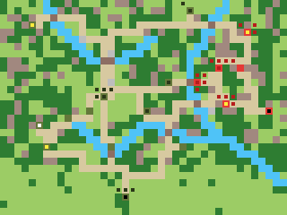

# Topic Doc 13: Ardennes Scenarios

**Status:** first Ardennes map built (v0). Balance untested.
**Last updated:** 2026-11-08
**Depends on:** 00-master-design.md §8, 01-units.md, 04-economy-production.md §8 (victory conditions), 12-weather.md.

---

## 1. Bastogne (`bastogne`)

Army green properties are US, red German, grey neutral. The inner mark shows the kind: yellow factory, white airfield, black HQ. Dark squares are starting units.

### The history it follows

In December 1944 Germany attacked through the snowy Ardennes forest, hoping bad weather would keep Allied aircraft grounded. The crossroads town of **Bastogne** was held by the US 101st Airborne and armored teams, and was surrounded. German tanks were strong but short of fuel and stuck to the few roads. On 23 December the skies cleared, Allied aircraft returned, and Patton's 4th Armored Division broke through from the south on 26 December.

### Area and scale

- **40 × 30 squares**, about 2.5 km each: from Marche and Neufchâteau in the west to Prüm and Bitburg in the German Eifel, and from St. Vith in the north to Arlon in the south.
- Generated from real longitude and latitude, with even scale.

### Places

| | US | Germany | Neutral |
|---|---|---|---|
| HQ | Arlon | Bitburg | |
| Factories | Neufchâteau, Marche | Prüm, Neuerburg | |
| Airfield | Libramont | none | |
| Cities | **Bastogne** (objective), Martelange, Sibret, Vaux-sur-Sûre, St. Vith, Clervaux, Wiltz, Ettelbruck | Dasburg, Arzfeld, Waxweiler | Houffalize, La Roche, Noville, Vianden |

- **Income:** the US starts with 12 properties, Germany with 6. The US front-line towns along the Our (St. Vith, Clervaux, Wiltz, Ettelbruck) are close to the German start and can be taken quickly.
- **Germany has no airfield** and can't build aircraft: the Luftwaffe barely flew in the battle. The US can build aircraft from Libramont, at half range while it snows (12-weather §3).

### Terrain

- **Bastogne** sits on an open plateau with a road leaving on every side: north to Noville, Houffalize and St. Vith; east to Clervaux and Prüm; south-east to Wiltz; south to Martelange and Arlon (Patton's road); west to Sibret and Neufchâteau; north-west to La Roche and Marche.
- **Rivers:** the **Our** along the German border, crossed on bridges at Dasburg and on the roads to St. Vith and Vianden; the **Sûre** across the south past Martelange and Ettelbruck; the **Ourthe** past Houffalize and La Roche.
- Steep, wooded valleys along the rivers (more Hills and Forest). The Ardennes, Luxembourg's Oesling and the Eifel are about half forest with ridges. The Gaume around Arlon in the south is open farmland.

### Starting forces

- **US** (4,000 funds): in Bastogne, three Infantry, Artillery and a Tank Destroyer; one Infantry each in St. Vith (with a Tank Destroyer), Clervaux and Wiltz; two Medium Tanks and a Halftrack near Arlon in the far south, as the 4th Armored was.
- **Germany** (10,000 funds): massed behind the Our: two Heavy Tanks, four Medium Tanks, a Recon, a Halftrack, two Artillery, five Infantry and two Assault Infantry. **Its tanks start short of fuel** (Heavy Tanks 12 of 20, Medium Tanks 17 of 30), so they need the Halftrack or a captured or own town to refuel.

### Weather

- **Snow from day 1 to day 5, clear from day 6**, matching the clear skies of 23 December. In snow, tanks crawl off-road (12-weather §3), so the roads and the towns where they meet decide the battle. The map is drawn in winter all game: snow stays on the ground after the skies clear.

### Build lists

- US: every land unit except the Heavy Tank, plus Fighter, Bomber and Transport Aircraft.
- Germany: every land unit, including the Heavy Tank. No aircraft.

### Victory

- **Germany** wins by capturing **Bastogne** (`captureProperties`) or the US HQ at Arlon.
- **The US** wins by still being in the game when **day 12** starts (`surviveDays`), or by capturing Germany's HQ at Bitburg.
- Rout is on: a side that loses every unit loses. Resign is always available.

### How it's made

- `tools/maps/bastogne.mjs` generates the scenario file from real longitude/latitude points for towns and rivers, routing roads between towns along the cheapest path. Rerun it after editing; `tools/maps/overview.mjs bastogne` redraws the picture above.
- Tests (`tests/scenario.test.ts`, "Bastogne") check the objective and its owner, the day-12 survival rule, the crossroads, the weather, Germany's bigger army and low fuel, who can build aircraft, and that German tanks can drive to Bastogne.

## 2. Known gaps

- Balance is a first guess: the US income lead, Germany's starting funds, and whether 11 days is long enough for Germany to take Bastogne all need playtesting.
- Supply drops into Bastogne (Transport Aircraft carrying fuel and ammo) aren't a rule; Transport Aircraft only carry soldiers (01-units §5).
- There's no AI yet, so the scenario is hot-seat only until milestone 15.
