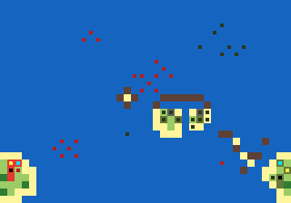

# Topic Doc 14: Pacific Scenarios

**Status:** three Pacific maps built (v0): Iwo Jima, The Slot and Midway. Balance untested.
**Last updated:** 2026-11-13
**Depends on:** 00-master-design.md §6 and §8, 01-units.md, 04-economy-production.md §8 (victory conditions), 05-supply-transport.md (landings), 08-art-pipeline.md (Japanese art).

---

## 1. Iwo Jima (`iwo-jima`)

Army green properties are US, red Japanese. The inner mark shows the kind: yellow factory, white airfield, cyan port, black HQ. Dark squares are starting units.

### The history it follows

On 19 February 1945 the US 3rd, 4th and 5th Marine Divisions landed on the black volcanic sand of Iwo Jima's south-east coast. The island was wanted for its airfields, halfway between the Marianas and Japan. General Kuribayashi had given up defending the beaches: his 21,000 men waited in bunkers, caves and tunnels from Mount Suribachi to the northern plateau, to make the invasion as slow and costly as possible. Suribachi fell on 23 February, when the flag went up on its summit. The fighting through the northern ridges (the "Meat Grinder" round Hill 382, Turkey Knob and the Amphitheater) lasted until 26 March.

### Area and scale

- **36 × 26 squares**, about 300 m each. North is up. The island runs from Mount Suribachi at the south-west tip to Kitano Point and Tachiiwa Point in the north-east, about 27 squares long.
- The outline is a polygon traced from the real map in `tools/maps/iwo-jima.mjs`. The neck behind the landing beaches is 3 to 4 squares wide, as the real one was under a kilometre.
- **The US anchorage** is a block of land in the south-east corner. It stands for the transport and carrier groups offshore, which the game can't show as ships that build units: it holds the US HQ, a Factory and two Ports. The carriers are real Carriers offshore (below); the anchorage Airfield that stood in for them is gone (2026-11-09). It's about 12 squares, two Landing Craft turns, from the beaches.

### Places

| | US | Japan |
|---|---|---|
| HQ | The anchorage | Kuribayashi's command post near Kitano Point |
| Factory | The anchorage | The supply depot north of Motoyama |
| Airfields | none | **No. 1** (objective), **No. 2** (objective), No. 3 (unfinished, north-east) |
| Ports | Two at the anchorage | none |
| Cities | | **Mount Suribachi's summit** (objective), Motoyama, Minami, Nishi, Kita, Higashi |

- **Mount Suribachi's summit is a City,** standing for the observation post on the crater rim, so it can be captured: taking it plays the capture scene with the US flag going up, as on 23 February. It's ringed by Hills and bunkers.
- **Income:** the US starts with 4 properties, Japan with 11. Japan was cut off and short of everything; its income lets it replace losses slowly, but its starting army does most of the fighting.

### Terrain

- **Black sand beaches** (Beach) along the whole south-east coast from Suribachi to the East Boat Basin, and along the west coast below the plateau. The north coast is cliffs (Hills).
- **Mount Suribachi**: Hills round the summit, with bunkers on its flanks.
- **The airfields** sit across the middle of the island, with their runways running on as open ground and a road linking them to the villages.
- **The Motoyama plateau and the northern ridges**: Hills (Hill 382, Turkey Knob, the Amphitheater, Hill 362A, Nishi Ridge), broken ground of ash and rock (Rubble) and scrub (Forest). Hills stop vehicles (02-terrain), so tanks have to find the gaps and the roads, as they did.
- **Bunkers** (20): behind the beaches, on Suribachi, round both airfields and all through the north. Never on the sand.

### Starting forces

- **US** (6,000 funds): the first wave already ashore on the beaches: four Infantry, two Assault Infantry and two Medium Tanks. Offshore: two Battleships, two Destroyers and two Landing Craft for the next waves, and two Carriers, each carrying two Dive Bombers, between the beaches and the anchorage (at 26,15 and 23,16): close enough for their Dive Bombers to reach the bunkers round Airfield No. 2 on day 1, out of reach of every Japanese gun at the start. No Torpedo Bombers: Japan has no ships here. With no airfield of its own, the US can't build aircraft until it takes Airfield No. 1 or No. 2, so lost Dive Bombers aren't replaced before then, and each has only 2 bombs before it has to land on a Carrier to rearm. At the anchorage: an Infantry, an Artillery and a Halftrack waiting to be ferried in.
- **Japan** (3,000 funds), its foot soldiers almost all in bunkers: Mount Suribachi's garrison (two Infantry, a Mortar, an Artillery); the airfield line (three Infantry, Assault Infantry, a Mortar, a Flak Gun); the northern main line (four Infantry, Assault Infantry, two Rocket Artillery, an Artillery, a Mortar, a Flak Gun); and Baron Nishi's 26th Tank Regiment near Airfield No. 2 (two Medium Tanks and a Light Tank).

### Build lists

- **US**: every unit except the Heavy Tank: land, air and naval.
- **Japan**: Infantry, Assault Infantry, Mortar Team, Light and Medium Tanks, Artillery, Rocket Artillery and Flak Gun. No aircraft or ships (none reached the island), no Heavy Tank (Japan fielded none, 01-units §1).

### Victory

- **The US** wins by capturing **Mount Suribachi's summit and Airfields No. 1 and No. 2** (`captureProperties`), or Japan's HQ.
- **Japan** wins by still being in the game when **day 15** starts (`surviveDays`), or by capturing the US HQ at the anchorage.
- Rout is on: a side that loses every unit loses. Resign is always available.

### Weather

- Clear all game (the default). The real battle had rain on some days; rain isn't in the game yet (12-weather).

### How it's made

- `tools/maps/iwo-jima.mjs` builds the scenario file from the island polygon and lists of features, properties and units. Rerun it after editing; `tools/maps/overview.mjs iwo-jima` redraws the picture above.
- Tests (`tests/scenario.test.ts`, "Iwo Jima") check the nations, the objectives and their owner, the day-15 rule, Suribachi's place and hills, the first wave on the beaches with the fleet offshore, the Japanese in bunkers, Japan's build list, the two Carriers with their Dive Bombers and no US airfield, that the Dive Bombers can reach a bunker on day 1 while no Japanese gun reaches the Carriers, and that US tanks can drive from the beaches to Japan's HQ.

## 2. The Slot (`the-slot`)

Same key as above: army green properties are US, red Japanese, grey neutral.

### What it is

An island campaign in the style of the Solomons, **not a historical map**. The US holds the south, Japan the north, with the same islands and the same forces: the north is the south turned 180° about the centre square, so neither side has a better position. Only moving first differs, and no unit starts within reach of an enemy, so the first player can't open with a strike.

### Area

- **29 × 37 squares**, north up. The odd size gives the map a centre square for the central airfield.
- **The Slot**: a channel of open sea down the middle, between two chains of islands, from one side's HQ island to the other's. No reefs, so ships move at full speed, but it runs right past the central airfield, so it's exposed to air attack. It splits into two passages round the central island.
- **The flanks**: open ocean east and west of the chains, with scattered Reefs (ships pay 2 to cross one). Room for carriers to work round the side and strike from out of the Slot's line.

### Places (each side; the other side's are the same turned round)

| Place | Where (US) | Properties |
|---|---|---|
| HQ island | The south end, across the Slot's mouth | HQ, Factory, City, and two Ports facing up the Slot (the major port) |
| Secondary city | The western chain | Two Cities |
| Forward port | The eastern chain | Port, City |
| Airstrip outpost | An islet in the south-west ocean | Airfield, the side's only one at the start |

- Each side's secondary city faces the enemy's forward port across the map: the US city and Japan's forward port are both on the western chain, Japan's city and the US forward port both on the eastern.
- **The neutral centre**: the central island in the middle of the Slot, with an **Airfield** on the centre square and two Cities; from there aircraft reach both halves. Two **anchorages**, neutral Ports on islets out on the west and east flanks level with the centre, each the same distance from both HQs. Taken by Infantry put ashore, they refuel and repair ships far from home (04-economy §5).
- **Income:** each side starts with 10 properties; 5 are neutral.

### Starting forces (each side)

- **Fleet:** two Carriers, one out on each flank ocean, each with a Destroyer escort and a Fighter aboard, plus a Dive Bomber on one and a Torpedo Bomber on the other. At the mouth of the Slot: two Battleships, two Destroyers and two Torpedo Boats. Two Landing Craft off the ports, each with two Infantry aboard.
- **Garrisons:** the HQ island has two Infantry, a Medium Tank, an Artillery and a Mobile AA; the secondary city two Infantry and a Flak Gun; the forward port an Infantry and an Artillery; the airstrip an Infantry.
- **Cruisers:** the concept called for four cruisers and some destroyers. The game has no Cruiser: our Destroyer already plays the original's Cruiser role (anti-air, hunts submarines), so the four cruisers are four Destroyers, and the destroyers' torpedo work is done by two Torpedo Boats.
- **Funds:** 5,000 each.

### Build lists

- The same for both: every unit except the Heavy Tank, which Japan never fielded (01-units §1).

### Victory

- Capture the enemy's HQ, or rout them (the standard conditions). Resign is always available.

### How it's made

- `tools/maps/the-slot.mjs` builds the scenario file. Every island, property and unit is written once, for the south and the centre, and stamped again turned round for the north, so the map can't drift out of symmetry. Rerun it after editing; `tools/maps/overview.mjs the-slot` redraws the picture.
- Tests (`tests/scenario.test.ts`, "The Slot"): the map, units and owners rotate onto each other exactly; the US is in the south and Japan in the north with the same build lists; each side has its HQ island ports, city, forward port and airstrip; the neutral airfield is on the centre square and the anchorages are the same distance from both HQs; the Slot has no reefs and ships can sail it from port to port; the starting fleets match; the Carriers start on the flanks with their aircraft; and nothing can strike an enemy on day 1.

### Known gaps

- Balance is a first guess, especially the size of the starting fleets against 5,000 funds and the value of the central airfield.
- Since 2026-11-13 the Greedy AI uses Landing Craft, Transport Aircraft and Carriers (09-ai §4b), so against the computer the islands do change hands. Since milestone 17 (09-ai §4c) it lands in waves with warship escorts and keeps a garrison at home; AI vs AI games on The Slot end by day 54.

## 3. Midway (`midway`)

Same key as above: army green properties are US, red Japanese.

### The history it follows

In June 1942 Japan sent four carriers (Akagi, Kaga, Sōryū and Hiryū, Admiral Nagumo's Kido Butai) to strike Midway ahead of an invasion, with Admiral Yamamoto's battleships far behind and the invasion transports coming from the south-west. US codebreakers had read the plan, and three US carriers (Enterprise, Hornet and Yorktown) waited north-east of the atoll at "Point Luck". On 4 June Japan struck Midway at dawn. Midway's own aircraft attacked the carriers and achieved nothing. While Nagumo's aircraft were landing and rearming, US dive bombers sank Akagi, Kaga and Sōryū in a few minutes; Hiryū struck back and crippled Yorktown before it was sunk in turn, and the submarine I-168 finished Yorktown off. Japan called off the invasion.

### Area and scale

- **40 × 28 squares** of open ocean, about **30 nautical miles a square**, north up. The scale is set by carrier aircraft: a Dive or Torpedo Bomber launched from a Carrier flies 6 and attacks the next square, so a strike reaches about 7 squares, roughly the real 200 miles.
- **Midway atoll** is drawn far larger than life (in truth it's about 6 miles across, under a square): a ring of Reef round a lagoon, open to the south by a channel between its two islands. **Sand Island** to the west has the Marine command post (a City) and the harbor and seaplane base (a Port); **Eastern Island** to the east has the airstrip (an Airfield). Both have Bunkers and beaches all round, so the invasion can come ashore anywhere. Ships cross the reef at double cost.
- **Kure Atoll**, a reef and sandbar two squares west-north-west of Midway, on the invasion's way in.
- **The Northwestern Hawaiian Islands**: a broken chain of reefs and sandy islets from Midway towards Pearl Harbor (Pearl and Hermes Reef, Lisianski, Laysan, Maro Reef, French Frigate Shoals), much compressed.
- **The bases**: Japan's in the south-west corner stands for the forward bases at Wake and Saipan, the US base in the south-east corner for Pearl Harbor. Both are far closer than the real ones; like Iwo Jima's anchorage they give each side an HQ, a Factory, a Port and a City.

### Places

| | US | Japan |
|---|---|---|
| HQ, Factory, Port, City | Pearl Harbor (south-east corner) | Wake and Saipan (south-west corner) |
| Midway | **The command post** (City, objective), the harbor (Port), **the airstrip** (Airfield, objective) | none |
| Airfields | Midway's only | **none**: Japan's carrier air groups were irreplaceable, and it can only build aircraft once it takes Midway's airstrip |

- **Income:** 500 per property (`incomePerProperty`, half the usual), so reinforcements are a trickle and the starting fleets do the fighting. The US starts with 7 properties, Japan with 4; both start with 2,000.

### Starting forces

Each Carrier's two aircraft stand for its whole air group (a real carrier held about 60).

- **Japan, the Kido Butai**, north-west of Midway: four Carriers, Akagi (Fighter, Torpedo Bomber), Kaga (Dive Bomber, Torpedo Bomber), Sōryū (Fighter, Dive Bomber) and Hiryū (Dive Bomber, Torpedo Bomber); two Battleships (Haruna, Kirishima) and three Destroyers (the cruisers Tone and Chikuma and the screen; the game has no Cruiser, as in The Slot). Every Carrier can strike Sand Island on its first turn without moving. Torpedo Bombers can't hit land, so they are the reserve kept for ships, as Nagumo's was.
- **Japan, the Main Body**: Yamamoto's battleships, two Battleships and a Destroyer, far to the north-west, two days behind.
- **Japan, the invasion force**, south-west of Midway, more than two days' sailing away: three Landing Craft carrying four Infantry and two Assault Infantry, a Battleship and two Destroyers. The submarine **I-168** waits between Pearl Harbor and Midway. One Infantry holds the home base.
- **The US carriers** at Point Luck, north-east of Midway: Enterprise (two Dive Bombers: its dive bombers sank Akagi and Kaga), Hornet (Fighter, Torpedo Bomber: Torpedo 8 found the enemy first and was cut down) and Yorktown (Dive Bomber, Torpedo Bomber), with three Destroyers for their cruisers and destroyers.
- **Midway**: its own air group on Eastern Island, a Fighter, a Bomber (the B-17s), a Dive Bomber and a Torpedo Bomber (the new Avengers); the 6th Marine Defense Battalion, three Infantry in the bunkers and the command post, an Artillery (the coastal guns) and a Flak Gun; a Torpedo Boat (the PT boats) in the harbor. Two Submarines on picket: Nautilus north-east of the Japanese carriers, another on the invasion's way in. One Infantry holds Pearl Harbor.

### How the opening works

- **The US moves first**, as on every built-in map (the first player is army green, 08-art-pipeline §12; the engine always starts with the first player). Its day-1 turn stands for the night before the battle and the dawn searches: Midway's aircraft can scramble or head out, the carriers can close in or wait. Japan's first turn is the dawn strike on Midway.
- **Nothing can reach either side's Carriers from where the units start**, and Midway's aircraft and PT boats can't reach the Japanese ones. Each US Carrier is one move from striking range of a Japanese Carrier.
- **Whoever closes in first is exposed**, from the carrier rules (05-supply-transport §10) with no special rule: a Carrier either moves or launches in a turn, so a Carrier that sails into striking range can't launch until its next turn, and the other side's Carriers, if they still have aircraft aboard, strike first. An aircraft that has struck has to fly back and land, and can't launch again the turn it lands. So a Japanese Carrier that sent its aircraft at Midway is empty for two turns: the moment the US dive bombers caught Nagumo in, which the players can now recreate or avoid.

### Build lists

- Both sides: every unit except the Heavy Tank, which neither fielded (01-units §1). Japan has no airfield, so in practice it builds land units and ships until it takes Midway's airstrip.

### Victory

- **Japan** wins by capturing **Sand Island's command post and Eastern Island's airfield** (`captureProperties`), or the US HQ.
- **The US** wins by still being in the game when **day 12** starts (`surviveDays`), or by capturing Japan's HQ. Sinking Japan's carriers ends any hope of the invasion, but there's no "sink these units" victory condition, so holding out stands in for it.
- Rout is on. Resign is always available.

### Weather

- Clear all game. The real Kido Butai approached under a weather front, but there's no fog of war or cloud in the game yet (12-weather).

### How it's made

- `tools/maps/midway.mjs` builds the scenario file; `node tools/maps/midway.mjs --reach` also lists every unit an enemy could attack on its first turn, for tuning. `tools/maps/overview.mjs midway` redraws the picture above. The overview now colors properties and units by side (Allies green, Axis red) instead of by player order.
- Tests (`tests/scenario.test.ts`, "Midway") check the nations and order, the objectives and their owner, the day-12 rule, the atoll's two islands inside the reef, Japan's four Carriers north-west of Midway each able to strike Sand Island, the three US Carriers north-east with two aircraft each, that nothing can attack an enemy Carrier from where it starts, that each US Carrier is one move from striking range, Midway's air group, the invasion force's distance, that Japan has no airfield, and the build lists. The AI tests play it AI vs AI to a finish: every game ends by day 12.

### Known gaps

- **No fog of war.** Midway was decided by who found whom first; here both sides see everything from the start, and the US code-breaking advantage is gone. The move-or-launch timing carries the tension instead. Fog stays under "later / maybe" (00-master-design §4); this is the map that most wants it.
- **Balance is a first guess**, especially the day-12 limit, half income, and the strength of Midway's air group. In AI vs AI games (10 seeds) Japan wins every time, by day 7 to 9, but mostly because of the AI (next point), not the map.
- **The Greedy AI doesn't hold objectives it must defend.** It garrisons only its HQ island (09-ai §4c), so as the US it ships Midway's Marines away in a Landing Craft and Japan walks in. Playing Japan against the computer is easy for now; playing the US against the computer, or hot-seat, is the better test.
- Carriers carry 2 aircraft, so each stands for a whole air group, and there's no combat air patrol: Fighters only shoot down aircraft that end their move nearby.

## 4. Known gaps (Iwo Jima)

- Carrier numbers are a first guess, to tune after playtests. Japan has no way to reach Carriers out of artillery range, as historically.
- Balance is a first guess: whether 14 days is enough for the US, and whether Japan's income is too high for a garrison that was cut off.
- Caves and tunnels (Japanese units reappearing behind the front) aren't a rule.
- Naval gunfire support is just Battleships and Destroyers firing at range; there's no pre-landing bombardment.
- There's no AI yet, so the scenario is hot-seat only until milestone 15.
