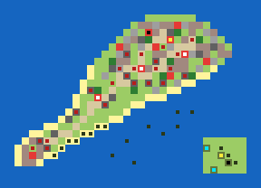

# Topic Doc 14: Pacific Scenarios

**Status:** first Pacific map built (v0). Balance untested.
**Last updated:** 2026-11-08
**Depends on:** 00-master-design.md §6 and §8, 01-units.md, 04-economy-production.md §8 (victory conditions), 05-supply-transport.md (landings), 08-art-pipeline.md (Japanese art).

---

## 1. Iwo Jima (`iwo-jima`)

Army green properties are US, red Japanese. The inner mark shows the kind: yellow factory, white airfield, cyan port, black HQ. Dark squares are starting units.

### The history it follows

On 19 February 1945 the US 3rd, 4th and 5th Marine Divisions landed on the black volcanic sand of Iwo Jima's south-east coast. The island was wanted for its airfields, halfway between the Marianas and Japan. General Kuribayashi had given up defending the beaches: his 21,000 men waited in bunkers, caves and tunnels from Mount Suribachi to the northern plateau, to make the invasion as slow and costly as possible. Suribachi fell on 23 February, when the flag went up on its summit. The fighting through the northern ridges (the "Meat Grinder" round Hill 382, Turkey Knob and the Amphitheater) lasted until 26 March.

### Area and scale

- **36 × 26 squares**, about 300 m each. North is up. The island runs from Mount Suribachi at the south-west tip to Kitano Point and Tachiiwa Point in the north-east, about 27 squares long.
- The outline is a polygon traced from the real map in `tools/maps/iwo-jima.mjs`. The neck behind the landing beaches is 3 to 4 squares wide, as the real one was under a kilometre.
- **The US anchorage** is a block of land in the south-east corner. It stands for the transport and carrier groups offshore, which the game can't show as ships that build units: it holds the US HQ, a Factory and two Ports. The carriers are real Carriers offshore (below); the anchorage Airfield that stood in for them is gone (2026-11-09). It's about 12 squares, two Landing Craft turns, from the beaches.

### Places

| | US | Japan |
|---|---|---|
| HQ | The anchorage | Kuribayashi's command post near Kitano Point |
| Factory | The anchorage | The supply depot north of Motoyama |
| Airfields | none | **No. 1** (objective), **No. 2** (objective), No. 3 (unfinished, north-east) |
| Ports | Two at the anchorage | none |
| Cities | | **Mount Suribachi's summit** (objective), Motoyama, Minami, Nishi, Kita, Higashi |

- **Mount Suribachi's summit is a City,** standing for the observation post on the crater rim, so it can be captured: taking it plays the capture scene with the US flag going up, as on 23 February. It's ringed by Hills and bunkers.
- **Income:** the US starts with 4 properties, Japan with 11. Japan was cut off and short of everything; its income lets it replace losses slowly, but its starting army does most of the fighting.

### Terrain

- **Black sand beaches** (Beach) along the whole south-east coast from Suribachi to the East Boat Basin, and along the west coast below the plateau. The north coast is cliffs (Hills).
- **Mount Suribachi**: Hills round the summit, with bunkers on its flanks.
- **The airfields** sit across the middle of the island, with their runways running on as open ground and a road linking them to the villages.
- **The Motoyama plateau and the northern ridges**: Hills (Hill 382, Turkey Knob, the Amphitheater, Hill 362A, Nishi Ridge), broken ground of ash and rock (Rubble) and scrub (Forest). Hills stop vehicles (02-terrain), so tanks have to find the gaps and the roads, as they did.
- **Bunkers** (20): behind the beaches, on Suribachi, round both airfields and all through the north. Never on the sand.

### Starting forces

- **US** (6,000 funds): the first wave already ashore on the beaches: four Infantry, two Assault Infantry and two Medium Tanks. Offshore: two Battleships, two Destroyers and two Landing Craft for the next waves, and two Carriers, each carrying two Bombers, between the beaches and the anchorage (at 26,15 and 24,17): close enough for their Bombers to reach the bunkers round Airfield No. 2 on day 1, out of reach of every Japanese gun at the start. With no airfield of its own, the US can't build aircraft until it takes Airfield No. 1 or No. 2, so lost Bombers aren't replaced before then. At the anchorage: an Infantry, an Artillery and a Halftrack waiting to be ferried in.
- **Japan** (3,000 funds), its foot soldiers almost all in bunkers: Mount Suribachi's garrison (two Infantry, a Mortar, an Artillery); the airfield line (three Infantry, Assault Infantry, a Mortar, a Flak Gun); the northern main line (four Infantry, Assault Infantry, two Rocket Artillery, an Artillery, a Mortar, a Flak Gun); and Baron Nishi's 26th Tank Regiment near Airfield No. 2 (two Medium Tanks and a Light Tank).

### Build lists

- **US**: every unit except the Heavy Tank: land, air and naval.
- **Japan**: Infantry, Assault Infantry, Mortar Team, Light and Medium Tanks, Artillery, Rocket Artillery and Flak Gun. No aircraft or ships (none reached the island), no Heavy Tank (Japan fielded none, 01-units §1).

### Victory

- **The US** wins by capturing **Mount Suribachi's summit and Airfields No. 1 and No. 2** (`captureProperties`), or Japan's HQ.
- **Japan** wins by still being in the game when **day 15** starts (`surviveDays`), or by capturing the US HQ at the anchorage.
- Rout is on: a side that loses every unit loses. Resign is always available.

### Weather

- Clear all game (the default). The real battle had rain on some days; rain isn't in the game yet (12-weather).

### How it's made

- `tools/maps/iwo-jima.mjs` builds the scenario file from the island polygon and lists of features, properties and units. Rerun it after editing; `tools/maps/overview.mjs iwo-jima` redraws the picture above.
- Tests (`tests/scenario.test.ts`, "Iwo Jima") check the nations, the objectives and their owner, the day-15 rule, Suribachi's place and hills, the first wave on the beaches with the fleet offshore, the Japanese in bunkers, Japan's build list, the two Carriers with their Bombers and no US airfield, that the Bombers can reach a bunker on day 1 while no Japanese gun reaches the Carriers, and that US tanks can drive from the beaches to Japan's HQ.

## 2. Known gaps

- Carrier numbers are a first guess, to tune after playtests. Japan has no way to reach Carriers out of artillery range, as historically.
- Balance is a first guess: whether 14 days is enough for the US, and whether Japan's income is too high for a garrison that was cut off.
- Caves and tunnels (Japanese units reappearing behind the front) aren't a rule.
- Naval gunfire support is just Battleships and Destroyers firing at range; there's no pre-landing bombardment.
- There's no AI yet, so the scenario is hot-seat only until milestone 15.
