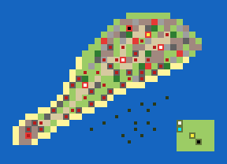
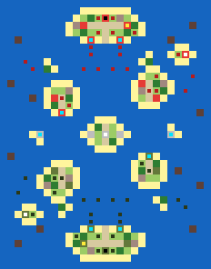
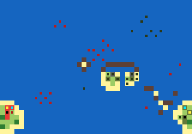
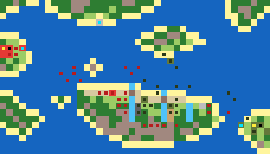

# Topic Doc 14: Pacific Scenarios

**Status:** four Pacific maps built (v0): Iwo Jima, The Slot, Midway and Guadalcanal. Balance untested.
**Last updated:** 2026-11-16
**Depends on:** 00-master-design.md §6 and §8, 01-units.md, 04-economy-production.md §8 (victory conditions), 05-supply-transport.md (landings), 08-art-pipeline.md (Japanese art).

---

## 1. Iwo Jima (`iwo-jima`)

Army green properties are US, red Japanese. The inner mark shows the kind: yellow factory, white airfield, cyan port, black HQ. Dark squares are starting units.

### The history it follows

On 19 February 1945 the US 3rd, 4th and 5th Marine Divisions landed on the black volcanic sand of Iwo Jima's south-east coast. The island was wanted for its airfields, halfway between the Marianas and Japan. General Kuribayashi had given up defending the beaches: his 21,000 men waited in bunkers, caves and tunnels from Mount Suribachi to the northern plateau, to make the invasion as slow and costly as possible. Suribachi fell on 23 February, when the flag went up on its summit. The fighting through the northern ridges (the "Meat Grinder" round Hill 382, Turkey Knob and the Amphitheater) lasted until 26 March.

### Area and scale

- **36 × 26 squares**, about 300 m each. North is up. The island runs from Mount Suribachi at the south-west tip to Kitano Point and Tachiiwa Point in the north-east, about 27 squares long.
- The outline is a polygon traced from the real map in `tools/maps/iwo-jima.mjs`. The neck behind the landing beaches is 3 to 4 squares wide, as the real one was under a kilometre.
- **The US anchorage** is a block of land in the south-east corner. It stands for the transport area offshore, which the game can't show as ships that build units, and for the Marianas, where the bombers flew from: it holds the US HQ, a Factory, a Port and an Airfield. (It had a second Port, in its south-west corner, until 2026-11-14, when it was removed at the developer's request to cut US income.) No US unit starts on it. The fleet itself is real ships offshore (below). An anchorage Airfield standing in for the carriers was removed on 2026-11-09 when real Carriers arrived; **since 2026-11-14, at the developer's request, it's back as the Marianas airfield**, so Bombers have somewhere to refuel and rearm. It's in the anchorage's north-west corner (28,19), about 13 squares (two Bomber turns) from the nearest manned bunker. It's about 12 squares, two Landing Craft turns, from the beaches.

### Places

| | US | Japan |
|---|---|---|
| HQ | The anchorage | Kuribayashi's command post near Kitano Point |
| Factory | The anchorage | The supply depot north of Motoyama |
| Airfields | The anchorage (stands for the Marianas) | **No. 1** (objective), **No. 2** (objective), No. 3 (unfinished, north-east) |
| Ports | One at the anchorage | none |
| Cities | | **Mount Suribachi's summit** (objective), Motoyama, Nishi, Kita |

- **Mount Suribachi's summit is a City,** standing for the observation post on the crater rim, so it can be captured: taking it plays the capture scene with the US flag going up, as on 23 February. It's ringed by Hills and bunkers.
- **Income:** the US starts with 4 properties (4,000 a day), Japan with 9 (9,000 a day). Japan had 11 until 2026-11-14, when a third of its cities (Minami and Higashi, two of its six) were removed at the developer's request, to cut its income. US income is kept low by giving the anchorage few properties, not by a special rule: the second Port was removed on 2026-11-14 for this. Japan was cut off and short of everything; its income lets it replace losses slowly, but its starting army does most of the fighting.

### Terrain

- **Black sand beaches** (Beach) along the whole south-east coast from Suribachi to the East Boat Basin, and along the west coast below the plateau. The north coast is cliffs (Hills).
- **Mount Suribachi**: Hills round the summit, with bunkers on its flanks.
- **The airfields** sit across the middle of the island, with their runways running on as open ground and a road linking them to the villages.
- **The Motoyama plateau and the northern ridges**: Hills (Hill 382, Turkey Knob, the Amphitheater, Hill 362A, Nishi Ridge), broken ground of ash and rock (Rubble) and scrub (Forest). Hills stop vehicles (02-terrain), so tanks have to find the gaps and the roads, as they did.
- **Bunkers** (31): a beach line of pillboxes one square inland all along the south-east landing beaches, above the west beach by Airfield No. 1 and above the East Boat Basin; more on Suribachi, round both airfields and all through the north. Never on the sand. (20 until 2026-11-14, when the beach line was added.)

### Starting forces

**Since 2026-11-14 (at the developer's request) the US starts entirely afloat**, with no one ashore, and Japan is dug in harder, so the player has to bombard the beach line with Battleships and bombers before landing. Rushing the Landing Craft in on day 2 against a full garrison costs the first waves.

- **US** (6,000 funds), all at sea south-east of the island:
  - **Bombardment group:** three Battleships, each starting within its 6-square reach of a manned beach bunker, and two Destroyers.
  - **Two Carriers**, each carrying two Dive Bombers (at 26,15 and 24,16), close enough for their Dive Bombers to reach a beach bunker on day 1. No Torpedo Bombers: Japan has no ships here. Each Dive Bomber has only 1 bomb before it has to land on a Carrier to rearm.
  - **Two Bombers** already over the sea, standing for the B-24 raids flown from the Marianas before the landing. They have two bombs each and fly back to the anchorage Airfield (the Marianas) to refuel and rearm: about two turns each way, so each Bomber strikes roughly once every four days. The US can build more aircraft there too.
  - **The landing force, all aboard six Landing Craft**, two units each: five Infantry, three Assault Infantry, two Medium Tanks, an Artillery and a Halftrack. The craft start more than 6 squares (a Landing Craft's move) from every beach, so none can land on day 1: day 1 is bombardment and the approach, and the first troops go ashore on day 2 at the earliest (and can't act until day 3, 05-supply-transport §8).
  - **No Japanese gun can reach any US ship or aircraft at the start**, so the first strike is the US's.
- **Japan** (3,000 funds), 40 units, its foot soldiers almost all in bunkers:
  - **Mount Suribachi:** two Infantry, a Mortar and two Artillery, one of them on the summit.
  - **The beach line:** a manned pillbox behind every stretch of sand (eight Infantry and two Assault Infantry in all, including the west beach and the East Boat Basin), with two Mortars and four Artillery behind them. **Every beach on the island is next to a manned bunker or within range of a Japanese gun**, so there's no quiet stretch of sand to land on instead.
  - **The airfield line and the neck:** three Infantry, Assault Infantry, a Mortar and a Flak Gun.
  - **The northern main line:** four Infantry, Assault Infantry, two Rocket Artillery, an Artillery, a Mortar and a Flak Gun.
  - **Baron Nishi's 26th Tank Regiment** near Airfield No. 2: two Medium Tanks and a Light Tank.
- Until 2026-11-14 the US first wave (four Infantry, two Assault Infantry, two Medium Tanks) started ashore on the beaches, with two Battleships, two Landing Craft and three more units at the anchorage, against 23 Japanese units and 20 bunkers.

### Build lists

- **US**: every unit except the Heavy Tank: land, air and naval.
- **Japan**: Infantry, Assault Infantry, Mortar Team, Light and Medium Tanks, Artillery, Rocket Artillery and Flak Gun. No aircraft or ships (none reached the island), no Heavy Tank (Japan fielded none, 01-units §1).

### Victory

- **The US** wins by capturing **Mount Suribachi's summit and Airfields No. 1 and No. 2** (`captureProperties`), or Japan's HQ.
- **Japan** wins by still being in the game when **day 18** starts (`surviveDays`), or by capturing the US HQ at the anchorage. (Day 15 until 2026-11-14: three days were added for the bombardment and the landing, which used to be done before day 1.)
- Rout is on: a side that loses every unit loses. Resign is always available.

### Weather

- Clear all game (the default). The real battle had rain on some days; rain isn't in the game yet (12-weather).

### How it's made

- `tools/maps/iwo-jima.mjs` builds the scenario file from the island polygon and lists of features, properties and units. Rerun it after editing; `tools/maps/overview.mjs iwo-jima` redraws the picture above.
- Tests (`tests/scenario.test.ts`, "Iwo Jima") check the nations, the objectives and their owner, the day-18 rule, Suribachi's place and hills, that the US starts entirely at sea with every soldier and tank aboard a Landing Craft, that no Landing Craft can reach a beach on day 1, that every beach is next to a manned bunker or under a Japanese gun, that no Japanese gun reaches a US ship or aircraft at the start, that each Battleship can shell a manned bunker on day 1 without moving, the two Carriers with their Dive Bombers, the anchorage Airfield (the Bombers can fly home to it, a Bomber from it reaches a manned bunker in two turns, and no Japanese gun reaches it), that the Dive Bombers and Bombers can reach a manned bunker on day 1, the Japanese in bunkers, Japan's build list, and that US tanks can drive from the beaches to Japan's HQ.

## 2. The Slot (`the-slot`)

Same key as above: army green properties are US, red Japanese, grey neutral.

### What it is

An island campaign in the style of the Solomons, **not a historical map**. The US holds the south, Japan the north, with the same islands and the same forces: the north is the south turned 180° about the centre square, so neither side has a better position. Only moving first differs, and no unit starts within reach of an enemy, so the first player can't open with a strike.

### Area

- **29 × 37 squares**, north up. The odd size gives the map a centre square for the central airfield.
- **The Slot**: a channel of open sea down the middle, between two chains of islands, from one side's HQ island to the other's. No reefs, so ships move at full speed, but it runs right past the central airfield, so it's exposed to air attack. It splits into two passages round the central island.
- **The flanks**: open ocean east and west of the chains, with scattered Reefs (ships pay 2 to cross one). Room for carriers to work round the side and strike from out of the Slot's line.

### Places (each side; the other side's are the same turned round)

| Place | Where (US) | Properties |
|---|---|---|
| HQ island | The south end, across the Slot's mouth | HQ, Factory, City, and two Ports facing up the Slot (the major port) |
| Secondary city | The western chain | Two Cities |
| Forward port | The eastern chain | Port, City |
| Airstrip outpost | An islet in the south-west ocean | Airfield, the side's only one at the start |

- Each side's secondary city faces the enemy's forward port across the map: the US city and Japan's forward port are both on the western chain, Japan's city and the US forward port both on the eastern.
- **The neutral centre**: the central island in the middle of the Slot, with an **Airfield** on the centre square and two Cities; from there aircraft reach both halves. Two **anchorages**, neutral Ports on islets out on the west and east flanks level with the centre, each the same distance from both HQs. Taken by Infantry put ashore, they refuel and repair ships far from home (04-economy §5).
- **Income:** each side starts with 10 properties; 5 are neutral.

### Starting forces (each side)

- **Fleet:** two Carriers, one out on each flank ocean, each with a Destroyer escort and a Fighter aboard, plus a Dive Bomber on one and a Torpedo Bomber on the other. At the mouth of the Slot: two Battleships, two Destroyers and two Torpedo Boats. Two Landing Craft off the ports, each with two Infantry aboard.
- **Garrisons:** the HQ island has two Infantry, a Medium Tank, an Artillery and a Mobile AA; the secondary city two Infantry and a Flak Gun; the forward port an Infantry and an Artillery; the airstrip an Infantry.
- **Cruisers:** the concept called for four cruisers and some destroyers. The game has no Cruiser: our Destroyer already plays the original's Cruiser role (anti-air, hunts submarines), so the four cruisers are four Destroyers, and the destroyers' torpedo work is done by two Torpedo Boats.
- **Funds:** 5,000 each.

### Build lists

- The same for both: every unit except the Heavy Tank, which Japan never fielded (01-units §1). The Supply Ship is on the list since 2026-11-16 (05-supply-transport §3a); AI vs AI results didn't change.

### Victory

- Capture the enemy's HQ, or rout them (the standard conditions). Resign is always available.

### How it's made

- `tools/maps/the-slot.mjs` builds the scenario file. Every island, property and unit is written once, for the south and the centre, and stamped again turned round for the north, so the map can't drift out of symmetry. Rerun it after editing; `tools/maps/overview.mjs the-slot` redraws the picture.
- Tests (`tests/scenario.test.ts`, "The Slot"): the map, units and owners rotate onto each other exactly; the US is in the south and Japan in the north with the same build lists; each side has its HQ island ports, city, forward port and airstrip; the neutral airfield is on the centre square and the anchorages are the same distance from both HQs; the Slot has no reefs and ships can sail it from port to port; the starting fleets match; the Carriers start on the flanks with their aircraft; and nothing can strike an enemy on day 1.

### Known gaps

- Balance is a first guess, especially the size of the starting fleets against 5,000 funds and the value of the central airfield.
- Since 2026-11-13 the Greedy AI uses Landing Craft, Transport Aircraft and Carriers (09-ai §4b), so against the computer the islands do change hands. Since milestone 17 (09-ai §4c) it lands in waves with warship escorts and keeps a garrison at home; AI vs AI games on The Slot end by day 54.

## 3. Midway (`midway`)

Same key as above: army green properties are US, red Japanese.

### The history it follows

In June 1942 Japan sent four carriers (Akagi, Kaga, Sōryū and Hiryū, Admiral Nagumo's Kido Butai) to strike Midway ahead of an invasion, with Admiral Yamamoto's battleships far behind and the invasion transports coming from the south-west. US codebreakers had read the plan, and three US carriers (Enterprise, Hornet and Yorktown) waited north-east of the atoll at "Point Luck". On 4 June Japan struck Midway at dawn. Midway's own aircraft attacked the carriers and achieved nothing. While Nagumo's aircraft were landing and rearming, US dive bombers sank Akagi, Kaga and Sōryū in a few minutes; Hiryū struck back and crippled Yorktown before it was sunk in turn, and the submarine I-168 finished Yorktown off. Japan called off the invasion.

### Area and scale

- **40 × 28 squares** of open ocean, about **30 nautical miles a square**, north up. The scale is set by carrier aircraft: a Dive or Torpedo Bomber launched from a Carrier flies 6 and attacks the next square, so a strike reaches about 7 squares, roughly the real 200 miles.
- **Midway atoll** is drawn far larger than life (in truth it's about 6 miles across, under a square): a ring of Reef round a lagoon, open to the south by a channel between its two islands. **Sand Island** to the west has the Marine command post (a City) and the harbor and seaplane base (a Port); **Eastern Island** to the east has the airstrip (an Airfield). Both have Bunkers and beaches all round, so the invasion can come ashore anywhere. Ships cross the reef at double cost.
- **Kure Atoll**, a reef and sandbar two squares west-north-west of Midway, on the invasion's way in.
- **The Northwestern Hawaiian Islands**: a broken chain of reefs and sandy islets from Midway towards Pearl Harbor (Pearl and Hermes Reef, Lisianski, Laysan, Maro Reef, French Frigate Shoals), much compressed.
- **The bases**: Japan's in the south-west corner stands for the forward bases at Wake and Saipan, the US base in the south-east corner for Pearl Harbor. Both are far closer than the real ones; like Iwo Jima's anchorage they give each side an HQ, a Factory, a Port and a City.

### Places

| | US | Japan |
|---|---|---|
| HQ, Factory, Port, City | Pearl Harbor (south-east corner) | Wake and Saipan (south-west corner) |
| Midway | **The command post** (City, objective), the harbor (Port), **the airstrip** (Airfield, objective) | none |
| Airfields | Midway's only | **none**: Japan's carrier air groups were irreplaceable, and it can only build aircraft once it takes Midway's airstrip |

- **Income:** 500 per property (`incomePerProperty`, half the usual), so reinforcements are a trickle and the starting fleets do the fighting. The US starts with 7 properties, Japan with 4; both start with 2,000.

### Starting forces

Each Carrier's two aircraft stand for its whole air group (a real carrier held about 60).

- **Japan, the Kido Butai**, north-west of Midway: four Carriers, Akagi (Fighter, Torpedo Bomber), Kaga (Dive Bomber, Torpedo Bomber), Sōryū (Fighter, Dive Bomber) and Hiryū (Dive Bomber, Torpedo Bomber); two Battleships (Haruna, Kirishima) and three Destroyers (the cruisers Tone and Chikuma and the screen; the game has no Cruiser, as in The Slot). Every Carrier can strike Sand Island on its first turn without moving. Torpedo Bombers can't hit land, so they are the reserve kept for ships, as Nagumo's was.
- **Japan, the Main Body**: Yamamoto's battleships, two Battleships and a Destroyer, far to the north-west, two days behind.
- **Japan, the invasion force**, south-west of Midway, more than two days' sailing away: three Landing Craft carrying four Infantry and two Assault Infantry, a Battleship and two Destroyers. The submarine **I-168** waits between Pearl Harbor and Midway. One Infantry holds the home base.
- **The US carriers** at Point Luck, north-east of Midway: Enterprise (two Dive Bombers: its dive bombers sank Akagi and Kaga), Hornet (Fighter, Torpedo Bomber: Torpedo 8 found the enemy first and was cut down) and Yorktown (Dive Bomber, Torpedo Bomber), with three Destroyers for their cruisers and destroyers.
- **Midway**: its own air group on Eastern Island, a Fighter, a Bomber (the B-17s), a Dive Bomber and a Torpedo Bomber (the new Avengers); the 6th Marine Defense Battalion, three Infantry in the bunkers and the command post, an Artillery (the coastal guns) and a Flak Gun; a Torpedo Boat (the PT boats) in the harbor. Two Submarines on picket: Nautilus north-east of the Japanese carriers, another on the invasion's way in. One Infantry holds Pearl Harbor.

### How the opening works

- **The US moves first**, as on every built-in map (the first player is army green, 08-art-pipeline §12; the engine always starts with the first player). Its day-1 turn stands for the night before the battle and the dawn searches: Midway's aircraft can scramble or head out, the carriers can close in or wait. Japan's first turn is the dawn strike on Midway.
- **Nothing can reach either side's Carriers from where the units start**, and Midway's aircraft and PT boats can't reach the Japanese ones. Each US Carrier is one move from striking range of a Japanese Carrier.
- **Whoever closes in first is exposed**, from the carrier rules (05-supply-transport §10) with no special rule: a Carrier either moves or launches in a turn, so a Carrier that sails into striking range can't launch until its next turn, and the other side's Carriers, if they still have aircraft aboard, strike first. An aircraft that has struck has to fly back and land, and can't launch again the turn it lands. So a Japanese Carrier that sent its aircraft at Midway is empty for two turns: the moment the US dive bombers caught Nagumo in, which the players can now recreate or avoid.

### Build lists

- Both sides: every unit except the Heavy Tank, which neither fielded (01-units §1). Japan has no airfield, so in practice it builds land units and ships until it takes Midway's airstrip. The Supply Ship is on both lists since 2026-11-16 (05-supply-transport §3a): it lets Japan's fleet, whose base is in the far corner, refuel at sea. AI vs AI results didn't change.

### Victory

- **Japan** wins by capturing **Sand Island's command post and Eastern Island's airfield** (`captureProperties`), or the US HQ.
- **The US** wins by still being in the game when **day 12** starts (`surviveDays`), or by capturing Japan's HQ. Sinking Japan's carriers ends any hope of the invasion, but there's no "sink these units" victory condition, so holding out stands in for it.
- Rout is on. Resign is always available.

### Weather

- Clear all game. The real Kido Butai approached under a weather front, but there's no fog of war or cloud in the game yet (12-weather).

### How it's made

- `tools/maps/midway.mjs` builds the scenario file; `node tools/maps/midway.mjs --reach` also lists every unit an enemy could attack on its first turn, for tuning. `tools/maps/overview.mjs midway` redraws the picture above. The overview now colors properties and units by side (Allies green, Axis red) instead of by player order.
- Tests (`tests/scenario.test.ts`, "Midway") check the nations and order, the objectives and their owner, the day-12 rule, the atoll's two islands inside the reef, Japan's four Carriers north-west of Midway each able to strike Sand Island, the three US Carriers north-east with two aircraft each, that nothing can attack an enemy Carrier from where it starts, that each US Carrier is one move from striking range, Midway's air group, the invasion force's distance, that Japan has no airfield, and the build lists. The AI tests play it AI vs AI to a finish: every game ends by day 12.

### Known gaps

- **No fog of war.** Midway was decided by who found whom first; here both sides see everything from the start, and the US code-breaking advantage is gone. The move-or-launch timing carries the tension instead. Fog stays under "later / maybe" (00-master-design §4); this is the map that most wants it.
- **Balance is a first guess**, especially the day-12 limit, half income, and the strength of Midway's air group. In AI vs AI games (10 seeds) Japan wins every time, by day 7 to 9, but mostly because of the AI (next point), not the map.
- **The Greedy AI doesn't hold objectives it must defend.** It garrisons only its HQ island (09-ai §4c), so as the US it ships Midway's Marines away in a Landing Craft and Japan walks in. Playing Japan against the computer is easy for now; playing the US against the computer, or hot-seat, is the better test.
- Carriers carry 2 aircraft, so each stands for a whole air group, and there's no combat air patrol: Fighters only shoot down aircraft that end their move nearby.

## 4. Guadalcanal (`guadalcanal`)

Same key as above: army green properties are US, red Japanese, grey neutral. Built 2026-11-16 at the developer's request, as the map for the new Supply Ship (05-supply-transport §3a).

### The history it follows

On 7 August 1942 the 1st Marine Division landed on Guadalcanal and took the airfield Japan was building at Lunga Point, which became Henderson Field. Two nights later, at Savo Island, Japanese cruisers sank four Allied cruisers, and the US transports sailed away half unloaded. For six months both sides fed the island from the sea: the US by day, under the cover of Henderson's aircraft (the "Cactus Air Force"), Japan by night, with destroyers running troops and supplies down the Slot from the Shortlands (the "Tokyo Express"). So many ships went down off Lunga Point that the water became Ironbottom Sound. In mid-October the battleships Kongō and Haruna shelled Henderson Field for an hour and a half, and on 24 and 25 October the Sendai Division, after cutting a trail through the jungle (the Maruyama Road), attacked the perimeter from the south at Edson's Ridge while another force attacked across the Matanikau. Both attacks failed. Japan evacuated the island in February 1943.

### Area and scale

- **42 × 24 squares**, about 5 km each, north up.
- **Guadalcanal**'s north coast is drawn about to scale, from Cape Esperance at the west tip to Koli Point: Tassafaronga's beaches, Kokumbona, Point Cruz, the Matanikau River, Lunga Point with Henderson Field, the Lunga River, Edson's Ridge south of the airfield (Ridge terrain, 02-terrain §4b), and the Tenaru. The coast track is a road, bridged over the Matanikau and the Lunga. Jungle (Forest) and mountains (Hills) fill the interior down to the south coast. **There is no port on Guadalcanal**, as there wasn't: ships unloaded off the beaches.
- **Ironbottom Sound** lies between Guadalcanal and the **Florida Islands**, with **Tulagi**'s anchorage and PT-boat base on their south shore. **Savo Island** sits at the sound's western mouth.
- **The Slot** is pulled in: it really runs north-west for about 500 km, and here it comes in from the west, between **Santa Isabel** (with Rekata Bay) along the top and the **New Georgia** islands at the bottom left, past the **Russell Islands**. **Malaita** is in the north-east corner.
- **The two bases** are far closer than the real ones, as on Midway: Japan's, at the far end of the Slot on the west edge, stands for the Shortlands, Buin and Rabaul; the US base in the south-east corner for Espiritu Santo and Nouméa. Lunga Point is more than three days' Destroyer sailing from Japan's port and more than two from the US base's.

### Places

| | US | Japan | Neutral |
|---|---|---|---|
| Base | HQ, Factory, Port, Airfield, City (south-east corner) | HQ, Factory, Port, Airfield, City (west edge) | |
| Guadalcanal | **Henderson Field** (Airfield, the objective), Lunga (City, the perimeter) | Kokumbona (City) | Koli Point (City) |
| Elsewhere | Tulagi (Port) | | Rekata Bay on Santa Isabel (Port), half way down the Slot |

- **Income:** 500 per property (`incomePerProperty`, half the usual), as on Midway, so the starting forces do most of the fighting and a Supply Ship (10,000) is a real choice. The US starts with 8 properties (4,000 a day), Japan with 6 (3,000).

### Why it's about supply

- **The US has no port on the island.** Its ships refuel at Tulagi, one at a time, two days from its base, or at its Supply Ship off Lunga Point.
- **Japan's ships are four or five days from home.** Its convoy's destroyers have already come down the Slot and start short of fuel (36 of 65), with their Supply Ship a day's sailing away. Rekata Bay is a neutral port half way down the Slot for whoever puts infantry ashore to take it.
- **Land units need it too.** A Supply Ship next to the shore refuels and rearms the troops on the beach. One US Marine battery starts on the beach at Lunga Point with 2 shells left, next to the US Supply Ship, which refills it at the start of day 1.

### Starting forces (mid-October 1942)

- **US** (3,000 funds), moving first:
  - **Henderson Field:** a Fighter on the airfield and a Dive Bomber beside it (Marine Wildcats and Dauntlesses).
  - **The perimeter:** four Infantry (two in bunkers on the Matanikau line, one at Lunga, one on Edson's Ridge), Assault Infantry, a Mortar, two Artillery short of shells (3 and 2), a Light Tank and a Flak Gun (the 90mm guns by the airfield).
  - **Off Lunga Point:** the Supply Ship (the cargo ships unloading), a Landing Craft with two Infantry (the Army's 164th Infantry, which landed on 13 October), and two Destroyers.
  - **Coming up the channel:** a Battleship (Washington) and a Destroyer.
  - **Tulagi:** two Torpedo Boats (PT boats) and an Infantry.
  - **The base:** a Bomber (B-17s) and an Infantry.
- **Japan** (3,000 funds):
  - **West of the Matanikau** (Kokumbona and Point Cruz): four Infantry, Assault Infantry, a Light Tank, a Mortar and two Artillery (the 150mm howitzers called "Pistol Pete"), the guns within range of the Matanikau bunkers.
  - **In the jungle south of the perimeter** (the Maruyama Road): three Infantry, Assault Infantry and a Mortar, two to four squares from Henderson Field.
  - **East, towards Koli Point:** two Infantry.
  - **The Tokyo Express**, off the Russells: two Destroyers short of fuel, two Landing Craft (Infantry and Artillery; Infantry and Assault Infantry) and a Supply Ship.
  - **The bombardment force**, north of Savo: two Battleships (Kongō and Haruna) and a Destroyer, out of gun range of Henderson Field but one day's sailing from it, so they close in on Japan's first turn and can fire on its second.
  - **A Submarine** on the US supply route between the base and Guadalcanal, as I-19 and I-26 were.
  - **The base:** a Fighter and a Bomber (Zeros and Bettys, a long flight from the island) and an Infantry.

### Build lists

- Both sides: every unit except the Heavy Tank, which neither fielded here (01-units §1). Supply Ships included.

### Victory

- **Japan** wins by capturing **Henderson Field** (`captureProperties`), or the US HQ.
- **The US** wins by still being in the game when **day 15** starts (`surviveDays`), or by capturing Japan's HQ.
- Rout is on. Resign is always available.

### Weather

- Clear all game. The night actions are not shown: the game has no night or fog of war (12-weather).

### How it's made

- `tools/maps/guadalcanal.mjs` builds the scenario file; `tools/maps/overview.mjs guadalcanal` redraws the picture above.
- Tests (`tests/scenario.test.ts`, "Guadalcanal"): the nations and order; the objective and its owner; the day-15 rule; no port anywhere on Guadalcanal; Tulagi a day's sailing from Lunga Point; both home ports days away; a Supply Ship each, and both can build them; the US Supply Ship refills the Marine battery on day 1; Japan's convoy destroyers short of fuel within a day of their Supply Ship; the Battleships one day from gun range of the airfield; Japan's attacks from the west and the south; Kokumbona Japanese, Rekata Bay and Koli Point neutral; half income; no Heavy Tanks. The AI tests play it AI vs AI to a finish.

### Known gaps

- **Balance is a first guess.** AI vs AI (seeds 1 to 10, 2026-11-16) the US holds Henderson Field to day 15 every time. Japan takes Lunga or Rekata Bay in some games and the US retakes Kokumbona in others, but the Greedy AI never presses the final capture of the airfield. Playing Japan against the computer, or hot-seat, is the better test.
- **No night.** The real campaign was day for the US and night for Japan; here both sides move in daylight.
- Cruisers: the game has none, so the cruiser actions in Ironbottom Sound are fought by Destroyers and Battleships (as on The Slot, above).

## 5. Known gaps (Iwo Jima)

- Carrier numbers are a first guess, to tune after playtests. Japan has no way to reach Carriers out of artillery range, as historically.
- Balance is a first guess: whether 17 days is enough for the US to bombard, land and take the objectives, and whether Japan's income is too high for a garrison that was cut off. AI vs AI (seeds 1 to 5 and 7, 2026-11-14, with the Marianas airfield): the US shells and bombs from day 1, lands 13 to 17 craft-loads and cuts Japan from 40 units to as few as 20 to 25, but Japan holds out to day 18 every time.
- Caves and tunnels (Japanese units reappearing behind the front) aren't a rule.
- The pre-landing bombardment is played out in the first days, not a special rule: Battleships and bombers soften the beach line before the Landing Craft go in. There's no beach-obstacle terrain yet (02-terrain §4), so nothing has to be cleared from the sand itself.
- The Greedy AI plays it (09-ai §4b): as the US it bombards, launches and lands, but doesn't yet hold back its Landing Craft until the beach line is broken, and it uses each Bomber for about one strike a game instead of flying it home to rearm.
