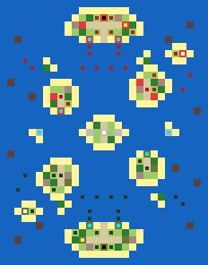

# Topic Doc 14: Pacific Scenarios

**Status:** two Pacific maps built (v0): Iwo Jima and The Slot. Balance untested.
**Last updated:** 2026-11-09
**Depends on:** 00-master-design.md §6 and §8, 01-units.md, 04-economy-production.md §8 (victory conditions), 05-supply-transport.md (landings), 08-art-pipeline.md (Japanese art).

---

## 1. Iwo Jima (`iwo-jima`)

Army green properties are US, red Japanese. The inner mark shows the kind: yellow factory, white airfield, cyan port, black HQ. Dark squares are starting units.

### The history it follows

On 19 February 1945 the US 3rd, 4th and 5th Marine Divisions landed on the black volcanic sand of Iwo Jima's south-east coast. The island was wanted for its airfields, halfway between the Marianas and Japan. General Kuribayashi had given up defending the beaches: his 21,000 men waited in bunkers, caves and tunnels from Mount Suribachi to the northern plateau, to make the invasion as slow and costly as possible. Suribachi fell on 23 February, when the flag went up on its summit. The fighting through the northern ridges (the "Meat Grinder" round Hill 382, Turkey Knob and the Amphitheater) lasted until 26 March.

### Area and scale

- **36 × 26 squares**, about 300 m each. North is up. The island runs from Mount Suribachi at the south-west tip to Kitano Point and Tachiiwa Point in the north-east, about 27 squares long.
- The outline is a polygon traced from the real map in `tools/maps/iwo-jima.mjs`. The neck behind the landing beaches is 3 to 4 squares wide, as the real one was under a kilometre.
- **The US anchorage** is a block of land in the south-east corner. It stands for the transport and carrier groups offshore, which the game can't show as ships that build units: it holds the US HQ, a Factory and two Ports. The carriers are real Carriers offshore (below); the anchorage Airfield that stood in for them is gone (2026-11-09). It's about 12 squares, two Landing Craft turns, from the beaches.

### Places

| | US | Japan |
|---|---|---|
| HQ | The anchorage | Kuribayashi's command post near Kitano Point |
| Factory | The anchorage | The supply depot north of Motoyama |
| Airfields | none | **No. 1** (objective), **No. 2** (objective), No. 3 (unfinished, north-east) |
| Ports | Two at the anchorage | none |
| Cities | | **Mount Suribachi's summit** (objective), Motoyama, Minami, Nishi, Kita, Higashi |

- **Mount Suribachi's summit is a City,** standing for the observation post on the crater rim, so it can be captured: taking it plays the capture scene with the US flag going up, as on 23 February. It's ringed by Hills and bunkers.
- **Income:** the US starts with 4 properties, Japan with 11. Japan was cut off and short of everything; its income lets it replace losses slowly, but its starting army does most of the fighting.

### Terrain

- **Black sand beaches** (Beach) along the whole south-east coast from Suribachi to the East Boat Basin, and along the west coast below the plateau. The north coast is cliffs (Hills).
- **Mount Suribachi**: Hills round the summit, with bunkers on its flanks.
- **The airfields** sit across the middle of the island, with their runways running on as open ground and a road linking them to the villages.
- **The Motoyama plateau and the northern ridges**: Hills (Hill 382, Turkey Knob, the Amphitheater, Hill 362A, Nishi Ridge), broken ground of ash and rock (Rubble) and scrub (Forest). Hills stop vehicles (02-terrain), so tanks have to find the gaps and the roads, as they did.
- **Bunkers** (20): behind the beaches, on Suribachi, round both airfields and all through the north. Never on the sand.

### Starting forces

- **US** (6,000 funds): the first wave already ashore on the beaches: four Infantry, two Assault Infantry and two Medium Tanks. Offshore: two Battleships, two Destroyers and two Landing Craft for the next waves, and two Carriers, each carrying two Dive Bombers, between the beaches and the anchorage (at 26,15 and 23,16): close enough for their Dive Bombers to reach the bunkers round Airfield No. 2 on day 1, out of reach of every Japanese gun at the start. No Torpedo Bombers: Japan has no ships here. With no airfield of its own, the US can't build aircraft until it takes Airfield No. 1 or No. 2, so lost Dive Bombers aren't replaced before then, and each has only 2 bombs before it has to land on a Carrier to rearm. At the anchorage: an Infantry, an Artillery and a Halftrack waiting to be ferried in.
- **Japan** (3,000 funds), its foot soldiers almost all in bunkers: Mount Suribachi's garrison (two Infantry, a Mortar, an Artillery); the airfield line (three Infantry, Assault Infantry, a Mortar, a Flak Gun); the northern main line (four Infantry, Assault Infantry, two Rocket Artillery, an Artillery, a Mortar, a Flak Gun); and Baron Nishi's 26th Tank Regiment near Airfield No. 2 (two Medium Tanks and a Light Tank).

### Build lists

- **US**: every unit except the Heavy Tank: land, air and naval.
- **Japan**: Infantry, Assault Infantry, Mortar Team, Light and Medium Tanks, Artillery, Rocket Artillery and Flak Gun. No aircraft or ships (none reached the island), no Heavy Tank (Japan fielded none, 01-units §1).

### Victory

- **The US** wins by capturing **Mount Suribachi's summit and Airfields No. 1 and No. 2** (`captureProperties`), or Japan's HQ.
- **Japan** wins by still being in the game when **day 15** starts (`surviveDays`), or by capturing the US HQ at the anchorage.
- Rout is on: a side that loses every unit loses. Resign is always available.

### Weather

- Clear all game (the default). The real battle had rain on some days; rain isn't in the game yet (12-weather).

### How it's made

- `tools/maps/iwo-jima.mjs` builds the scenario file from the island polygon and lists of features, properties and units. Rerun it after editing; `tools/maps/overview.mjs iwo-jima` redraws the picture above.
- Tests (`tests/scenario.test.ts`, "Iwo Jima") check the nations, the objectives and their owner, the day-15 rule, Suribachi's place and hills, the first wave on the beaches with the fleet offshore, the Japanese in bunkers, Japan's build list, the two Carriers with their Dive Bombers and no US airfield, that the Dive Bombers can reach a bunker on day 1 while no Japanese gun reaches the Carriers, and that US tanks can drive from the beaches to Japan's HQ.

## 2. The Slot (`the-slot`)

Same key as above: army green properties are US, red Japanese, grey neutral.

### What it is

An island campaign in the style of the Solomons, **not a historical map**. The US holds the south, Japan the north, with the same islands and the same forces: the north is the south turned 180° about the centre square, so neither side has a better position. Only moving first differs, and no unit starts within reach of an enemy, so the first player can't open with a strike.

### Area

- **29 × 37 squares**, north up. The odd size gives the map a centre square for the central airfield.
- **The Slot**: a channel of open sea down the middle, between two chains of islands, from one side's HQ island to the other's. No reefs, so ships move at full speed, but it runs right past the central airfield, so it's exposed to air attack. It splits into two passages round the central island.
- **The flanks**: open ocean east and west of the chains, with scattered Reefs (ships pay 2 to cross one). Room for carriers to work round the side and strike from out of the Slot's line.

### Places (each side; the other side's are the same turned round)

| Place | Where (US) | Properties |
|---|---|---|
| HQ island | The south end, across the Slot's mouth | HQ, Factory, City, and two Ports facing up the Slot (the major port) |
| Secondary city | The western chain | Two Cities |
| Forward port | The eastern chain | Port, City |
| Airstrip outpost | An islet in the south-west ocean | Airfield, the side's only one at the start |

- Each side's secondary city faces the enemy's forward port across the map: the US city and Japan's forward port are both on the western chain, Japan's city and the US forward port both on the eastern.
- **The neutral centre**: the central island in the middle of the Slot, with an **Airfield** on the centre square and two Cities; from there aircraft reach both halves. Two **anchorages**, neutral Ports on islets out on the west and east flanks level with the centre, each the same distance from both HQs. Taken by Infantry put ashore, they refuel and repair ships far from home (04-economy §5).
- **Income:** each side starts with 10 properties; 5 are neutral.

### Starting forces (each side)

- **Fleet:** two Carriers, one out on each flank ocean, each with a Destroyer escort and a Fighter aboard, plus a Dive Bomber on one and a Torpedo Bomber on the other. At the mouth of the Slot: two Battleships, two Destroyers and two Torpedo Boats. Two Landing Craft off the ports, each with two Infantry aboard.
- **Garrisons:** the HQ island has two Infantry, a Medium Tank, an Artillery and a Mobile AA; the secondary city two Infantry and a Flak Gun; the forward port an Infantry and an Artillery; the airstrip an Infantry.
- **Cruisers:** the concept called for four cruisers and some destroyers. The game has no Cruiser: our Destroyer already plays the original's Cruiser role (anti-air, hunts submarines), so the four cruisers are four Destroyers, and the destroyers' torpedo work is done by two Torpedo Boats.
- **Funds:** 5,000 each.

### Build lists

- The same for both: every unit except the Heavy Tank, which Japan never fielded (01-units §1).

### Victory

- Capture the enemy's HQ, or rout them (the standard conditions). Resign is always available.

### How it's made

- `tools/maps/the-slot.mjs` builds the scenario file. Every island, property and unit is written once, for the south and the centre, and stamped again turned round for the north, so the map can't drift out of symmetry. Rerun it after editing; `tools/maps/overview.mjs the-slot` redraws the picture.
- Tests (`tests/scenario.test.ts`, "The Slot"): the map, units and owners rotate onto each other exactly; the US is in the south and Japan in the north with the same build lists; each side has its HQ island ports, city, forward port and airstrip; the neutral airfield is on the centre square and the anchorages are the same distance from both HQs; the Slot has no reefs and ships can sail it from port to port; the starting fleets match; the Carriers start on the flanks with their aircraft; and nothing can strike an enemy on day 1.

### Known gaps

- Balance is a first guess, especially the size of the starting fleets against 5,000 funds and the value of the central airfield.
- Since 2026-11-13 the Greedy AI uses Landing Craft, Transport Aircraft and Carriers (09-ai §4b), so against the computer the islands do change hands. It lands two units at a time with no escort, so it's slow to finish a game.

## 3. Known gaps (Iwo Jima)

- Carrier numbers are a first guess, to tune after playtests. Japan has no way to reach Carriers out of artillery range, as historically.
- Balance is a first guess: whether 14 days is enough for the US, and whether Japan's income is too high for a garrison that was cut off.
- Caves and tunnels (Japanese units reappearing behind the front) aren't a rule.
- Naval gunfire support is just Battleships and Destroyers firing at range; there's no pre-landing bombardment.
- There's no AI yet, so the scenario is hot-seat only until milestone 15.
