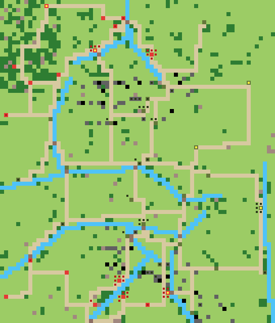

# Topic Doc 15: Eastern Front Scenarios

**Status:** first Eastern Front map built (v0): Kursk, the first theater map after Normandy and the first with the Soviet Union. Balance untested.
**Last updated:** 2026-11-14
**Depends on:** 00-master-design.md §8 and §9, 01-units.md (availability rule), 02-terrain.md §4 (bunkers and obstacles), 04-economy-production.md §8 (victory conditions), 08-art-pipeline.md §12 (Soviet art and insignia).

---

## 1. Kursk (`kursk`)

Army green properties are Soviet, red German. The inner mark shows the kind: yellow factory, white airfield, black HQ. Dark squares are starting units; grey squares are bunkers and black squares anti-tank obstacles.

### The history it follows

After Stalingrad, the front had a bulge around the city of Kursk, about 200 km wide, pushing west into German lines. In July 1943 Germany launched Operation Citadel: two pincers, Model's 9th Army from Orel in the north and Hoth's 4th Panzer Army with Army Detachment Kempf from Belgorod in the south, were to meet at Kursk and cut off everything inside. Germany had waited months for its new Panther and Tiger tanks and Ferdinand tank destroyers. That gave the Soviets time: they knew the plan and dug in deeper than anywhere else in the war, with belt after belt of strongpoints, anti-tank ditches and minefields, and a reserve army (the Steppe Front) waiting behind.

In the north, Model got about 12 km in and stalled at Ponyri station and the Olkhovatka heights. In the south, the SS Panzer Corps got furthest and met the Soviet 5th Guards Tank Army at **Prokhorovka** on 12 July, the famous tank battle. Hitler called the offensive off the next day; the Allies had just landed in Sicily. It was Germany's last great offensive in the east.

### Area and scale

- **68 × 80 squares**, a theater map like Normandy (10-scenarios-normandy): the whole salient, from Orel and Karachev in the north to Belgorod and Sumy in the south, and from Sevsk and Lebedin in the west to the Oskol river in the east.
- Generated from real longitude and latitude, with near-even scale: each square is about 3.5 km across and 3.9 km tall. Kharkov, the southern pincer's real base, is just off the south edge.
- The north German line is about 16 squares south of Orel; Kursk is about 19 squares behind the north front and 25 behind the south front, so a tank (6 moves) needs a few days of fighting through the belts to reach it.

### The front, 4 July 1943

The front line is traced as a polygon of real points in `tools/maps/kursk.mjs`. Germany holds one piece of ground wrapped round the salient: the Orel bulge in the north, a thin strip along the west face, and the Belgorod–Sumy line in the south. Every town is placed on its own side of that line.

### Places

| | Soviet Union | Germany |
|---|---|---|
| HQ | Kursk | Orel |
| Factories | Shchigry, Livny, Stary Oskol | Kromy, Karachev, Belgorod, Sumy |
| Airfields | Kursk East, Novy Oskol | Orel West, Mikoyanovka |
| Cities | North face: Ponyri, Olkhovatka, Maloarkhangelsk, Fatezh, Zolotukhino, Novosil, Dmitriev. West face: Lgov, Rylsk, Sudzha. South face: Medvenka, **Oboyan**, **Prokhorovka**, Ivnya, Yakovlevo, Korocha, Shebekino, Solntsevo, Tim | Zmiyovka, Naryshkino, Dmitrovsk, Komarichi, Lokot, Sevsk, Tomarovka, Borisovka, Grayvoron, Krasnopolye, Lebedin |

- **Income:** the Soviet Union owns 25 properties, Germany 18. There are no neutral towns: the front ran through open country with no gap between the lines.
- Orel is the German HQ because it was the hub of the northern salient, well behind the front; Belgorod sat right on the line. Mikoyanovka was the airfield the Luftwaffe's VIII Air Corps flew from over the south face. Factories and HQs are our choice, not history.

### Terrain

- **Open steppe and black-earth farmland** across the salient: tank country, with scattered woods. Woods and a few steep banks follow the rivers, standing for the wooded gullies (*balkas*) that broke up the steppe.
- **The Olkhovatka heights** north of Kursk: a cluster of Hills, the ridge that stopped the northern pincer. Hills stop vehicles (02-terrain), so the roads and the gaps decide the fight there, as they did.
- **The Bryansk forests** in the north-west corner: dense forest, partisan country.
- **Rivers:** the Seym past Kursk, Lgov and Rylsk; the Psel past Prokhorovka's bend, Oboyan and Sudzha to Sumy; the Pena on the Oboyan road; the Northern Donets past Belgorod, the line Kempf crossed; the Vorskla behind the German south line; the Oka and Kroma up to Orel; the Svapa; and the Oskol behind the Steppe Front. Roads cross them on bridges.
- **Roads** are routed between towns along the cheapest path, so they keep to the open ground. The main axes are the Orel–Kromy–Fatezh–Kursk highway, the Orel–Ponyri–Kursk railway, the Belgorod–Oboyan–Kursk highway and the Belgorod–Prokhorovka railway.

### The Soviet defense belts

- **Bunkers** (strongpoints) and **obstacles** (anti-tank ditches and minefields) stand in belts behind the **north face** (Ponyri, Olkhovatka, Maloarkhangelsk) and the **south face** (from Yakovlevo back to Oboyan and Prokhorovka): one belt right at the front, a second about 5 squares back, and a third about 10 squares back. About 30 bunkers and 11 obstacles on each face.
- **None on the west face**, where no attack came, and none on a road, river or town, so every road stays open for the attacker to fight along. A test checks that every German tank can still drive to Kursk.
- Obstacles are impassable to land units until cleared (02-terrain §4), so the belts funnel tanks onto the roads, where the bunkers are.

### Starting forces

- **Soviet Union** (8,000 funds, 37 units): on each face, rifle squads dug in across the first belts (12 in bunkers in all, with PTRD anti-tank rifle teams and mortars), plus artillery, Katyushas, SU-152s and T-34s behind; a KV-1 near Medvenka; the **5th Guards Tank Army** (three T-34s, a T-70 and a halftrack) in reserve near Stary Oskol, a few days' drive from Prokhorovka; Infantry and a Flak Gun at Kursk; Infantry holding Rylsk and Sudzha on the west face; a Fighter at Kursk East and an Il-2 (Bomber) at Novy Oskol.
- **Germany** (12,000 funds, 32 units): in the north, Model's attack on the Orel–Kursk railway near Zmiyovka and Kromy (a Tiger, a Ferdinand-style Tank Destroyer, two Medium Tanks, artillery, rockets, infantry); in the south, the bigger pincer round Tomarovka, Borisovka and Belgorod (two Tigers, four Medium Tanks, a StuG, artillery, rockets, assault infantry, halftracks, a Recon and Mobile AA); thin holding forces at Sevsk and Sumy; a Fighter at Orel West and a Bomber at Mikoyanovka.
- Germany has more Heavy Tanks (3 to 1), the Soviet Union more units and more income, as at Kursk.

### Turn order

The Soviet Union moves first, so it's the army green player (08-art-pipeline §12), as the Allies are on every built-in map. It fits the history: in the night before the attack, the Soviets fired a huge artillery barrage into the German assembly areas.

### Weather

Summer, with two days of **rain** (since 2026-11-17, 12-weather §3a), for the heavy summer thunderstorms of the real battle: day 3, as the northern attack stalls in the belts, and day 8, the eve of the Prokhorovka tank battle. Clear on every other day. Rain brings fog for the day and mud off the roads, so on those days the attackers lose sight of the defenders and their armor slows. Not balance-tested yet.

### Build lists

- Both sides: every land unit, Heavy Tank included (KV-1 and Tiger), plus Fighter, Bomber and Transport Aircraft. No ships: the map has no sea. The Soviet Union has no Dive or Torpedo Bomber art in any case, as it had no carriers (08-art-pipeline §12).

### Victory

- **Capture the enemy HQ** only: Kursk for Germany, Orel for the Soviet Union. Rout is off, as on the Normandy theater map, because on a map this size a side that loses every unit can still rebuild from its factories. Resign is always available.

### How it's made

- `tools/maps/kursk.mjs` generates the scenario file from real longitude/latitude points for the front line, towns and rivers, routes roads between towns along the cheapest path, and lays out the defense belts by distance from the front. Rerun it after editing; `tools/maps/overview.mjs kursk` redraws the picture above.
- Tests (`tests/scenario.test.ts`, "Kursk") check the size and nations, who moves first, the HQs and the shape of the salient, the defense belts on the north and south faces and none on the west, the dug-in garrisons, that German tanks from both pincers can reach Kursk, the Heavy Tank count, Prokhorovka, the reserve's drive there, income and funds, the HQ-only victory and the build lists.

## 2. Known gaps

- Balance is a first guess: funds, the size of the belts and the German tank count all need playtesting.
- Minefields are obstacles: impassable until cleared, not a hidden hazard that damages whoever drives in. Hidden mines would need fog of war.
- The Ferdinand and the SU-152 are both the Tank Destroyer unit; the Panther is a Medium Tank. Stats are the same across sides (01-units §1), so the German tank edge comes from Heavy Tank numbers.
- No reinforcement schedule: the Steppe Front's reserve starts on the map instead of arriving later.
- Future Eastern Front scenarios (Prokhorovka on its own, Stalingrad, Operation Bagration) can reuse this generator's approach and the Soviet art.
