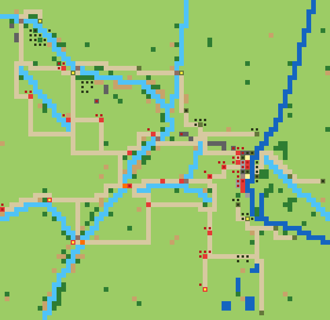

# Topic Doc 15: Eastern Front Scenarios

**Status:** three Eastern Front maps built (v0): Kursk (§1), the first theater map after Normandy and the first with the Soviet Union; Stalingrad (§2), the first city fight and the first Soviet boat; and Sevastopol (§3), the first railway and the Railway Gun. Balance untested. **Moscow** (§4), November 1941 to January 1942, is designed but won't be built: not different enough in play (2026-11-24).
**Last updated:** 2026-11-24 (§4 Moscow)
**Depends on:** 00-master-design.md §8 and §9, 01-units.md (availability rule; §2b Railway Gun), 02-terrain.md §4 (bunkers and obstacles) and §4c (Railway), 04-economy-production.md §8 (victory conditions), 08-art-pipeline.md §12 (Soviet art and insignia), 12-weather.md (snow), 22-campaign.md (§4–§6), 23-survival.md §5a (arrivals).

---

## 1. Kursk (`kursk`)

Army green properties are Soviet, red German. The inner mark shows the kind: yellow factory, white airfield, black HQ. Dark squares are starting units; grey squares are bunkers and black squares anti-tank obstacles.

### The history it follows

After Stalingrad, the front had a bulge around the city of Kursk, about 200 km wide, pushing west into German lines. In July 1943 Germany launched Operation Citadel: two pincers, Model's 9th Army from Orel in the north and Hoth's 4th Panzer Army with Army Detachment Kempf from Belgorod in the south, were to meet at Kursk and cut off everything inside. Germany had waited months for its new Panther and Tiger tanks and Ferdinand tank destroyers. That gave the Soviets time: they knew the plan and dug in deeper than anywhere else in the war, with belt after belt of strongpoints, anti-tank ditches and minefields, and a reserve army (the Steppe Front) waiting behind.

In the north, Model got about 12 km in and stalled at Ponyri station and the Olkhovatka heights. In the south, the SS Panzer Corps got furthest and met the Soviet 5th Guards Tank Army at **Prokhorovka** on 12 July, the famous tank battle. Hitler called the offensive off the next day; the Allies had just landed in Sicily. It was Germany's last great offensive in the east.

### Area and scale

- **68 × 80 squares**, a theater map like Normandy (10-scenarios-normandy): the whole salient, from Orel and Karachev in the north to Belgorod and Sumy in the south, and from Sevsk and Lebedin in the west to the Oskol river in the east.
- Generated from real longitude and latitude, with near-even scale: each square is about 3.5 km across and 3.9 km tall. Kharkov, the southern pincer's real base, is just off the south edge.
- The north German line is about 16 squares south of Orel; Kursk is about 19 squares behind the north front and 25 behind the south front, so a tank (6 moves) needs a few days of fighting through the belts to reach it.

### The front, 4 July 1943

The front line is traced as a polygon of real points in `tools/maps/kursk.mjs`. Germany holds one piece of ground wrapped round the salient: the Orel bulge in the north, a thin strip along the west face, and the Belgorod–Sumy line in the south. Every town is placed on its own side of that line.

### Places

| | Soviet Union | Germany |
|---|---|---|
| HQ | Kursk | Orel |
| Factories | Shchigry, Livny, Stary Oskol | Kromy, Karachev, Belgorod, Sumy |
| Airfields | Kursk East, Novy Oskol | Orel West, Mikoyanovka |
| Cities | North face: Ponyri, Olkhovatka, Maloarkhangelsk, Fatezh, Zolotukhino, Novosil, Dmitriev. West face: Lgov, Rylsk, Sudzha. South face: Medvenka, **Oboyan**, **Prokhorovka**, Ivnya, Yakovlevo, Korocha, Shebekino, Solntsevo, Tim | Zmiyovka, Naryshkino, Dmitrovsk, Komarichi, Lokot, Sevsk, Tomarovka, Borisovka, Grayvoron, Krasnopolye, Lebedin |

- **Income:** the Soviet Union owns 25 properties, Germany 18. There are no neutral towns: the front ran through open country with no gap between the lines.
- Orel is the German HQ because it was the hub of the northern salient, well behind the front; Belgorod sat right on the line. Mikoyanovka was the airfield the Luftwaffe's VIII Air Corps flew from over the south face. Factories and HQs are our choice, not history.

### Terrain

- **Open steppe and black-earth farmland** across the salient: tank country, with scattered woods. Woods and a few steep banks follow the rivers, standing for the wooded gullies (*balkas*) that broke up the steppe.
- **The Olkhovatka heights** north of Kursk: a cluster of Hills, the ridge that stopped the northern pincer. Hills stop vehicles (02-terrain), so the roads and the gaps decide the fight there, as they did.
- **The Bryansk forests** in the north-west corner: dense forest, partisan country.
- **Rivers:** the Seym past Kursk, Lgov and Rylsk; the Psel past Prokhorovka's bend, Oboyan and Sudzha to Sumy; the Pena on the Oboyan road; the Northern Donets past Belgorod, the line Kempf crossed; the Vorskla behind the German south line; the Oka and Kroma up to Orel; the Svapa; and the Oskol behind the Steppe Front. Roads cross them on bridges.
- **Roads** are routed between towns along the cheapest path, so they keep to the open ground. The main axes are the Orel–Kromy–Fatezh–Kursk highway, the Orel–Ponyri–Kursk railway, the Belgorod–Oboyan–Kursk highway and the Belgorod–Prokhorovka railway.

### The Soviet defense belts

- **Bunkers** (strongpoints) and **obstacles** (anti-tank ditches and minefields) stand in belts behind the **north face** (Ponyri, Olkhovatka, Maloarkhangelsk) and the **south face** (from Yakovlevo back to Oboyan and Prokhorovka): one belt right at the front, a second about 5 squares back, and a third about 10 squares back. About 30 bunkers and 11 obstacles on each face.
- **None on the west face**, where no attack came, and none on a road, river or town, so every road stays open for the attacker to fight along. A test checks that every German tank can still drive to Kursk.
- Obstacles are impassable to land units until cleared (02-terrain §4), so the belts funnel tanks onto the roads, where the bunkers are.

### Starting forces

- **Soviet Union** (8,000 funds, 37 units): on each face, rifle squads dug in across the first belts (12 in bunkers in all, with PTRD anti-tank rifle teams and mortars), plus artillery, Katyushas, SU-152s and T-34s behind; a KV-1 near Medvenka; the **5th Guards Tank Army** (three T-34s, a T-70 and a halftrack) in reserve near Stary Oskol, a few days' drive from Prokhorovka; Infantry and a Flak Gun at Kursk; Infantry holding Rylsk and Sudzha on the west face; a Fighter at Kursk East and an Il-2 (Bomber) at Novy Oskol.
- **Germany** (12,000 funds, 32 units): in the north, Model's attack on the Orel–Kursk railway near Zmiyovka and Kromy (a Tiger, a Ferdinand-style Tank Destroyer, two Medium Tanks, artillery, rockets, infantry); in the south, the bigger pincer round Tomarovka, Borisovka and Belgorod (two Tigers, four Medium Tanks, a StuG, artillery, rockets, assault infantry, halftracks, a Recon and Mobile AA); thin holding forces at Sevsk and Sumy; a Fighter at Orel West and a Bomber at Mikoyanovka.
- Germany has more Heavy Tanks (3 to 1), the Soviet Union more units and more income, as at Kursk.

### Turn order

The Soviet Union moves first, so it's the army green player (08-art-pipeline §12), as the Allies are on every built-in map. It fits the history: in the night before the attack, the Soviets fired a huge artillery barrage into the German assembly areas.

### Weather

Summer, with two days of **rain** (since 2026-11-17, 12-weather §3a), for the heavy summer thunderstorms of the real battle: day 3, as the northern attack stalls in the belts, and day 8, the eve of the Prokhorovka tank battle. Clear on every other day. Rain brings fog for the day and mud off the roads, so on those days the attackers lose sight of the defenders and their armor slows. Not balance-tested yet.

### Build lists

- Both sides: every land unit, Heavy Tank included (KV-1 and Tiger), plus Fighter, Bomber and Transport Aircraft. No ships: the map has no sea. The Soviet Union has no Dive or Torpedo Bomber art in any case, as it had no carriers (08-art-pipeline §12).

### Victory

- **Capture the enemy HQ** only: Kursk for Germany, Orel for the Soviet Union. Rout is off, as on the Normandy theater map, because on a map this size a side that loses every unit can still rebuild from its factories. Resign is always available.

### How it's made

- `tools/maps/kursk.mjs` generates the scenario file from real longitude/latitude points for the front line, towns and rivers, routes roads between towns along the cheapest path, and lays out the defense belts by distance from the front. Rerun it after editing; `tools/maps/overview.mjs kursk` redraws the picture above.
- Tests (`tests/scenario.test.ts`, "Kursk") check the size and nations, who moves first, the HQs and the shape of the salient, the defense belts on the north and south faces and none on the west, the dug-in garrisons, that German tanks from both pincers can reach Kursk, the Heavy Tank count, Prokhorovka, the reserve's drive there, income and funds, the HQ-only victory and the build lists.

## 2. Stalingrad (`stalingrad`)

Colors as for Kursk above; the cyan mark is a port, dark blue is water (the Volga and the Sarpa lakes), orange the two Major Bridges.

**Status:** built (v0), 2026-11-19, drafted and built the same day at the developer's request. Balance untested: funds and unit counts are first guesses.

### The history it follows

In summer 1942 Germany drove east across the Don bend to the Volga. From September the 6th Army fought its way into Stalingrad, a city strung out for about 35 km along the Volga's high west bank, block by block and factory by factory. By November it held about nine-tenths of the city. The Soviet 62nd Army clung to a few strips of riverbank, fed every night by boats crossing the Volga from the east bank under fire, with the Red Army's big guns firing across the river.

While the 6th Army was drawn into the city, its flanks along the Don to the north-west and in the lake country to the south were held by the Romanian 3rd and 4th Armies, spread thin and short of anti-tank guns. On **19 November 1942**, in fog and snow that kept the Luftwaffe on the ground, the Soviets launched **Operation Uranus**: the Southwestern and Don Fronts broke through the Romanians from the Serafimovich and Kletskaya bridgeheads, and the next day the Stalingrad Front broke through south of the city. Soviet tanks seized the Don bridge at **Kalach** intact on 22 November, and the two pincers met at **Sovetsky** on 23 November. About 300,000 Axis troops were trapped. An airlift from Pitomnik and Gumrak failed to feed them, and the pocket surrendered in early February 1943.

### Why this map

It plays like the reverse of Kursk: the Soviets attack and Germany is stuck in place, with a strong army that has its back to a river it can't cross and its supply line through a single bridge. It's also the first map where the fight inside a city matters, and the first in winter on the Eastern Front.

### Area and scale

- **70 × 68 squares**, a theater map like Kursk: from Serafimovich and Oblivskaya in the west to Leninsk east of the Volga, and from the Don bend north of Kletskaya in the north to Abganerovo and the Sarpa lakes in the south. Roughly 42.45–45.25° E and 47.95–49.70° N.
- Near-even scale, as at Kursk: each square is about **2.9 km**. That's smaller than Kursk's 3.5–3.9 km so the city fits: Stalingrad comes out about **10 squares long and 1–2 wide**, a thin strip along the river.
- Kalach is about 25 squares west of the city. The northern pincer has about 40 squares to drive to Kalach, the southern about 26 to Sovetsky. In snow, armor keeps to the roads (12-weather §3), so the pincers take most of a week to close, and Germany gets a few turns to react.

### The front, 19 November 1942

Traced as a polygon of real points in the generator, like Kursk. Germany holds one piece of ground:

- **The north-west:** the Don's south bank from the west edge past Serafimovich to Kletskaya, held by the Romanian 3rd Army. The Soviets hold the north bank and two **bridgeheads on the south bank** at Serafimovich and Kletskaya.
- **The north:** the 6th Army's "land bridge" from the Don near Vertyachy east to the Volga at Latashanka, facing the Don Front at Kotluban.
- **The city:** all of the west bank from Latashanka to Kuporosnoe, **except three Soviet strips on the riverbank** (below).
- **The south:** from Kuporosnoe on the Volga south-west past Tinguta and the Sarpa lakes, held by the German 4th Panzer Army and the Romanian 4th Army.
- Everything west of that line back to the map edge, including Kalach, the Chir valley and the railway south to Abganerovo.

The Soviets hold the Volga's whole east bank, the north (Kotluban, Ilovlya, the Don's north bank), and the south-east from Beketovka and Krasnoarmeysk down past the lakes.

### The city

At 2.9 km a square, the city is one or two columns of squares between the steppe and the Volga, from north to south:

| Squares | Held by | Notes |
|---|---|---|
| Rynok, Spartanovka | Soviet | The northern pocket (Gorokhov's group), Germans to the north and west |
| Tractor Factory | Germany | Taken in October |
| Barrikady | Germany | The gun factory; Soviets held a sliver of bank behind it, too small for a square |
| **Red October** | Soviet | The eastern half of the steel works and the bank south of it: the main Soviet foothold |
| Mamayev Kurgan | contested | A **Hills** square, height 102, overlooking everything. Not a property; starts empty |
| Central Station, Grain Elevator | Germany | The city center and the south, taken in September |
| Kuporosnoe | Germany | Where Germany reached the Volga and split the 62nd Army from the 64th |
| Beketovka | Soviet | Just south of the city, the 64th Army's stronghold, never taken |

- The few squares between the named ones are **Rubble**: wrecked blocks where tanks crawl (2 movement points for tracks) and infantry fight. Roads stop at the city's edge.
- A **bunker** stands just inland of Rynok and of Red October, for the fortified buildings and cellars the 62nd Army held.
- The two Soviet strips (Rynok–Spartanovka, and Red October) each have a **Beach square on the river**: the night landing stages, where boats unload. The Rynok–Spartanovka landing sits between the two and touches Spartanovka and Rynok's bunker.
- Gorodishche and Orlovka sit just west of the city as German towns, Gumrak and Pitomnik as German airfields.

### The Volga

- Drawn as **one column of water (Sea squares)** down the whole map, about the river's real width, splitting round Sarpinsky island south of the city (plains squares between two channels). There's **no bridge**: in 1942 there was none.
- Land units can only cross by boat. The **Soviet Landing Craft** stands for the ferries and armored river boats that carried the 62nd Army's men and shells: it loads at **Krasnaya Sloboda**, a Soviet port opposite the city, and unloads on the city beaches (05-supply-transport: a Landing Craft loads and unloads only on a beach or port).
- Germany has no port and can't build ships, so it can't cross. Its way to stop the ferries is to take the riverbank squares, or shell and bomb the beaches.
- Soviet **Artillery and Katyushas on the east bank** start at the water's edge, so they reach across the river into the city (range 2–3 and 3–5), as the massed guns of the east bank did.

### Places

| | Soviet Union | Germany |
|---|---|---|
| HQ | Beketovka | Kalach |
| Factories | Serafimovich, Kletskaya, Ilovlya, Krasnoarmeysk | Surovikino, Nizhne-Chirskaya, Abganerovo |
| Airfields | Leninsk, Kachalinskaya | Pitomnik, Gumrak, Oblivskaya |
| Port | Krasnaya Sloboda | — |
| Cities | City: Rynok, Spartanovka, Red October. North: Kotluban, Yerzovka, Sirotinskaya. East bank: Srednyaya Akhtuba. South: Svetly Yar, Raigorod, Malye Derbety | City: Tractor Factory, Barrikady, Central Station, Grain Elevator, Kuporosnoe, Gorodishche, Orlovka. Rear: Karpovka, Marinovka, Vertyachy, Golubinsky, Sovetsky, Perelazovsky, Raspopinskaya, Verkhne-Buzinovka, Manoilin, Plodovitoe, Tinguta |

- **Kalach is the German HQ** because it was the 6th Army's lifeline: its supply came over the Don bridge there, and taking it is what closed the ring. **Sovetsky**, where the pincers met, is a German town just south-east of it.
- **Beketovka is the Soviet HQ**: on the west bank, so Germany can reach it by land, and it held out all battle. Krasnaya Sloboda would have been the truer HQ (the 62nd Army's supply base), but it's across the river where Germany can never get to it.
- Germany's factories are all **outside the future pocket**, so once it's surrounded the 6th Army can't build reinforcements, only aircraft at Pitomnik and Gumrak. Factories and HQs are our choice, not history, as at Kursk.
- **Income:** 18 Soviet properties to 25 German at the start. Germany holds more ground, but much of its income sits behind the thin flanks, where the Soviets will take it.

### Terrain

- **Snowy steppe** (plains) almost everywhere: open, rolling, nearly treeless.
- **Ridges** (02-terrain §4b) along the Don's steep banks and for the deep *balkas*, the dry ravines that cut the steppe. They give cover and slow vehicles without blocking them.
- **Woods** only in the Don and Chir valleys and on the Volga's east-bank floodplain.
- **Rivers:** the **Don** (river terrain, crossable by foot units, bridged for vehicles) round its great bend; the **Chir** down the west into the Don at Nizhne-Chirskaya; the **Akhtuba**, the Volga's side channel on the east bank; the small Karpovka, Rossoshka, Kurtlak and Ilovlya.
- **Major Bridges** (02-terrain §4a, the Market Garden rule): the **Don bridge at Kalach** and the rail bridge at Rychkovsky near Nizhne-Chirskaya. German Assault Infantry can blow them; in 1942 the Kalach bridge was taken intact by a Soviet column that drove up with its headlights on and was mistaken for German. Other Don crossings (Vertyachy, Peskovatka) are ordinary bridges.
- **The Sarpa lakes** south of the city are water squares not joined to the Volga. The southern pincer attacked through the gaps between them.
- **Roads** routed between towns along the cheapest path, as at Kursk, plus the main axes: the Kalach–Stalingrad road and railway, Serafimovich–Perelazovsky–Kalach, Kletskaya–Verkhne-Buzinovka–Golubinsky, the railway south from Stalingrad through Tinguta and Abganerovo, and Surovikino–Nizhne-Chirskaya along the Chir.

### Fortifications

- **German bunkers along the land bridge**, facing Kotluban: the line the Don Front attacked again and again in September and October. About 10, in the front two rows.
- **Soviet bunkers in the city**: one behind Rynok, one behind Red October.
- **Little on the Romanian fronts**: two or three bunkers on the front line opposite each Soviet bridgehead and none behind, so once the line breaks it's open steppe to Kalach. That's the heart of the scenario.
- Never on a road, river or town.

### Starting forces

Germany's starting army stands in for the Romanians on the flanks too (see "Romania" below).

- **Soviet Union** (6,000 funds, 50 units):
  - **Northern pincer, in the Serafimovich bridgehead** south of the Don (5th Tank Army): three T-34s (Medium Tank), a KV-1 (Heavy Tank), a T-70 (Light Tank), four Infantry, two Artillery, a Katyusha.
  - **In the Kletskaya bridgehead** (21st Army): two T-34s, three Infantry, an Artillery, a Mortar Team.
  - **Don Front**, north of the land bridge: four Infantry, two Artillery, a T-34.
  - **62nd Army in the city**: an Infantry in each foothold (Rynok, Spartanovka, Red October), a Mortar Team in the bunker behind Rynok, an Assault Infantry (the storm groups) in the bunker behind Red October.
  - **East bank**: two Artillery and a Katyusha on the shore opposite the city, a Landing Craft in Krasnaya Sloboda's port and an Infantry beside it.
  - **Southern pincer**, round Krasnoarmeysk and north of the Sarpa lakes (57th and 51st Armies): three T-34s, a T-70, three Infantry, an Artillery, a Katyusha.
  - **Beketovka** (64th Army): two Infantry (one in the HQ), an Artillery.
  - A Fighter at Leninsk, an Il-2 (Bomber) at Kachalinskaya.
- **Germany** (4,000 funds, 43 units):
  - **In the city** (6th Army): three Assault Infantry, four Infantry, two Medium Tanks, a StuG (Tank Destroyer), two Artillery, two Mortar Teams, a Nebelwerfer (Rocket Artillery).
  - **The land bridge**: three Infantry in bunkers, two Medium Tanks, an Artillery.
  - **Round Gumrak and Pitomnik**: a Flak Gun.
  - **The Don front, north-west** (Romanian 3rd Army): five Infantry (one in a bunker), an Artillery, a Light Tank; behind it near Perelazovsky the reserve (48th Panzer Corps), a Medium and a Light Tank.
  - **The south** (Romanian 4th Army and 4th Panzer Army): four Infantry, an Artillery; behind them near Plodovitoe a Halftrack and a Medium Tank (29th Motorized Division).
  - **Kalach**: one Infantry guarding the bridge.
  - A Fighter at Pitomnik, Bombers at Gumrak and Oblivskaya, and a Transport Aircraft beside Oblivskaya.
- The Soviets have more tanks, more units and the first move; Germany has the better units in the city, more income at first, and its tanks are close to the city, not to the flanks.

### Romania

The flank armies were Romanian, and Romania isn't a nation in the game. **Germany fields them** (v0, chosen as the cheaper option when the map was built), with weaker forces on the flanks (more Infantry, fewer tanks, almost no anti-tank) standing in for the Romanians. The truer option, for the developer to choose, is a **Romania** nation on the Axis side, as Italy joined El Alamein: either a second Axis player sharing the side, like the UK and US at Market Garden, or Romanian units under the German player. That needs its own art (08-art-pipeline §12) or an art loan. Left for later.

### Turn order

The Soviet Union moves first, as the Allies do on every built-in map, and it fits: Uranus opened at dawn on 19 November with an 80-minute barrage. Its armies start on average further west than Germany's (the bridgeheads), so Soviet units face right and German units face left (08-art-pipeline §12).

### Weather

**Winter** season (snow on the ground, 12-weather §1). Snow on days 1–2, for the fog and snow of the opening; clear on days 3–6; snow on days 7–8; clear on days 9–11; snow from day 12, for the deep cold of December. Snow slows the attacker's tanks off the roads, which is why the road towns (Perelazovsky, Verkhne-Buzinovka, Kalach) matter.

### Build lists

- **Soviet Union:** every land unit, Heavy Tank included (KV-1); Fighter, Bomber, Transport Aircraft; **Landing Craft** (at Krasnaya Sloboda only). No other ships.
- **Germany:** every land unit **except Heavy Tank** (the first Tigers didn't reach this front until January 1943); Fighter, Bomber, Transport Aircraft. No ships. No Dive Bomber either: Germany has no Stuka art yet (08-art-pipeline §17).

### Victory

- **Soviet Union:** capture **Kalach**, the German HQ (HQ capture): closing the ring.
- **Germany:** capture **Beketovka**, the Soviet HQ, **or** take **Rynok, Spartanovka and Red October**, the last Soviet footholds in the city (`captureProperties`, 04-economy §8): finishing the job before the ring closes.
- Rout is off, as on the other theater maps. Resign is always available.

### New art

- **The Soviet Landing Craft** is a Project 1125 armored boat (*bronekater*) of the Volga Flotilla: a short river hull with a tank turret forward and an armored wheelhouse, on the map (`su-naval-32-*.png`, the only row on the Soviet naval sheet) and in battle scenes, where riflemen crouch on its open deck aft. No insignia, like every ship (08-art-pipeline §12).
- The map select features it: German artillery firing on a Soviet boat at a Volga landing.

### How it's made

As at Kursk: `tools/maps/stalingrad.mjs` generates the scenario (weather included) from real longitude/latitude points for the front line, towns, rivers, the Volga and the lakes, and lays the city out along the Volga's west bank, placing its named squares by latitude. Rerun it after editing; `tools/maps/overview.mjs stalingrad` redraws the picture above. Tests in `tests/scenario.test.ts`, "Stalingrad", check the size and nations, who moves first, the HQs, that the Volga has no land crossing, that the Soviet Landing Craft can reach each city beach from Krasnaya Sloboda, that both pincers' tanks can drive to Kalach and Sovetsky, that every German factory is outside the ring, that the land bridge is fortified and the Don front only lightly, that east-bank guns reach the city, that Germany has no Heavy Tank, the city footholds and both victory conditions, and the weather.

## 3. Sevastopol (`sevastopol`)

Colors as for Kursk above; brown lines are the railway.

**Status:** built (v0), 2026-11-19, at the developer's request, to try the Railway Gun (01-units §2b). Balance untested: funds and unit counts are first guesses.

### The history it follows

Sevastopol, the Black Sea Fleet's base at the south-west tip of the Crimea, was the most heavily fortified port in the world in 1941. Manstein's 11th Army overran the rest of the Crimea that autumn but failed to take the city in two assaults, in November and December. In June 1942 it tried again with **Operation Störfang** ("Sturgeon Catch"): five days of bombardment from 2 June by the heaviest siege artillery Germany had, including **Schwerer Gustav**, the 80 cm railway gun, and two 60 cm Karl mortars, with the Luftwaffe's VIII Air Corps bombing round the clock. The infantry attacked on 7 June.

The Soviet Coastal Army held three belts of field works round the city, anchored on concrete forts and turreted coastal batteries the Germans named Stalin, Molotov, Lenin, Siberia, GPU, Cheka, Volga and Ural, and **Maxim Gorky I** (Coastal Battery 30), whose 305 mm turrets the Gustav and the Karl mortars pounded. The main attack (LIV Corps) came from the north, across the Belbek valley toward the forts and **Severnaya Bay**; XXX Corps attacked in the south-east toward the **Sapun Ridge**, with the Romanian Mountain Corps between them. The Gustav's 48 shells broke concrete forts and, most famously, an ammunition store dug deep under Severnaya Bay.

The north side fell by 17 June. On 29 June the Germans crossed Severnaya Bay in assault boats by night and stormed the Sapun Ridge the same day. The city fell on **4 July 1942**; the last defenders were cornered on the Khersones peninsula.

### Why this map

A siege: the attacker has the guns and the air force, the defender the forts. It's the first map with a railway, and the first with the Railway Gun: a German player who keeps it fed with shells can break a fort a turn, so the Soviet game is to hold on, hunt the gun's Halftrack, and make every fort cost Germany days.

### Area and scale

- **30 × 24 squares**, from Cape Khersones in the west to Bakhchisaray in the east, and from the Kacha in the north to Balaklava in the south. 33.36–33.92° E, 44.47–44.80° N.
- About **1.5 km a square**, smaller than any other land theater map so the forts, the bay and the ridges each get their own squares. Severnaya Bay is a single row of water about five squares long; the city is a few squares on its south shore.
- The Gustav's firing spur near Bakhchisaray is within its range (20) of the northern forts and Maxim Gorky I, but not of the city: to shell Sevastopol it has to creep down the railway line, one square a turn, as the front moves.

### The front, 7 June 1942

Traced as a polygon of real points, as at Kursk and Stalingrad. Germany holds everything east and north-east of an arc from the coast just north of the Belbek's mouth, east along the north side of the Belbek valley, south across the Mekenzie heights, down to the Chernaya valley near Chorgun, and south-west to the coast just east of Balaklava. The Soviet Union holds everything inside the arc: the north side, the city, the Sapun Ridge, Balaklava and the Khersones peninsula.

### The railway

The single line from Simferopol, laid in straight stretches so it crosses each river square-on: in along the north edge past **Bakhchisaray**, south over the Kacha, west toward the Belbek valley, south over the Belbek at **Duvankoi** and down the Mekenzie heights past **Mekenzievy Gory**, then west along the south shore of Severnaya Bay, over the Chernaya at **Inkerman**, to **Sevastopol** station beside the city. Where it crosses a river, the Railway square is the bridge.

The **Gustav's firing spur** is a two-square dead end off the line just south-west of Bakhchisaray, where the gun starts. Historically the gun stood on its own curved track near there.

From the spur the gun reaches almost every fort of the north sector (Maxim Gorky I is 19 squares away) but not the city (27). To shell the city it has to creep down the line, one square a turn, about a dozen turns to get within 20 squares. Only units block it: any unit on the track ahead stops it, and nothing else does, so it can roll on past the front if the track is clear, out in front of its escorts. The Soviet side of the line is track too, but the Soviets have no railway gun (their armored train *Zheleznyakov* isn't in the game).

### Places

| | Soviet Union | Germany |
|---|---|---|
| HQ | Sevastopol | Bakhchisaray |
| Factories | Korabelnaya (the naval dockyard), Inkerman (the cliff galleries, which held workshops and ammunition) | Duvankoi, Baydary |
| Airfields | Khersones, Kulikovo Pole | Kacha |
| Cities | Severnaya (the north side), Lyubimovka, Mekenzievy Gory, Balaklava | Mamashai, Aranchi, Kamyshly, Chorgun, Shuli |

Factories and HQs are our choice, not history, as on the other maps. **Bakhchisaray is the German HQ** because the Gustav fired from beside it and Manstein's headquarters was close by.

### Terrain

- **The Mekenzie heights**, between the Belbek and the head of Severnaya Bay: wooded hills, forest and hills squares. The ground the main attack had to cross.
- **The Sapun Ridge** east of the city: a line of Hills, the last natural wall. The **Fedyukhin heights** in front of it over the Chernaya.
- **The mountains** in the south-east, behind Balaklava and the Baydar valley: hills and forest.
- **The Khersones plateau** west of the city: open plains to the cape.
- **North of the Belbek**: orchards and open ground (plains, some forest), rising to the Kacha.
- **Rivers:** the **Kacha** and the **Belbek** across the north, the **Chernaya** from the Baydar valley north into the head of Severnaya Bay at Inkerman. Roads cross on bridges.
- **Severnaya Bay**: one row of sea from the open sea east to Inkerman, splitting the north side from the city. **No bridge**: Germany crossed it in assault boats. Here Germany can't cross it at all (no ships), so it has to go round by Inkerman, as the real attack mostly did.
- **The sea** along the west and south coasts. No ports: neither side has ships here.

### Fortifications

- **The named forts** as Bunkers in the north sector, between the Belbek and the bay: Maxim Gorky I near Lyubimovka, Stalin, Molotov, Lenin, Siberia, GPU, Cheka, Volga and Ural, placed approximately.
- **Maxim Gorky II** (Coastal Battery 35) as a Bunker near Cape Khersones.
- **Field works** in belts, as at Kursk: a few more bunkers along the Soviet side of the front. Few in the north, where the forts already make the belt; more on the Chernaya before the Sapun Ridge. Never on a road, railway, river or town.

### Starting forces

- **Soviet Union** (Coastal Army and the fleet's naval infantry): rifle units dug into the forts and field works, more Infantry, Assault Infantry and Mortar Teams behind them, Artillery for the coastal batteries (one inside Maxim Gorky I), a few T-26 light tanks, a Flak Gun in the city, a Halftrack, and a Fighter at Khersones and an Il-2 (Bomber) at Kulikovo Pole. Naval infantry hold the Korabelnaya dockyard (Infantry and Artillery) and the Inkerman galleries (Assault Infantry), the way round the head of the bay (added 2026-11-19, below).
- **Germany** (11th Army, with the Romanian Mountain Corps fielded as German units, as at Stalingrad): **the Railway Gun on its spur with a Halftrack beside it** (the ammunition train) and a Flak Gun guarding it; in the north (LIV Corps) Infantry, pioneers (Assault Infantry), StuGs (Tank Destroyer), Artillery and Nebelwerfers; a thinner centre; XXX Corps in the south-east; and the VIII Air Corps (Bombers and Fighters) round Kacha.
- Germany has more of everything except fortifications.

### Turn order

The Soviet Union moves first, as the Allies do on every built-in map; Germany faces left (its armies start east of the Soviets).

### Weather

Summer, clear every day: June 1942 was hot and dry, and the bombing went on from dawn to dusk.

### Build lists

- **Soviet Union:** every land unit except Heavy Tank; Fighter and Bomber. No ships.
- **Germany:** every land unit except Heavy Tank; Fighter, Bomber, Transport Aircraft. No ships. The Railway Gun is never built (01-units §2b): if it's destroyed, it's gone.

### Victory

- **Germany:** capture **Sevastopol**, the Soviet HQ.
- **Soviet Union:** capture **Bakhchisaray**, the German HQ, **or survive to day 20** (`surviveDays`, 04-economy §8): the city held about four weeks after the assault began.
- Rout is off. Resign is always available.

### How it's made

`tools/maps/sevastopol.mjs` generates the scenario from real longitude/latitude points for the coast, the bay, the front, the rivers, the railway, towns and forts, as for Stalingrad. Rerun it after editing; `tools/maps/overview.mjs sevastopol` redraws the picture above. Tests in `tests/scenario.test.ts`, "Sevastopol", check the size and nations, who moves first, the HQs, that the railway runs unbroken from the north-east edge to the city, that the Gustav starts on its spur with a Halftrack beside it, that it reaches Maxim Gorky I but not the city from the start, that it can get within range of the city down the line, that the railway's river crossings are clean, that Severnaya Bay has no bridge, the forts, that no starting unit stands where it couldn't move, the weather, the build lists and both victory conditions.

## 4. Moscow (`moscow`)

**Status:** designed (v0 draft), 2026-11-24, at the developer's request, to fill the empty 1941 slot on the map select. **Not going to be built** (developer decision, 2026-11-24): it doesn't play differently enough from the maps already built (see "Decision: not built" below). Kept as a record of the design, in case a later idea makes it distinct. It would have needed **no new rule**: it uses Snow (12-weather §3), Major Bridges (02-terrain §4a), scheduled arrivals (23-survival §5a) and the existing victory conditions (04-economy §8). Forces and numbers are first guesses.

### Decision: not built (2026-11-24)

After reading the design, the developer decided not to build it: **it isn't unique enough in how it plays.**

- **What would have been new:** the battle turning round halfway (Germany attacks, then the Soviet reserves arrive and the Soviet Union attacks); Germany deciding when to stop attacking; the first battle map with scheduled reinforcements; and the defender holding the road hub.
- **What the built maps already do:** Bastogne has winter snow keeping tanks on the roads, German tanks short of fuel and a road hub to fight over. Stalingrad has a Soviet win by taking a set of towns, winter and Major Bridges. Sevastopol and Dunkirk have a side winning by holding out to a set day.
- **Risks:** Bastogne had uneven goals like these (take the town against hold to a day) and dropped them on 2026-11-14 as too lopsided; and the computer wouldn't feel the turn, since the standard AI doesn't decide when to stop attacking.
- **What could make it distinct, if it's ever picked up:** fog of war on by default, so the reserves arrive unseen; a deep-cold rule that weakens the German side from about day 11 (question 1 below); or a German win only for holding forward ground (Klin or Solnechnogorsk) at the deadline.

The 1941 slot stays empty for now.

### Why this map

- **It fills 1941** (00-master-design §8): every other map is from 1940 or from 1942 on.
- **It's the first map where the battle turns round halfway.** Germany attacks for the first ten days, with the better army but worn out and short of fuel; then the cold deepens, fresh Soviet armies arrive from the east, and the Soviet Union attacks. Each side has to play both roles, and the German player has to decide when to stop attacking and dig in.
- **It's the first Eastern Front map where the Soviet Union defends its capital**, and its HQ is the prize Germany came for.

### The history it follows

Operation Typhoon, the German drive on Moscow, began on 30 September 1941 and destroyed huge Soviet armies in the pockets at Vyazma and Bryansk. Then the autumn rains turned the roads to mud (the *rasputitsa*), and the advance stuck for most of October and early November while the Soviets dug new lines and brought up what they could.

In mid-November the ground froze hard and the attack resumed. In the north, the 3rd and 4th Panzer Groups drove east from Volokolamsk and from the Volga reservoir: they took **Klin** on 23 November and Solnechnogorsk the next day, crossed the **Moscow–Volga Canal at Yakhroma** on 28 November and were thrown back the next day, and reached **Krasnaya Polyana**, about 30 km from the Kremlin, at the start of December. Rokossovsky's 16th Army gave ground a step at a time along the Volokolamsk highway. In the south, Guderian's 2nd Panzer Army couldn't take **Tula**, held by the 50th Army and a workers' regiment, and swung round its east side toward **Kashira** and the Oka bridges, where Belov's cavalry corps stopped it on 27 November. In the centre the 4th Army's last attack, at **Naro-Fominsk** on 1 December, was beaten back.

By then the German divisions were at a third of their strength, without winter clothing, their tanks and guns freezing as the temperature fell to −35 °C on 4–5 December. On **5 December** the Kalinin Front attacked, and on **6 December** the Western Front, with three new armies (the 1st Shock, 10th and 20th) and divisions from Siberia and the Far East that the Germans hadn't known were there. **Klin** was retaken on 15 December, **Kalinin** on 16 December, **Volokolamsk** on 20 December and **Kaluga** on 30 December. The Germans were pushed back 100 to 250 km before the front settled in the spring, but their army held together on the Rzhev–Vyazma line. It was the first time the German army had lost a campaign.

### Area and scale

- **About 39 × 56 squares**, north up. From Kalinin and Kimry in the north to Tula and Stalinogorsk in the south, and from Volokolamsk, Mozhaysk and Kaluga in the west to Zagorsk, Kolomna and Mikhailov in the east. Roughly 35.4–39.1° E and 53.95–56.95° N.
- **About 6 km a square**, near-even scale, as at Kursk. Moscow (in 1941 about 20 km across) is a block of about 3 × 3 squares. The German line on day 1 is about 17 squares from the Kremlin at Volokolamsk, 14 at Klin's approaches, 9 at Naro-Fominsk, and 29 at Tula.
- **Each day in the game stands for two days of the battle**, so the map runs from 15 November 1941 (day 1) to 2 January 1942 (day 25). Dates are only the doc's and the briefing's; the game counts days as usual (see "Questions for the developer" for showing dates on screen).
- Generated from real longitude and latitude, like the other Eastern Front maps.

### Players

- **Soviet Union** (Allies), moving first. The Kalinin and Western Fronts, and the right wing of the Southwestern Front round Tula, are one player.
- **Germany** (Axis): Army Group Centre (the 9th Army, the 3rd and 4th Panzer Groups, the 4th Army and the 2nd Panzer Army).

### The front, 15 November 1941

Traced as a polygon of real points in the generator, as at Kursk and Stalingrad. Germany holds the west and the south-west:

- **The north:** Kalinin, on the Volga, and the ground west of it. The Kalinin Front holds the north and east of the city and the north shore of the **Volga reservoir** (the "Moscow Sea").
- **The north-west:** from the reservoir's south shore at Turginovo south past **Lotoshino** to **Volokolamsk**, the 3rd and 4th Panzer Groups' start line. The Soviet 30th Army holds the thin joint between the reservoir and the Klin road, the gap the panzers broke through.
- **The west:** from Volokolamsk south past **Ruza** and Dorokhovo to the **Nara river** at Naro-Fominsk, which the Soviets hold.
- **The south-west:** along the Nara and the Protva to the **Oka** at Tarusa and Aleksin, both German.
- **Tula** is Soviet, with German units round it on three sides (west, south and south-east), as in November. The open country **east of Tula** (Venev, Stalinogorsk, Mikhailov) is no man's land: neutral towns, the gap Guderian drove through.

### Places

| | Soviet Union | Germany |
|---|---|---|
| HQ | **Moscow** (the Kremlin) | **Mozhaysk** |
| Factories | Moscow (the car works, east of the Kremlin), Tula (the arms works), Podolsk, Kolomna, Zagorsk | Kalinin, Kaluga, Maloyaroslavets |
| Airfields | Moscow Central (Khodynka), Vnukovo, Tula | Kalinin-Migalovo, Kaluga |
| Cities | Moscow: Tushino, Khimki, Kuntsevo. North: Klin, Zavidovo, Konakovo, Kimry, Rogachevo, Dmitrov, Yakhroma, Solnechnogorsk, Kryukovo, Krasnaya Polyana, Istra. West: Zvenigorod, Kubinka, Naro-Fominsk. South: Serpukhov, Kashira. East: Noginsk | Turginovo, Lotoshino, **Volokolamsk**, Ruza, Dorokhovo, Vereya, Borovsk, Medyn, Tarutino, Tarusa, Aleksin, Kosaya Gora, Shchekino, Bogoroditsk |
| Neutral | Venev, Stalinogorsk, Mikhailov | |

- **Income:** the Soviet Union owns 29 properties, Germany 20, with 3 neutral. Germany's army is better; the Soviet Union's income is bigger, and grows with its reserves.
- **Moscow is the Soviet HQ.** If Germany takes it, the game is over. It's ringed by Tushino, Khimki and Kuntsevo and has a factory and an airfield of its own, so it's never empty for long.
- **Mozhaysk is the German HQ**, on the Minsk highway: the 4th Army's base and the road back to Vyazma. The Soviets retook it in January 1942, after this map ends, so taking it is a Soviet win beyond the history.
- **Kalinin, Volokolamsk and Kaluga** are the Soviet objectives (§4 "Victory"): the German anchors at the north, centre and south of the line, all retaken in December.
- Factories and HQs are our choice, not history, as on the other maps.

### Terrain

- **Forest** almost everywhere west of Moscow: the mixed woods of the Moscow region, with farmland (plains) round the towns and along the rivers. Forest stops wheels and slows tracks (02-terrain §3), so the fight follows the roads.
- **Roads** run out from Moscow like spokes: the Leningrad highway (Khimki–Solnechnogorsk–Klin–Kalinin), the Volokolamsk highway (Istra–Volokolamsk), the Minsk highway (Kubinka–Mozhaysk), the Kiev and Warsaw roads (Naro-Fominsk, Maloyaroslavets–Kaluga), the Simferopol highway (Podolsk–Serpukhov–Tula), the Kashira road, and east to Kolomna, Noginsk and Zagorsk. Few roads cross between the spokes, so the attacker has to drive along them toward the hub, while the defender shifts troops between them through Moscow. Smaller roads are routed between towns along the cheapest path, as at Kursk.
- **The Klin–Dmitrov ridge** north of Moscow: a line of **Ridge** squares (02-terrain §4b), the high ground east of the canal, which vehicles can cross slowly. No Hills: the region has no ground steep enough to stop a tank.
- **Rivers:** the **Volga** past Kalinin to the reservoir; the **Lama** at Volokolamsk; the **Istra**, the **Ruza** and the **Moskva** west of the city; the **Nara** (Naro-Fominsk) and the **Protva**; the **Oka** across the south, from Kaluga past Aleksin, Tarusa, Serpukhov and Kashira to Kolomna; the **Upa** at Tula. Roads cross on bridges.
- **The Moscow–Volga Canal**, from the reservoir south past Dmitrov and Yakhroma to Khimki: a line of River squares, the last barrier north of the city. Its bridges at **Yakhroma** and **Dmitrov** are **Major Bridges** (02-terrain §4a), as are the **Oka bridges at Serpukhov and Kashira**, Guderian's goal. Assault Infantry can blow them; Germany took the Yakhroma bridge intact in 1941. Other crossings are ordinary bridges.
- **Water:** the **Volga reservoir** (about 2 × 8 squares east of Kalinin) and the **Istra reservoir**, whose dam the Soviets blew on 24 November to flood the approach, are Sea squares with no ports, as the Sarpa lakes are at Stalingrad.
- **Moscow** is City squares round the HQ, with its factory and airfield.

### Fortifications

- **The Moscow defence zone:** about 10 Bunkers on the approaches (Krasnaya Polyana, Khimki, Kryukovo, Zvenigorod, Kubinka and the Podolsk road), and **anti-tank ditches** (Obstacles, 02-terrain §4) between them, dug by Moscow's civilians in October and November. Never on a road, river or town, so every highway stays open to fight along.
- **Tula:** 4 Bunkers round the south and west of the city, where it held for six weeks.
- **The Nara line:** 3 Bunkers on the Soviet bank at Naro-Fominsk.
- **The Volokolamsk highway:** 2 Bunkers near Dubosekovo, east of Volokolamsk, where Panfilov's division fought.
- **Germany has none.** It was attacking, and dug in only in December, which here is the player's job.

### Starting forces (first guess)

**Soviet Union** (6,000 funds, 48 units on the map, 26 more arriving):

- **Kalinin Front**, north and east of Kalinin: 4 Infantry, an Artillery, a Light Tank (T-60).
- **30th Army**, between the reservoir and Klin: 2 Infantry, a Light Tank. The weak joint.
- **16th Army**, on the Volokolamsk highway: 3 Infantry (one in each Dubosekovo bunker and one in Istra), 2 Assault Infantry (the anti-tank rifles), a Mortar Team, an Artillery, a Rocket Artillery (Katyusha), 2 Medium Tanks and a Heavy Tank (Katukov's tank brigade of T-34s and a KV-1).
- **5th Army**, on the Minsk highway at Kubinka and Zvenigorod: 3 Infantry, an Artillery, a Medium Tank.
- **33rd and 43rd Armies**, on the Nara from Naro-Fominsk to Serpukhov: 4 Infantry (2 in the Nara bunkers), a Mortar Team, an Artillery.
- **49th Army**, at Serpukhov and on the Oka: 2 Infantry, an Artillery.
- **50th Army and the Tula Workers' Regiment**: 3 Infantry (2 in bunkers), an Assault Infantry, an Artillery, a Medium Tank, and a Flak Gun (Tula's AA guns fired at tanks too).
- **Moscow:** an Infantry in the HQ, 2 Flak Guns and a Mobile AA (the city's air defence).
- **Air force:** a Fighter at Moscow Central, a Fighter and a Bomber (Il-2) at Vnukovo.

**Soviet reserves (arrivals, 23-survival §5a)**, each at the start of the Soviet turn, at full strength, in an entry zone of squares:

| Day | Date | Arrives | Where | Units |
|---|---|---|---|---|
| 6 | 25 Nov | **1st Guards Cavalry Corps** (Belov), with a tank brigade | Kashira | 2 Infantry, a Light Tank, a Medium Tank |
| 7 | 27 Nov | **1st Shock Army** | Dmitrov and Zagorsk railway | 4 Infantry, an Assault Infantry, an Artillery, a Rocket Artillery |
| 8 | 29 Nov | **20th Army** | Khimki and Lobnya, north of Moscow | 3 Infantry, an Assault Infantry, an Artillery, a Medium Tank |
| 10 | 3 Dec | **10th Army** | The east edge by Mikhailov | 4 Infantry, an Artillery, a Light Tank |
| 10 | 3 Dec | **The air force's reserve** | Moscow Central and Vnukovo | 2 Fighters, a Bomber |

An arrival with no free square waits for the next turn (23-survival §5a). The Siberian divisions aren't a separate wave: in 1941 they were spread through these armies.

**Germany** (8,000 funds, 65 units, counting the Infantry riding in Halftracks). **Worn down:** every German tank, Tank Destroyer and Halftrack starts at **7 HP and half fuel**, and every other German land unit at **8 HP**, for divisions at a third of their strength at the end of a long supply line. Only the Halftracks and properties can resupply them (05-supply-transport §3).

- **9th Army**, in Kalinin: 4 Infantry, an Assault Infantry, an Artillery.
- **3rd Panzer Group**, Turginovo and Lotoshino, aimed at Klin: 3 Medium Tanks, 2 Light Tanks, a Recon, 2 Halftracks each carrying an Infantry, an Infantry, an Artillery.
- **4th Panzer Group**, Volokolamsk to Ruza, aimed at Istra and Solnechnogorsk: 4 Medium Tanks, a Light Tank, a Tank Destroyer (StuG), 2 Halftracks each carrying an Infantry, 2 Infantry, an Assault Infantry, an Artillery, a Rocket Artillery (Nebelwerfer).
- **4th Army**, Dorokhovo to Tarutino, facing the Nara: 5 Infantry, an Assault Infantry, a Mortar Team, 2 Artillery, a Tank Destroyer.
- **2nd Panzer Army**, south of Tula at Kosaya Gora and Shchekino, aimed round Tula's east side at Kashira: 3 Medium Tanks, 2 Light Tanks, a Recon, 2 Halftracks each carrying an Infantry, 2 Infantry, an Artillery, a Mobile AA.
- **On the Oka** at Aleksin and Tarusa: 2 Infantry.
- **Luftwaffe:** a Fighter and a Bomber at Kalinin-Migalovo, a Fighter and a Bomber at Kaluga, a Transport Aircraft at Kaluga; a Flak Gun at Mozhaysk. Small, as in December 1941, when much of it had gone to the Mediterranean.

Germany starts with more tanks (15 to 7, plus 2 Tank Destroyers) and more units; the Soviet Union ends up with more of everything once its reserves are in.

### How it plays

- **Two halves.** For the first ten days or so (to 5 December) Germany is the attacker: its panzers outnumber anything in front of them, but they're worn and half-fuelled, and every Halftrack spent refuelling tanks isn't carrying infantry. From about day 8 the Soviet reserves are in, the snow sets in, and the Soviet Union attacks.
- **Germany's choice:** go all in for Moscow before the reserves arrive (an outright win), or take ground for depth (Klin, Solnechnogorsk, the Tula gap) and then turn the panzers into a reserve behind Kalinin, Volokolamsk and Kaluga, and hold one of them to day 25. Attacking too long leaves the army spent when the counter-offensive comes; stopping too soon gives the Soviets an easy approach.
- **The Soviet choice:** give ground slowly and keep the army alive (Rokossovsky's way), or hold every town and lose units it needs in December. Its reserves arrive whatever happens; the question is what's left to fight beside them. Moscow's factory keeps building, but Infantry built there is slow to reach the front.
- **The spokes:** both sides move fastest along the highways. In snow (12-weather §3) tanks off the road pay 2 on plains and 3 in forest, so the road towns (Klin, Istra, Solnechnogorsk, Naro-Fominsk, Kashira) decide the battle.
- **The canal and the Oka** are the last barriers: if Germany crosses at Yakhroma or Kashira with tanks, Moscow is open from the north or south. Soviet Assault Infantry can blow those bridges; Germany's can rebuild them.

### Fog of war

Off by default, and the player chooses (19-fog-of-war §1). In 1941 the counter-offensive came as a surprise; with fog on, the reserves arrive out of German sight behind Moscow. Snow doesn't bring fog (12-weather §2).

### Turn order

The Soviet Union moves first, as the Allies do on every built-in map: its first turn is the last day of digging in before the attack resumed. Its armies start east of Germany's, so Soviet units face left and German units face right (08-art-pipeline §12).

### Weather

**Winter** season (snow on the ground, 12-weather §1, §4), following November and December 1941, two days of the battle to each day in the game:

| Days | Dates | Weather | Why |
|---|---|---|---|
| 1–4 | 15–22 Nov | Clear | Hard frost: the ground froze and the panzers could move again |
| 5 | 23 Nov | Snow | The first heavy snowfall, as Klin fell |
| 6–7 | 25–28 Nov | Clear | Cold and clear: the fighting for the canal and Kashira |
| 8–12 | 29 Nov – 8 Dec | Snow | Blizzards and deep cold, −35 °C on 4–5 December; the counter-offensive opens in deep snow |
| 13–15 | 9–14 Dec | Clear | |
| 16–18 | 15–20 Dec | Snow | |
| 19–20 | 21–24 Dec | Clear | |
| 21–25 | 25 Dec – 2 Jan | Snow | |

In snow, tanks and wheels slow down off the roads and aircraft fly half as far (12-weather §3). Snow slows the Soviet counter-offensive as much as the German attack; the cold's harder grip on the unprepared German army is represented by its worn starting units, not by weather (see the questions below).

### Build lists

- **Soviet Union:** Infantry, Assault Infantry, Mortar Team, Recon, Halftrack, Light, Medium and Heavy Tank (T-60, T-34, KV-1), Artillery, Rocket Artillery (Katyusha), Mobile AA, Flak Gun; Fighter, Bomber (Il-2), Transport Aircraft. **No Tank Destroyer**: the Soviet art is the SU-152 of 1943. No ships.
- **Germany:** every land unit **except Heavy Tank** (no Tiger until 1942); Fighter, Bomber, Transport Aircraft. No Dive Bomber (no Stuka art, 08-art-pipeline §17). No ships.

### Victory

- **Germany:** capture **Moscow**, the Soviet HQ (`hqCapture`). Or still be in the game when **day 25** starts (`surviveDays`): 2 January 1942, the army still standing.
- **Soviet Union:** capture **Kalinin, Volokolamsk and Kaluga** (`captureProperties`), the three German anchors retaken in December. Or capture **Mozhaysk**, the German HQ (`hqCapture`).
- Rout is off, as on the other theater maps. Resign is always available.
- **Following history**, the Soviet Union wins on about day 23 (Kaluga, 30 December): a narrow win. A German player who holds any one of the three to day 25 wins.

### Skirmish (two equal players)

Either side can be played by a person or the computer. Fair here doesn't mean symmetric: Germany is stronger early and the Soviet Union later, and the deadline sits so that a German player who attacks well and then stops in time can hold one anchor, while one who overreaches loses all three. Tuned by AI-vs-AI play (§4 "How it's tuned").

**The computer as Germany** needs nothing new: the standard AI attacks along the roads toward the nearest targets and Moscow. **As the Soviet Union** it also needs nothing new: the pull of the objectives (09-ai §4i) draws its land units toward Kalinin, Volokolamsk and Kaluga, the properties it wins by capturing. The risk is that it walks toward them from day 1 instead of defending; if self-play shows that, the fix is a map plan (below), not a rule.

### Campaign (the player as the Soviet Union)

Following 22-campaign §4–§6. The computer plays Germany, with the advantage all in its starting setup; the map, the victory conditions and the Soviet forces (reserves included) are unchanged.

- **Where it goes in the chain:** between the Battle of Britain (August 1940) and Gazala (May 1942), as **"Moscow, November 1941"**. With Dunkirk built, the chain opens Dunkirk, the Battle of Britain, Moscow, Gazala. It's the player's first Soviet mission and first winter map.
- **Commander:** **Jakob Wendt** for Germany (foot soldiers +15% attack and defence; Mortar Teams +1 move; air units cost 10% more). His infantry is what holds Kalinin, Volokolamsk and Kaluga in December, and Germany builds few aircraft here, so his drawback costs little. **Not Konrad Falk**: the panzers already start at half fuel, and his 20% less fuel and ammo would strand them, as it did at Gazala (22-campaign §5a).
- **Advantage (first guess), in proportion to Stalingrad and Normandy:**
  - **Extra units:** 2 Medium Tanks and a Halftrack carrying an Assault Infantry with the 4th Panzer Group (a stronger push on the Volokolamsk highway); a Tank Destroyer in Kalinin; 2 Infantry and an Artillery in Kaluga (so the counter-offensive meets a real garrison in the south). Extra units start worn like the rest (7 or 8 HP).
  - **Extra properties:** **Venev and Stalinogorsk** start German (Guderian took both on 24–25 November).
  - **+3,000 funds, +25% income.**
- **Map AI (optional, `src/ai/maps/moscow.ts`, 22-campaign §6):** "Typhoon, then the winter line". Try the standard AI first, as Stalingrad and Kursk do; write the plan only if the Allied AI wins too often.
  1. **Typhoon.** Until day 10, or once Germany has lost half its starting tanks (it knows: its losses are public, 04-economy §8a), the panzer groups drive on Moscow along the highways, using the objective plan's parts (22-campaign §6b) with Moscow as the target, and Halftracks follow the tanks lowest on fuel, as in Rommel's sweep (22-campaign §6d).
  2. **The winter line.** From then on, infantry goes to and stays in Kalinin, Volokolamsk, Kaluga and Mozhaysk (two units each where it can), and tanks stay within 3 squares of them to counter-attack. Nothing else changes.
- **Target:** the standard AI playing the Soviet Union wins about one game in four (22-campaign §5), or, if AI games don't finish by day 25, the computer is ahead on day 20 in about three games in four (22-campaign §5b). Tune the extra units first (22-campaign §5a: units move the result, money mostly doesn't).

### How it's tuned

1. **Skirmish first:** `npm run selfplay` on Moscow, seeds 1–20, the standard AI on both sides. The levers, in order: when the reserves arrive and how big they are; the German starting HP and fuel; the deadline (day 25). The target is Soviet wins about half the time, with German wins coming from both Moscow and the deadline in some games.
2. **Then the campaign:** `npm run selfplay -- --campaign` with the advantage above, toward one Soviet AI win in four.
3. Record both results in this section and in 22-campaign §5.

### Art

- **Nothing new is needed.** The winter season (08-art-pipeline §21) draws the map and battle scenes snowy; Stalingrad and Bastogne use it already.
- **Older equipment is drawn as later models**, as on other maps: the T-34/76 of 1943 for the 1941 T-34, the T-70 for the T-60, the Yak-9 for the Yak-1 and MiG-3; the Panzer IV for the Panzer III, the Panzer II for the Panzer 38(t).
- **Optional:** whitewashed Soviet tanks and riflemen in white snow smocks, as a winter variant of the Soviet sheet.
- **The map select** features Soviet riflemen in white smocks with a whitewashed T-34 advancing through birch woods in falling snow, past a German tank stuck in a drift. No Kremlin or flags in the picture: its towers carry political stars.

### How it's made

`tools/maps/moscow.mjs` generates the scenario (weather and arrivals included) from real longitude and latitude points for the front line, towns, rivers, the canal, the reservoirs, the bunkers and ditches, as for Kursk and Stalingrad: roads routed along the cheapest path between towns plus the highways listed above, forest everywhere west of Moscow except round towns and on river meadows. Rerun it after editing; `tools/maps/overview.mjs moscow` draws the overview picture for this section.

### Build order

1. **Map:** the generator and scenario file, with the starting units' HP and fuel, the arrivals and the victory conditions. No engine change.
2. **Scenario tests** (below), then `npm run check`.
3. **Skirmish tuning:** `npm run selfplay` on Moscow and every other map, then tune as above.
4. **Campaign:** the mission entry in `src/campaign/missions.ts`, placed after the Battle of Britain; tune it. The map AI only if needed.
5. **Map select:** the world-map dot west of Moscow's position and the featured picture; the overview picture in this doc.

### Tests to write

Scenario tests ("Moscow (15-scenarios-eastern-front §4)"):

- "The map is about 39 × 56, the Soviet Union against Germany, and the Soviet Union moves first"
- "Moscow is the Soviet HQ and Mozhaysk the German HQ"
- "The Soviet Union wins by capturing Kalinin, Volokolamsk and Kaluga"
- "The Soviet Union wins by capturing Mozhaysk"
- "Germany wins by capturing Moscow"
- "Germany wins at the start of day 25"
- "Rout is off"
- "The Soviet reserves arrive on days 6, 7, 8 and 10 in their entry zones"
- "Every German tank starts at 7 HP and half fuel"
- "Each German spearhead's tanks can drive to Moscow by road"
- "North of Moscow, vehicles can cross the canal only at Yakhroma and Dmitrov, and both are Major Bridges"
- "The Oka bridges at Serpukhov and Kashira are Major Bridges"
- "Tula is Soviet, and German units stand on three sides of it"
- "No bunker or anti-tank ditch stands on a road, river or town"
- "Venev, Stalinogorsk and Mikhailov start neutral"
- "The Soviet Union owns 29 properties and Germany 20 at the start"
- "Germany can't build a Heavy Tank, the Soviet Union can't build a Tank Destroyer, and nobody builds ships"
- "The weather follows 15 November to 2 January: clear on days 1 to 4, snow on days 8 to 12"

Campaign tests (22-campaign):

- "The Moscow mission comes after the Battle of Britain and before Gazala"
- "On the Moscow mission the computer plays Germany with Jakob Wendt"

### Questions for the developer

None of these is needed for v0; each would be a new rule, so none is assumed. The doc's answer for now is in brackets.

1. **The deep cold.** In December 1941 the cold hurt the German army far more than the Soviet: no winter clothing, frozen weapons and engines. Should a **Deep Cold** weather hit one side harder (for example −10% attack for a side the scenario marks as unprepared, or double fuel use)? Weather today is the same for everyone (12-weather §1), so this would be new. [v0: no. The worn German starting units and the fresh reserves stand for it.]
2. **Frozen rivers.** By mid-December the rivers and the canal froze hard enough to cross. Should a scenario be able to turn River squares into passable ice from a given day? Stalingrad has the same gap (the Volga froze). [v0: no. Squares don't change terrain mid-game.]
3. **Dates on screen.** Should the turn bar show "17 November 1941" instead of "Day 2", from a scenario start date and days per turn? A presentation change only. [v0: no. The briefing gives the dates.]
4. **Cavalry and ski troops.** Belov's cavalry and the Soviet ski battalions moved through deep snow where tanks couldn't. A unit that ignores snow would be new. [v0: no. Infantry and Light Tanks stand in.]

## 5. Known gaps

**Kursk**

- Balance is a first guess: funds, the size of the belts and the German tank count all need playtesting.
- Minefields are obstacles: impassable until cleared, not a hidden hazard that damages whoever drives in. Hidden mines would need fog of war.
- The Ferdinand and the SU-152 are both the Tank Destroyer unit; the Panther is a Medium Tank. Stats are the same across sides (01-units §1), so the German tank edge comes from Heavy Tank numbers.
- No reinforcement schedule: the Steppe Front's reserve starts on the map instead of arriving later.

**Stalingrad**

- Balance is a first guess: funds, the size of each army and whether Germany can clear the city before the ring closes all need playtesting.

- **No supply lines**, as in the original game: being surrounded doesn't starve units, and the 6th Army keeps drawing income from the city squares it holds. The ring hurts through losing Kalach (the game), the factories outside it and the road in for reinforcements.
- **No airlift of supplies**: Transport Aircraft carry only foot units (05-supply-transport §6), so the Pitomnik airlift can bring men, not fuel and shells.
- **Fog doesn't ground aircraft**: in 1942 the opening fog kept the Luftwaffe down; here day 1 is snow, which slows tanks but lets planes fly.
- **The Volga doesn't freeze**: it froze over in mid-December, letting the Soviets walk across. Squares don't change terrain mid-game.
- **The armored boat can't fire**: it's a Landing Craft, unarmed in the rules, though the real boats shelled the city; the east-bank artillery stands in for that.
- **Coordinates are approximate**: places within a square or two of where they were; a few small towns are on the wrong bank of the Don.
- **No reinforcement schedule**, as at Kursk: Operation Winter Storm, Manstein's relief attack from Kotelnikovo in December, starts off the south edge and isn't in the scenario. A later Winter Storm map could use the same generator.

**Sevastopol**

- Balance is a first guess, and the Railway Gun is new: a Halftrack parked beside it rearms it every turn, so it can fire every turn for as long as the Halftrack lives.
- **Balance, 2026-11-19:** once the computer kept its Railway Gun rearmed (09-ai §4j), Germany won 6 of 8 AI-vs-AI games (seeds 1 to 8, to day 20), as early as day 10. Garrisoning the dockyard and Inkerman, with funds unchanged, brought it to 4 to 4, Germany's wins on days 11 to 17. More Soviet funds alone (4,000 to 8,000) made the result noisier, not fairer.
- **No assault boats**: Germany can't cross Severnaya Bay, as it did on 29 June.
- **No Karl mortars**: the two 60 cm self-propelled mortars are left out; Germany's other heavy guns are Artillery and Rocket Artillery.
- **The fleet isn't there**: the Soviet supply runs by cruiser, destroyer and submarine from Novorossiysk, and the coastal batteries' fire at sea, have no part in it.
- **Fort positions are approximate**, within a square or two.

**Moscow** (designed, not to be built)

- **Balance is a first guess**, untested: the reserves' size and timing, the German starting HP and fuel, and the day-25 deadline all need self-play.
- **No deep cold**: the weather treats both armies alike (question 1 in §4).
- **The rivers don't freeze** (question 2 in §4), so the counter-offensive has to use the bridges, which the Soviets didn't need in late December.
- **No cavalry or ski troops** (question 4 in §4): Belov's cavalry corps is Infantry and tanks.
- **No Rzhev or Vyazma**: the map ends west of Mozhaysk, so the January fighting there, and the airborne drops near Vyazma, are off the map.
- **The Siberian divisions aren't their own units**: they're spread through the reserve armies, as they were.
- **The Luftwaffe is small** and the Soviet air force gets reserves on day 10; there's no rule for the heated hangars round Moscow that kept Soviet aircraft flying in the cold.
- **Moscow's evacuation and the 7 November parade** aren't in the game.
- **Coordinates are approximate**, within a square or two.

**Future scenarios**

- Prokhorovka on its own and Operation Bagration can reuse the generators' approach and the Soviet art.
