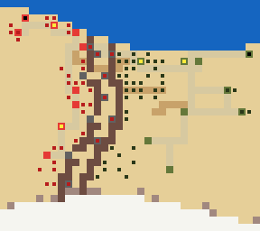
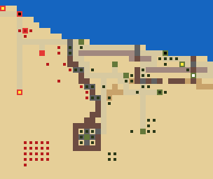

# Topic Doc 18: North Africa Scenarios

**Status:** §1 El Alamein built (v0) on 2026-11-15; §2 Gazala and Tobruk built (v0) on 2026-11-20. Balance untested.
**Last updated:** 2026-11-20 (§2 Gazala and Tobruk)
**Depends on:** 00-master-design.md §6 and §8, 01-units.md (availability rule), 02-terrain.md §4 and §4b (Minefield, Ridge, Salt Marsh), 03-combat.md §4 (attacking fortifications), 04-economy-production.md §5 and §8 (ally repair, victory conditions), 08-art-pipeline.md §21 (seasons), 19-fog-of-war.md (Gazala).

---

## 1. Second El Alamein (`el-alamein`)

Sand is open desert, brown squares are minefields, tan squares ridges, white the salt marsh of the Qattara Depression, grey bunkers. Army green properties are the UK's, red the Axis's (German or Italian). The inner mark shows the kind: yellow factory, white airfield, black HQ. Dark squares are starting units.

### Why this map

At the developer's request, the first North Africa map. Second El Alamein was chosen over Gazala, Crusader, Kasserine and Torch. It fills these gaps in the built-in maps:
- No map so far is in the **desert**. It needs a desert art season (§1 "Art") and three new terrains (02-terrain §4b).
- No map so far is a **set-piece breakthrough through minefields**, cleared square by square by sappers.
- **Italy** joins the Axis as a nation, as the second Axis player (§1 "Players"). It borrowed Germany's art until 2026-11-18 and now has its own.
- No map so far has the attacker's enemy **starved of fuel**.

### The history it follows

By October 1942 the Axis advance on Egypt had stopped 100 km west of Alexandria, at the railway halt of El Alamein. Here the desert narrows to a 65 km neck between the sea and the **Qattara Depression**, a sunken salt marsh that tanks couldn't cross. There was no open flank to go round, unlike every earlier desert battle. Panzerarmee Afrika, about half German and half Italian, dug in behind two belts of mines, the "Devil's Gardens", about half a million mines in all, with infantry strongpoints between them. Its armour waited behind, in German and Italian pairs in the north and south. Its fuel ran low as British aircraft and submarines sank the tankers crossing from Italy.

Montgomery's **Eighth Army** was British, Australian, New Zealand, South African and Indian, with a Free French and a Greek brigade. It outnumbered the Axis about two to one in men and tanks and had plenty of fuel. On the night of 23 October (**Operation Lightfoot**) a barrage from about 880 guns opened, and infantry with sappers cleared two corridors through the mines in the north, with the armour following behind. A diversion went in in the south, where the Free French attacked Himeimat. A week of grinding followed around Kidney Ridge and along the coast, where the Australians pushed north. On 2 November **Operation Supercharge** broke through at Tel el Aqqaqir. The Axis had too little fuel to move its armour or get it away. On 4 November Rommel ordered the retreat west along the coast road.

### Area and scale

- **36 × 32 squares**, about 3 km wide and 3.3 km tall each, with north up.
- It runs from El Daba (west) to El Hammam (east), and from the coast (north) to the Qattara Depression (south). That is roughly 28.35°E to 29.45°E and 30.15°N to 31.10°N.
- It's generated from real longitude and latitude, like Bastogne and Market Garden.
- From the second minefield belt to El Daba is about 10 squares along the coast road: two days for a Medium Tank (move 6) once through the mines, with nobody in the way. The Depression fills the bottom five rows.

### Players

Three players, in this turn order:

1. **UK** (Allies): the whole Eighth Army. The Australian, New Zealand, South African and Indian divisions and the Free French and Greek brigades are folded in, as the Poles are on Market Garden. Its units are drawn with the UK art.
2. **Germany** (Axis): the Afrika Korps (15th and 21st Panzer), the 90th and 164th Light Divisions, and the Ramcke paratroop brigade.
3. **Italy** (Axis): the Littorio and Ariete armoured divisions, the Trieste and Trento motorized divisions, the Bologna, Brescia and Pavia infantry divisions, and the Folgore paratroopers.

- **The Allies move first,** as on every built-in map, and they're the attacker here. Allied players stay the first player and army green.
- **Each Axis player has its own funds, properties and build list.** An ally's property repairs and resupplies your units at your cost (04-economy §5). So Italian tanks refuel in German-held places and the other way round, as the mixed German and Italian line did.
- **Italy has no HQ.** It's out only if every Italian unit is destroyed (as the US on Market Garden).
- **By default the computer plays Germany and Italy** (09-ai §5), so one person plays the Allies with one turn a day.

#### Why the Free French are folded in

The Free French at El Alamein were two brigades (about 5,000 men) and a flying column, out of an Eighth Army of about 195,000. They took part in XIII Corps' diversion in the south: on the night of 23 October they attacked the Himeimat heights, were thrown back by the Folgore and German armour, and lost Lieutenant-Colonel Amilakhvari. It was a brave but small part of the battle, so a separate Free French player would add a second Allied turn every day for a brigade's worth of units. The Commonwealth divisions were a much bigger share (four of the ten divisions and about half the infantry), so the "UK" player is really the Eighth Army. A Free French nation, borrowing the UK art like Canada, can be added later if a map needs it (Bir Hakeim at Gazala would).

### Italy as a nation

- **New nation `italy`**, on the Axis side, named "Italy".
- **Its own art since 2026-11-18** (08-art-pipeline §12, §18): map sprites with front and back views and battle-scene figures and models for every unit type below. Until then it borrowed Germany's (`ART_LOANS`).
- **Color:** blue, Italy's azzurro (as built, 2026-11-15). Borrowing Germany's color too would have made Germany and Italy match, so by the usual rule both would have lost their color and Germany would no longer wear field grey. Germany's sheets already come in blue, so no new art was needed. Italy can get a color of its own with its own art.
- **Flag (HUD and capture flag):** a plain green, white and red vertical tricolour. Never the Savoy crest of the wartime flag, and never the fasces (00-master-design §6).
- **Unit types it fielded** (availability rule, 01-units §1): Infantry, Assault Infantry (the *guastatori* combat engineers), Mortar Team, Recon (AB 41 armoured car), Halftrack (standing in for its troop lorries), Supply Truck (SPA Dovunque), Light Tank (L6/40), Medium Tank (M13/40, M14/41), Tank Destroyer (Semovente 75/18, 47/32), Artillery (75/27, 100/17), Mobile AA (truck-mounted 20 mm), Flak Gun (90/53), Fighter (C.202) and Bomber (SM.79). No Heavy Tank, no Rocket Artillery, no carrier aircraft. It had a navy, but this map has no ships.

### Places

| | UK | Germany | Italy |
|---|---|---|---|
| HQ | El Hammam (Eighth Army's rear) | El Daba (Panzerarmee's rear) | none |
| Factories | El Imayid (the railhead dumps), El Alamein station | Ghazal station | Bab el Qattara |
| Airfields | Two landing grounds near the east edge (the Desert Air Force) | El Daba | |
| Cities | Alam Halfa, Deir el Ragil, Samaket Gaballa, Ruweisat Station | Sidi Abd el Rahman, Tel el Mampsra | Deir el Qatani, El Mreir, Qaret el Abd |

- **El Daba**, Germany's HQ, is the Allied objective.
- **Few real towns:** the desert inland had almost none. Most properties stand for supply dumps, camps and railway halts, drawn as towns.
- **Income:** the UK starts with 9 properties, Germany 5 and Italy 4, so the Allies earn as much as both Axis players together (9,000 a day each side) and start with more units (43 against 38). That stands for the buildup from Alexandria.
- **No neutral properties:** every square of the neck was held, as at Kursk.

### The front, 23 October 1942

- The Axis forward edge runs from **Tel el Eisa** on the coast, south past the west foot of **Miteiriya Ridge** and **Ruweisat Ridge**, through **Deir el Munassib**, to **Qaret el Himeimat** at the edge of the Depression.
- **Two minefield belts** (02-terrain §4b) run the whole length of the front, from the coast to the Depression:
  - The **first belt** is one square deep and unbroken.
  - The **second belt** is one square deep, two squares behind the first. It has three one-square gaps (a quarter, half and three quarters of the way down the front), each with a Bunker just behind it, for Axis counterattacks.
  - Between the belts stand **Bunkers**, the infantry strongpoints: one every third row, six in all.
- The belts are drawn as 4-connected lines, so there's never a diagonal gap. As built they hold 51 squares of mines and 11 Bunkers (two on the coast road, six strongpoints, three behind the gaps).
- **No minefield on a road.** The coast road and railway get a Bunker where they cross each belt instead, and the Australians' push along the coast has to break it.
- **Allied lines** face the belts from two or three squares east, with no mines of their own on the map.

### Terrain

- Mostly **Plains**, drawn as hard desert ("good going"): open tank country.
- **Ridge** (new, 02-terrain §4b): Miteiriya, Kidney, Ruweisat, Alam Halfa and Tel el Aqqaqir. Low ridges a tank could cross, giving hull-down cover. Fought over for days.
- **Hills:** only Qaret el Himeimat, the hill at the south end of the line, which tanks couldn't climb.
- **Salt Marsh** (new, 02-terrain §4b): the Qattara Depression along the south edge, impassable to every land unit, so the line can't be turned.
- **Road:** the coast road (Via Balbia) along the shore, plus the Rahman track and a few desert tracks. The railway runs beside the coast road and is drawn as part of it.
- **Sea** along the north edge. No ports, beaches or ships.
- **Minefields** and **Bunkers** as above.

### Starting forces

All units are first guesses, scaled to the map as on the other maps.

- **UK** (5,000 funds):
  - **XXX Corps**, north (9th Australian, 51st Highland, 2nd New Zealand, 1st South African): six Infantry, three Assault Infantry (the sappers who cleared the corridors), two Mortar Teams, four Artillery (the barrage) and two Medium Tanks (Valentines in infantry support).
  - **X Corps** (1st and 10th Armoured), behind XXX Corps: five Medium Tanks (Shermans, Grants and Crusaders), a Light Tank, two Halftracks each carrying Infantry, a Recon, a Tank Destroyer and a Mobile AA.
  - **4th Indian Division** on Ruweisat Ridge: two Infantry.
  - **XIII Corps**, south (7th Armoured, 44th and 50th Divisions, the Free French): two Medium Tanks, a Light Tank, three Infantry, an Assault Infantry, an Artillery and a Recon.
  - **Desert Air Force:** two Fighters and two Bombers on the landing grounds.
- **Germany** (2,000 funds):
  - **164th Light Division** in the northern line: an Infantry in each of the coast road's two Bunkers, an Infantry in the northernmost strongpoint, and a Mortar Team, beside the Italians.
  - **15th Panzer**, north behind the belts: two Medium Tanks and an Artillery.
  - **21st Panzer**, south behind the belts: two Medium Tanks.
  - **90th Light Division** near Ghazal: two Infantry, an Assault Infantry and a Supply Truck.
  - **Ramcke Brigade** in the centre of the line: an Infantry in the middle strongpoint and one behind it.
  - **Anti-tank screen:** two Tank Destroyers (the 88s and Marders) behind the second belt in the north.
  - **El Daba:** a Flak Gun, two Fighters and a Bomber.
- **Italy** (2,000 funds):
  - **Trento, Bologna, Brescia and Pavia** in the line between the belts: four Infantry in the strongpoints, two Mortar Teams and two Artillery behind them.
  - **Littorio**, north behind the belts, paired with 15th Panzer: two Medium Tanks.
  - **Ariete**, south behind the belts, paired with 21st Panzer: two Medium Tanks.
  - **Trieste**, in reserve near Rahman: an Infantry and a Light Tank.
  - **Folgore**, at the south end facing Himeimat: two Infantry and an Assault Infantry.
- **Axis tanks start short of fuel:** Medium Tanks at 12 of 30, Light Tanks at 11 of 28. That's about two full moves, so shifting the armour from south to north costs most of a tank, as it did. Supply Trucks and owned properties refuel them as usual.

### Supply

No new supply rule. The desert's long supply lines are shown through the map, under the existing rules (05-supply-transport §1, §3):
- **Land units refuel only on owned properties** (or an ally's) **or next to a Supply Truck** (a Halftrack until 2026-11-27). There are few properties and they're far apart, so tanks that drive far from them need Supply Trucks bringing fuel behind them.
- **The Axis starts short of fuel** (above), and has fewer properties and Supply Trucks than the Allies.
- **The Allies are well supplied:** more properties, more Supply Trucks, full tanks.
- A capturable **Supply Dump** property (refuels but no income, no repair) was considered and left out: it isn't in the original game, and here the Axis shortage is shown well enough by starting fuel.

### Weather and season

- Clear all game.
- **Desert season** (08-art-pipeline §21, generalized from winter): sand-colored terrain and buildings and sand battle scenes, all game. Art only.

### Build lists

- **UK:** every land unit except the Heavy Tank (only a handful of Churchills fought, as a trial) and Rocket Artillery (01-units §7a), plus Fighter and Bomber.
- **Germany:** every land unit except the Heavy Tank (the first Tigers reached Africa in Tunisia, a month later) and Rocket Artillery, plus Fighter and Bomber.
- **Italy:** the unit types in "Italy as a nation" above.
- No ships and no Transport Aircraft for anyone.

### Victory

- **The Allies win by capturing El Daba**, Germany's HQ (`captureProperties` for the Allies, so it ends the game for the whole Axis at once, Italy included). That is the breakout.
- **The Axis wins by holding out to the start of day 15** (`surviveDays`). The real battle took 12 days.
- **Both sides** also win by capturing the enemy HQ or destroying every enemy unit (`hqCapture`, `rout`). Capturing El Daba as HQ capture alone would only knock out Germany, leaving Italy playing on, which is why the Allied condition is `captureProperties`.

### Computer opponent

- The Greedy AI already attacks fortifications and plans its paths as if breakable ones were gone (09-ai), so it can clear minefields with no new rule.
- **As built, AI vs AI, the Axis always wins** (seeds 1 to 4, all on day 15, with no engine or AI problem): the Allied AI clears only 5 to 7 of the 51 minefield squares, scattered along the belt rather than a corridor, and never gets its armour through. Teaching it to concentrate on a corridor is later AI work (§3).

### Art

- **Desert season** (built as a third season beside summer and winter, with `desertPath` sheets, 08-art-pipeline §21):
  - **Terrain sheet** with the same layout: sand and gravel for grass, pale tracks for roads, low rocky ridges, a dry escarpment for Hills, scrub (camel thorn) where a forest tile would be, sea with pale sand at the shore.
  - **Building sheet:** flat-roofed whitewashed buildings, railway halts, tented camps and dumps. Roofs or awnings keep the owner's color.
  - **Battle scenes:** sand ground and dust, a pale hot sky, no trees.
- **New terrain tiles** in every season sheet (summer, winter, desert): Minefield (wire on pickets with yellow warning triangles), Ridge, Salt Marsh (cracked white salt crust with dark wet patches). As built: 08-art-pipeline §21.
- **Italy** has its own art since 2026-11-18 (08-art-pipeline §12, §18).
- **UK art** is 1944 equipment (Firefly, Achilles). Desert-era tanks (Crusader, Grant, Valentine) are optional extra art, not needed for v0.

### How it's made

- `tools/maps/el-alamein.mjs` generates the scenario file from real longitude and latitude for the coast, the places, the ridges, the front line and the Depression's edge, as `market-garden.mjs` does. It lays the two minefield belts along the front line, checks that no land route from the Allied HQ to El Daba avoids every mine and Bunker, and checks that every Allied unit starts east of the first belt and every Axis unit west of it. `tools/maps/overview.mjs el-alamein` draws `docs/maps/el-alamein.png`.
- Tests: `tests/desertTerrain.test.ts` (the three terrains and the season) and `tests/scenario.test.ts`, "El Alamein".
- It comes third on the map select, after Market Garden.

### Build order (done)

1. **Engine:** the Minefield, Ridge and Salt Marsh terrain data (02-terrain §4b), map letters for them, and the self-play state checker allowing fortifications on Minefield squares. The `italy` nation.
2. **Presentation:** desert season art (terrain, buildings, battle colors), the three new tiles, Italy's flag and its art loan from Germany.
3. **Map:** the generator, the scenario file and its overview picture.
4. **Checks:** `npm run check`, then `npm run selfplay` on El Alamein and every other map.

### Tests

Rule tests (02-terrain §4b):
- "A minefield blocks every land unit, but aircraft fly over it"
- "A minefield is cleared by attacking it and becomes Plains"
- "Assault Infantry clears a minefield square in two attacks"
- "Clearing a minefield isn't a kill"
- "A ridge gives 2 defense stars and lets tanks cross at 2 movement points"
- "The salt marsh blocks every land unit, but aircraft fly over it"
- "Snow costs on a ridge are the forest's"

Scenario tests ("El Alamein"):
- "The UK moves first, then Germany, then Italy"
- "The computer plays Germany and Italy by default"
- "The Allies win at once by capturing El Daba, and Italy is out with Germany"
- "The Axis wins at the start of day 15"
- "Two minefield belts run unbroken from the coast to the Depression, apart from the second belt's gaps"
- "No minefield lies on a road"
- "No land unit can get round the south end of the line"
- "Every Axis tank starts short of fuel"
- "Italy fields no Heavy Tank or Rocket Artillery"
- "An Italian tank in a German-held town is repaired at Italy's cost" (04-economy §5)

## 2. Gazala and Tobruk (`gazala`)

**Status:** designed and built (v0) 2026-11-20 at the developer's request. Balance untested.

Sand is open desert, brown squares minefields, grey Bunkers, tan ridges and escarpments. Army green properties are Allied (UK or Free French), red Axis. The inner mark shows the kind: yellow factory, white airfield, black HQ. Dark squares are Allied units, red ones Axis.

### Why this map

The second North Africa map, chosen over Kasserine Pass, Crusader, the Mareth Line and Torch. It is the opposite of El Alamein (§1):
- **The Axis attacks** and the British defend.
- **The flank is open.** The line stops in the desert at Bir Hakeim, so the battle is about maneuver, not a frontal grind.
- **Fog of war** (19-fog-of-war) exists now, and this is the battle it suits best: the British didn't know where the Axis armour would come from. The fog is always on for this map.
- **The Free French** join as a nation of their own, holding Bir Hakeim.
- It needs **no new terrain or rule**: Minefields, Ridges, Bunkers, the desert season, ally repair and Italy's own art are all built.

### The history it follows

In May 1942 the Eighth Army held the **Gazala line**, west of Tobruk: a continuous minefield running about 70 km south from the coast at Gazala, with fortified brigade "boxes" along it. The 1st South African and 50th Divisions held the north, the 150th Brigade box stood at Got el Ualeb, and the **1st Free French Brigade** held the southern end at **Bir Hakeim**. The British armour waited behind the line around Knightsbridge and El Adem, and the 2nd South African Division garrisoned **Tobruk**, whose old defences had been stripped to build the line.

On the night of 26 May (Operation Venezia) Rommel took the Afrika Korps (15th and 21st Panzer), the Italian Ariete and Trieste divisions and the 90th Light round the south of Bir Hakeim, while the Italian infantry made a frontal feint against the north of the line. By dawn the Axis armour was behind the British line; the 3rd Indian Motor Brigade, south-east of Bir Hakeim, was overrun in its first hour.

The attack ran short of fuel. The Axis armour regrouped inside the British minefields, in the **Cauldron**, overran the 150th Brigade box on 1 June and cut a supply lane west through the mines. Bir Hakeim held for fifteen days against German and Italian attacks and Stukas before the French broke out on the night of 10 June. The British armour was beaten piecemeal around Knightsbridge on 12–13 June, the Eighth Army fell back east, and on 20 June Rommel turned on Tobruk and took it in a day, with 33,000 prisoners.

### Area and scale

- **38 × 32 squares**, about 3.2 km wide and 3.5 km tall each, north up. The coast runs across the top third, so the north-east corner is sea.
- From Tmimi (west) to Sidi Rezegh, past Tobruk (east), and from the coast (north) to well south of Bir Hakeim, so there's room for the sweep round the end of the line. Roughly 22.95°E to 24.25°E and 31.35°N to 32.35°N.
- Generated from real longitude and latitude, like El Alamein.
- From the Axis start south-west of Bir Hakeim to Tobruk is about 20 squares round the end of the line: three to four days for a Medium Tank with nobody in the way, which costs it most of a tank of fuel.

### Players

Four players, in this turn order:

1. **UK** (Allies): the Eighth Army, with the South African and Indian divisions and the 50th Division folded in, as on El Alamein.
2. **Free France** (Allies), a new nation: the 1st Free French Brigade at Bir Hakeim.
3. **Germany** (Axis): the Afrika Korps and the 90th Light.
4. **Italy** (Axis): the Ariete and Trieste divisions in the sweep, and the X and XXI Corps' infantry facing the north of the line.

- **The Allies move first,** as on every built-in map; the Axis assault comes on Germany's first turn.
- **By default the computer plays Germany and Italy** (09-ai §5). One person plays the UK and the Free French: two Allied turns a day, as on Market Garden, but the Free French turn is short, a garrison holding out.
- **The Free French have no HQ.** They are out only if every Free French unit is destroyed, as the US on Market Garden. Allies repair at each other's properties (04-economy §5).

#### Free France as a nation

At El Alamein the Free French were folded into the UK (§1 "Why the Free French are folded in"). Here Bir Hakeim is the centrepiece of the battle, so they get their own player.
- **New nation `freeFrance`**, on the Allied side, named "Free France". The country is France; "Free" tells it apart from Vichy France, which this game never fields.
- **It borrows the UK's art** (`ART_LOANS`, as Canada does): the brigade was equipped and supplied by the British. Battle scenes draw it with the UK's equipment.
- **Color: army green** (`olive`). The UK wears brown and Italy blue; Free France borrowing the UK's brown would make both lose their color by the usual rule (08-art-pipeline §12). The UK sheets already come in olive. On a map with the US, Free France would fall back to a slot color.
- **Flag:** the plain blue, white and red vertical tricolour. No Cross of Lorraine, keeping to the rule on symbols (00-master-design §6).

### Places

| | UK | Free France | Germany | Italy |
|---|---|---|---|---|
| HQ | **Tobruk** (objective) | none | Tmimi | none |
| Factories | Belhamed (the railhead dumps, east of Tobruk) | | Bomba road (the coast road west) | Rotonda Segnali |
| Airfields | El Adem, Sidi Rezegh landing ground | | Tmimi airfield | |
| Cities | Gazala, Acroma, Knightsbridge, Bir el Gubi | Bir Hakeim | | Bir Temrad |

- **Income:** the UK starts with 8 properties and Free France 1, against Germany's 3 and Italy's 2. The Axis is much poorer but starts with its armour concentrated; the British armour is spread out across the desert.
- **Every Axis property is west of the minefield.** That is the supply story (below).
- **Tobruk** sits on its harbour. It is a city (the HQ), not a Port: there are no ships on this map.

### The Gazala line

- **One Minefield belt**, one square deep, from the coast at Gazala south to Bir Hakeim, drawn 4-connected as on El Alamein. It stops at Bir Hakeim: south of it the desert is open.
- **Boxes** built into the minefield itself, as the real ones were: at each, two mined squares become Bunkers, so the line stays closed and the box holds it. Gazala (1st South African Division), two 50th Division boxes, Got el Ualeb (150th Brigade). And **Bir Hakeim**: Bunkers on the four sides of the Free French town, inside a ring of mines two squares out.
- **Gaps:** the coast road crosses the belt at the Gazala box's Bunker, and the Trigh Capuzzo and the Trigh el Abd cross it at Bunkers too, as at El Alamein. No minefield lies on a road.
- **Behind the line:** the **Knightsbridge box** (201st Guards Brigade) at the junction of the Trigh Capuzzo and the Bir Hakeim track, and the 3rd Indian Motor Brigade in the open south-east of Bir Hakeim.
- **The Tobruk perimeter:** an old ring of Minefields and Bunkers round Tobruk, about 8 squares across, with **several gaps** where it had been stripped for the Gazala line. That is why it fell in a day: it should slow an attack, not stop one.

### Terrain

- Mostly **Plains**, drawn as desert.
- **Hills** for the steep escarpments: along the coast at Gazala, and round Tobruk and El Adem, each with gaps where the roads and tracks climb it. Tanks can only cross at the gaps.
- **Ridge** for the lower escarpments and rises: Sidi Rezegh, Rigel Ridge near Knightsbridge, and the ground round the Cauldron.
- **Roads:** the Via Balbia along the coast, and the desert tracks: the Trigh Capuzzo (Tmimi to Tobruk through Knightsbridge), the Trigh el Abd further south, and the Bir Hakeim track north to Acroma.
- **Sea** along the north edge.
- No Salt Marsh: the south edge is open desert.

### Fog of war

- **Always on** for this map (`settings.fogOfWar`, 19-fog-of-war §1), as on the Battle of Britain, Ten-Go and Midway.
- The Axis assault force starts south-west of Bir Hakeim, out of sight of every Allied unit and property. The UK has to find it with Recon and aircraft.
- The Italian infantry facing the north of the line is in sight from the boxes, so the feint is the first thing the Allies see.

### Starting forces

All units are first guesses, scaled to the map as on the other maps.

- **UK** (4,000 funds):
  - **Gazala box** (1st South African Division): two Infantry in Bunkers, an Artillery.
  - **50th Division boxes:** four Infantry in Bunkers, a Mortar Team, an Artillery.
  - **Got el Ualeb** (150th Brigade): two Infantry in Bunkers, an Artillery, a Tank Destroyer.
  - **Knightsbridge** (201st Guards Brigade): two Infantry, an Artillery.
  - **1st Armoured Division**, near Knightsbridge: four Medium Tanks (Grants), a Light Tank, a Halftrack carrying Infantry.
  - **7th Armoured Division**, near Bir el Gubi: three Medium Tanks, a Light Tank, a Recon, an Artillery.
  - **3rd Indian Motor Brigade**, south-east of Bir Hakeim: two Infantry, a Supply Truck, an Artillery. Exposed, as it was.
  - **Tobruk** (2nd South African Division): three Infantry, an Artillery, a Flak Gun.
  - **Desert Air Force** at El Adem: two Fighters and a Bomber.
- **Free France** (1,000 funds), at Bir Hakeim: three Infantry in Bunkers, an Assault Infantry, a Mortar Team, an Artillery (the French 75s) and a Flak Gun (the Bofors that fought off the Stukas).
- **Germany** (3,000 funds), the assault force south-west of Bir Hakeim, out of sight:
  - **15th and 21st Panzer:** six Medium Tanks and a Light Tank.
  - **90th Light:** two Halftracks carrying Infantry, a Recon, an Artillery, and (since 2026-11-27, when Halftracks stopped resupplying) a Supply Truck on the west edge of the assault force.
  - **Anti-tank:** two Tank Destroyers (the 88s).
  - **At Tmimi:** two Fighters and a Bomber (the Stukas, drawn with Germany's bomber art).
- **Italy** (2,000 funds):
  - **Ariete and Trieste**, in the assault force: four Medium Tanks, a Light Tank, two Infantry, an Artillery.
  - **X and XXI Corps**, facing the north of the line: six Infantry (one just west of each box, where its soldiers can see it), two Artillery, a Mortar Team.
  - **At Tmimi:** a Fighter.
- **Fuel:** every tank starts full. The sweep round Bir Hakeim is what empties them.

### Supply

No new rule, as on El Alamein: the map makes the Cauldron.
- **Every Axis property is west of the minefield.** Armour that has swung round Bir Hakeim is about 20 squares from the nearest place to refuel.
- **Two ways to keep it moving:** Supply Trucks bringing fuel the long way round the south, or **clearing a lane through the minefield** to shorten the route, which is what Rommel did at Got el Ualeb. Breaking the 150th Brigade box opens it.
- **The British** have Tobruk, El Adem and the boxes behind them, and an ally's property repairs and refuels their units (04-economy §5), so a tank can refuel at Bir Hakeim.

### Weather and season

- Clear all game, in the desert season (08-art-pipeline §21). The fog of war is a game setting, not weather.

### Build lists

- **UK:** every land unit except the Heavy Tank and Rocket Artillery, plus Fighter and Bomber.
- **Free France:** Infantry, Assault Infantry, Mortar Team, Recon, Artillery, Flak Gun. It owns no factory, so it can build only if it captures one.
- **Germany:** every land unit except the Heavy Tank (no Tigers in Africa until Tunisia) and Rocket Artillery, plus Fighter and Bomber.
- **Italy:** as on El Alamein (§1 "Italy as a nation").
- No ships and no Transport Aircraft for anyone.

### Victory

- **The Axis wins by capturing Tobruk** (`captureProperties` for the Axis). That ends the game for the whole Allied side at once; plain HQ capture would only knock out the UK and leave the Free French playing on.
- **The Allies win by holding out to the start of day 16** (`surviveDays`). The real battle took 27 days to Tobruk.
- **Both sides** also win by capturing the enemy HQ or destroying every enemy unit (`hqCapture`, `rout`). The Allies taking Tmimi would end the game.

### Computer opponent

- The Greedy AI needs no new rule. Its route-finding treats a breakable minefield as passable once broken (09-ai), so it may attack the line rather than go round Bir Hakeim. Whether it sweeps round the south is to be checked in AI vs AI games; if it doesn't, a later AI change can weigh the open flank.
- Under fog, the AI sees only what its side sees (09-ai rule 3).
- AI vs AI must end within the day limit on every game (day 16 at the latest), with no AI bug (09-ai §7).
- **As built, AI vs AI, the Allies always win** (seeds 1 to 4, all on day 16, with no engine or AI problem). The Axis armour does swing round and closes to about 20 squares from Tobruk, then runs out of fuel by day 7, as Rommel's did. Unlike Rommel, the computer doesn't clear a lane through the minefield or bring fuel round in Halftracks (Supply Trucks since 2026-11-27), so the stranded tanks are destroyed. Teaching it to supply an armoured thrust is later AI work.

### Art

- **Free France** borrows the UK's art in army green, and needs only its flag (HUD and capture flag). No new map or battle art.
- **The map** uses the desert season and existing tiles. No new terrain art.

### How it's made

- `tools/maps/gazala.mjs` generates the scenario from real longitude and latitude for the coast, the places, the escarpments, the Gazala line, the boxes and the Tobruk perimeter, as `el-alamein.mjs` does. It checks that the minefield runs unbroken from the sea to Bir Hakeim with no mine on a road, that a land route round the south of Bir Hakeim exists, and that the Axis assault force starts out of sight of every Allied unit and property. `tools/maps/overview.mjs gazala` draws `docs/maps/gazala.png`.

### Build order (done)

1. **Free France:** the nation, its flag, its art loan from the UK and its color.
2. **Map:** the generator, the scenario file with fog always on, and its overview picture. It comes after El Alamein on the map select, in the North Africa theater.
3. **Checks:** `npm run check`, then `npm run selfplay` on Gazala and every other map.
4. **Map select:** Gazala's dot is at Bir Hakeim in the North Africa theater; its preview shows a German tank firing on the Free French in a Bir Hakeim bunker.

### Tests

In `tests/scenario.test.ts` ("Gazala"), `tests/artPack.test.ts` and `tests/flags.test.ts`. As planned:

- "Free France is an Allied nation that borrows the UK's art and wears army green"
- "Free France's flag is the plain tricolour"
- "The UK moves first, then Free France, then Germany, then Italy"
- "The computer plays Germany and Italy by default"
- "Fog of war is always on for Gazala"
- "The Axis wins at once by capturing Tobruk, and the Free French are out with the UK"
- "The Allies win at the start of day 16"
- "The Free French play on after the UK resigns"
- "The minefield runs unbroken from the sea to Bir Hakeim, and no mine lies on a road"
- "A land route round the south of Bir Hakeim reaches Tobruk"
- "The Axis assault force starts out of sight of every Allied unit and property"
- "Every Axis property is west of the minefield"
- "The Tobruk perimeter has gaps"
- "A British tank at Bir Hakeim is repaired at the UK's cost" (04-economy §5)

### Known gaps

- **The Axis AI doesn't keep its armour supplied** (§2 "Computer opponent"), so AI vs AI the Allies always win.
- **Night:** the sweep came by night; there is no night in the game.
- **Stukas** are drawn with Germany's bomber art (the Ju 88): Germany has no Dive Bomber art.
- **The Cauldron's dust and confusion** are only the fog of war.
- **Bir Hakeim's breakout** (the French fought their way out by night) is up to the player.
- Balance is a first guess: funds, the size of the assault force, the day 16 limit and the Tobruk perimeter's gaps all need playtesting.

## 3. Known gaps and later work (El Alamein)

- **Italian battle scenes** draw Italy's own soldiers, tank crews, tanks, armoured car and aircraft; its lorry, guns and AA use the German shapes, as Japan's do. No Bersaglieri plumes yet.
- **Free French** are folded into the UK (§1 "Why the Free French are folded in"). A nation borrowing the UK art can be added for a map where they matter more.
- **No fog of war:** Montgomery's deception plan (Operation Bertram: dummy tanks and a fake pipeline in the south) and the surprise of the night attack can't be shown.
- **No night:** Lightfoot was a night attack under a full moon.
- **The Allied AI doesn't make corridors** (§1 "Computer opponent"), so AI vs AI the Axis always wins.
- **Capture scenes** still show European town squares, factories and harbors behind the sand.
- **Minefields are cleared by attacking them,** like the original's pipe seams, rather than by a sapper action or casualties from crossing them.
- **The Commonwealth** plays under the UK name and art.
- Balance is a first guess: starting funds, the Axis starting fuel, the day 15 limit and the minefield depth all need playtesting.
