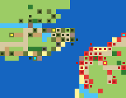

# Topic Doc 20: The Battle of Britain

**Status:** built (v0), 2026-11-19, at the developer's request ("focused on aerial fighting and bombing runs"). Balance untested beyond computer-vs-computer games: funds and unit counts are first guesses.
**Last updated:** 2026-11-19
**Depends on:** 01-units (aircraft, Landing Craft), 02-terrain, 03-combat, 05-supply-transport (fuel, landings), 12-weather (rain). **Feeds:** 00-master-design §8, 09-ai (known gaps).

---

## 1. Battle of Britain (`battle-of-britain`)

Green properties are British, red German; white marks are airfields, cyan ports, yellow factories, black the HQs. Dark squares are starting units. Pale yellow is beach, dark grey the pillboxes.

### The history it follows

After the fall of France in June 1940, Germany planned **Operation Sea Lion**, a landing on the south coast of England between Folkestone and Brighton. The Kriegsmarine couldn't hold the Channel against the Royal Navy, so the Luftwaffe first had to destroy RAF Fighter Command and win the air above it. From **Adlertag, 13 August**, Luftflotte 2 in the Pas-de-Calais and Flanders and Luftflotte 3 in Normandy attacked the RAF's airfields, radar stations and aircraft factories, while invasion barges gathered in Boulogne, Calais, Dunkirk and Ostend. The RAF's Hurricanes and Spitfires, about 700 against the Luftwaffe's 2,500 aircraft, were directed onto each raid by radar, and British factories built fighters faster than they were shot down. The Bf 109, the only German fighter that could match them, had fuel for only about ten minutes over London. Bomber Command's Blenheims bombed the barges in the Channel ports night after night. On 7 September the Luftwaffe turned on London (the Blitz), which spared the battered sector stations; on **15 September**, Battle of Britain Day, two great raids on London were broken up, and two days later Hitler postponed Sea Lion indefinitely.

### Why this map

It's the first map where the war is fought mostly in the air. Every other map is a land or sea battle with aircraft in support. Here the outcome hangs on fighters against fighters, fighters against bombers, and bombers against the ships and boats that decide whether an invasion can cross. Ground forces are thin, and only matter once a landing gets ashore.

### Area and scale

- **27 × 21 squares**, from Portsmouth and Reading in the west to Lille and Bruges in the east, and from Chelmsford in the north to the Somme in the south. Roughly 1.15° W to 3.17° E and 50.0° to 51.95° N.
- Each square is about **11 km** east to west and **10 km** north to south, much larger than any other theater map. The scale is set by aircraft fuel (05-supply-transport §5): at 2 fuel a square and 5 a day, a full Fighter can fly 18 squares out and back over four days and strike the square beyond, so **London is exactly 19 squares from Wissant**, the nearest German airfield: the very end of a Bf 109's reach, as in 1940. From every other German airfield it's out of reach and back.
- The Strait of Dover is 2 to 4 squares of water, so a Landing Craft (move 6) crosses in one day.
- The coastline comes from Natural Earth's 1:50m land outline (public domain, through the `world-atlas` package), sampled at five points a square.

### Places

| | United Kingdom | Germany |
|---|---|---|
| HQ | London | Cap Blanc-Nez (Kesselring's command post) |
| Airfields | The sector stations Northolt, North Weald, Hornchurch, Biggin Hill, Kenley and Tangmere; the forward fields Manston and Hawkinge; Detling and Rochford | Wissant, Le Touquet (fighter fields on the coast); Saint-Omer, Abbeville, Lille, Arras (inland) |
| Ports | Dover, Sheerness (the Nore), Newhaven, Portsmouth | Boulogne, Calais, Dunkirk, Ostend (the invasion ports) |
| Factories | Aldershot, Maidstone | Hazebrouck |
| Cities | Canterbury, Folkestone, Ashford, Rye, Hastings, Eastbourne, Brighton, Chelmsford | Montreuil, Hesdin, Doullens, Béthune, Ypres, Bruges |

- **Income:** 25 British properties to 18 German, so the UK earns more each day, standing for the British factories that out-built the German ones in fighters. Germany starts with more aircraft and more funds (20,000 to 10,000).
- Some places are a square or two off where they were, so that no two places touch (a rule every generated map follows). Folkestone is the most out of place.

### Terrain

- **Plains** almost everywhere, with woods in patches; the **Weald**, between the North and South Downs, is thickly wooded.
- The **North and South Downs** are **Ridge** (02-terrain §4b): chalk downs that give cover and slow vehicles without blocking them.
- **Hills** for the white cliffs between Folkestone and Dover, Beachy Head and Cap Gris-Nez, where no boat lands.
- **Beaches** on the Sea Lion coast from Folkestone to Brighton, and along the whole Continental shore from the Somme to Bruges. Elsewhere the English coast is plains, where a Landing Craft can't unload (05-supply-transport §8).
- **Rivers:** the Thames (open water up to Gravesend, so ships reach Sheerness, and a river above it), the Medway and the Somme. Few roads: London to Dover, Folkestone, Brighton and Portsmouth; the Continental coast road and the roads inland to Lille and Arras.
- **Pillboxes** (Bunkers) just inland of every second Sea Lion beach, each with Infantry in it: the "coastal crust" of 1940. Bombers and Assault Infantry can break them (03-combat §4).

### Starting forces

The Fighter stands for both the Hurricane and the Spitfire (drawn as a Spitfire) on the British side, and for both the Bf 109 and the Bf 110 on the German. The Bomber is the Blenheim for the UK (drawn as the Lancaster, the only British bomber art) and the He 111, Do 17 and Ju 88 for Germany (drawn as the Ju 88).

- **United Kingdom** (10,000 funds, 27 units):
  - **Fighter Command, 11 Group:** a Fighter on each of the six sector stations and on Manston and Hawkinge (8).
  - **Bomber and Coastal Command:** Bombers at Detling and Rochford, for the barges.
  - **Anti-Aircraft Command:** Flak Guns (the 3.7-inch) by London and Dover, Mobile AA (Bofors) by Hawkinge and Manston.
  - **The Royal Navy:** Destroyers at Sheerness and Portsmouth, two in the Downs off Dover and one off Newhaven, and an MTB (Torpedo Boat) in Dover.
  - **Home Forces:** Infantry in each pillbox, in Folkestone, by Dover and in London; an Artillery by Folkestone and a Light Tank by Ashford.
- **Germany** (20,000 funds, 33 units):
  - **Luftflotte 2:** 10 Fighters, three on Wissant, Saint-Omer and Le Touquet and the rest beside the fields, Cap Blanc-Nez, Abbeville and Lille; 8 Bombers on and around Abbeville, Lille, Arras and Saint-Omer.
  - **Operation Sea Lion:** an empty Landing Craft in each of Boulogne, Calais and Dunkirk, with five Infantry, two Assault Infantry and a Light Tank camped beside them; an Infantry in the HQ.
  - **The Kriegsmarine:** two S-boats (Torpedo Boat) off Boulogne and Calais.
  - A Flak Gun by Wissant.

### How it plays

- **Germany has to win the air first.** Its barges cross in a day but can't unload on the cliffs or past the pillboxes without a beach, and five Destroyers and the RAF's Bombers wait for them (a Destroyer does 50% to a Landing Craft, a Bomber 95%). So Germany's Bombers must sink the Royal Navy and silence the guns, and its Fighters must clear the RAF's Fighters out of the way (a Fighter does 100% to a Bomber, which can't fire back).
- **The Bf 109 is short-legged.** German Fighters reach Kent and the sector stations south of London and get home; London itself only from Wissant. Escorting a raid to London means a four-day round trip with no fuel to spare.
- **The RAF fights over home.** Its Fighters take off from airfields a day's flight from any raid, refuel and repair on the spot, and its Bombers can strike the invasion ports from Detling and Rochford.
- **Bombing runs are slow and costly.** A Bomber flies 7 a day, so a raid on London takes three days from the coast. Each day of the flight it can be intercepted.

### Fuel

**Bombers burn 1 fuel a square on this map, not 2** (a scenario modifier on `fuelPerMove`, 00-master-design §7). The He 111 and Do 17 had several times the Bf 109's range; at the usual 2 a square a Bomber couldn't reach Biggin Hill from the French coast and get home. Fighters keep the usual 2, which is what puts London at the end of the Bf 109's reach. The RAF's Bombers get the same modifier.

### Turn order

The UK moves first, as the Allies do on every built-in map. Its first turn stands for the morning of Adlertag, with the RAF warned by radar and scrambling before the first raid.

### Weather

**Summer.** Clear, except **rain on days 5–6** (the lull of 19–23 August, when cloud stopped the big raids) and **day 13** (the cloudy days of early September). Rain brings fog of war for the day (12-weather §3a), so raids can't see what's waiting for them.

### Build lists

- **United Kingdom:** Fighter, Bomber; Destroyer, Torpedo Boat; land units except Heavy Tank and Rocket Artillery (none in 1940). No Landing Craft, Battleship, Carrier or Submarine: the Home Fleet's heavy ships stayed in Scapa Flow, out of range of the Luftwaffe.
- **Germany:** Fighter, Bomber; **Landing Craft** (the barges, at its ports); Infantry, Assault Infantry, Mortar, Light and Medium Tank, Artillery, Mobile AA, Flak Gun. No warships: after Norway the Kriegsmarine had almost no destroyers left. No Transport Aircraft: the computer spent its money on them and lost them all to British Fighters, and Sea Lion's paratroopers were a small part of the plan. No Dive Bomber: Germany has no Stuka art yet (08-art-pipeline §17), though the Stuka fought here until it was withdrawn on 18 August after heavy losses.

### Victory

- **Germany:** capture **Dover and Hawkinge** (`captureProperties`, 04-economy §8): a port and an airfield on English soil, the first goals of Sea Lion's landing, through which the rest of the army would come. Or capture **London**.
- **United Kingdom:** still be in the game when **day 15** starts (`surviveDays`): 15 September, Battle of Britain Day, after which the invasion season was over. Or capture Cap Blanc-Nez, which it has no boats to do.
- Rout is off. Resign is always available.

### New art

- **Germany's Landing Craft** is a Sea Lion barge (*Prahm*), a Rhine barge converted for the invasion: a long, low, blunt hull with an open hold and a wheelhouse aft (`de-naval-32-*.png`, LC row). Its battle scene is still the generic German landing craft on an LCT hull.
- The map select features a Spitfire attacking a Ju 88.

### How it's made

`tools/maps/battle-of-britain.mjs` generates the scenario, coastline included, from real longitude/latitude points. `node tools/maps/battle-of-britain.mjs --reach` also prints how far each airfield is from the main targets, for tuning ranges. `tools/maps/overview.mjs battle-of-britain` redraws the picture above. Tests in `tests/scenario.test.ts`, "Battle of Britain", check the size and nations, the HQs, that no land route crosses the Channel, the RAF's airfields with a Fighter on each, that the Luftwaffe starts with more aircraft, that London is at the very end of a Bf 109's reach and only from Wissant, the Bombers' fuel rule, that RAF Fighters can strike the invasion ports, that each invasion barge can reach an English beach and has troops beside it, the pillboxes, that every Destroyer can reach the Strait, the build lists, the victory conditions, the weather, and that the computer plays Germany by default.

### Computer vs. computer

Eight Greedy-vs-Greedy games (seeds 1–8): **the UK won every one, on day 15.** The air war was even: each side lost about 10 Fighters, Germany about 10 Bombers and the UK 2–6, and German Bombers sank 5–7 Destroyers a game. But the computer can't mount an invasion: it builds barges and sends them over a few at a time, and the Destroyers and Bombers sink them (7–9 a game); at most three units got ashore in a game and none captured anything. That's the computer, not the map: it doesn't wait until it has won the air or mass its barges (09-ai §8, the planning layer). Playing Germany against the computer is the better test.

## 2. Known gaps

- **No radar.** Chain Home let the RAF see every raid forming over France; with fog of war on, here the RAF sees no further than its units' vision. A radar rule (coastal stations with long vision for aircraft) would need a new terrain or property and a decision.
- **Bombing an airfield does nothing to it.** In 1940 the Luftwaffe cratered the sector stations; here a Bomber can't hit an aircraft (01-units §3), and properties have no HP, so the only targets are units: ships, AA guns, ground troops and pillboxes. Damaged airfields that can't build or repair for a day would need a new rule.
- **No Stuka**, no Bf 110 or Hurricane as their own units: the Fighter and Bomber stand for several types each.
- **The RAF Bomber is drawn as a Lancaster**, which didn't fly until 1942. A Blenheim or Wellington would need new art.
- **Luftflotte 3** in Normandy is off the map; its raids on Portsmouth and the south coast come from Le Touquet and Abbeville instead.
- **No night bombing**, no Blitz damage to cities, and no pilot shortage (the RAF's real constraint by September).
- **Balance is a first guess**, and untested with a human playing Germany.
