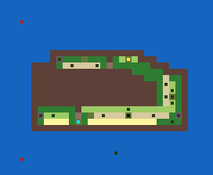

# Topic Doc 23: Survival

**Status:** v0 decided 2026-11-20, at the developer's request: the developer answered the six open choices (§10). Built 2026-11-20 and 21 in four milestones (§9): the engine rules, the wave generator, the Wake Island map with the Survival screens, and Japan's plan with a first tuning. Balance needs checking by play (§8).
**Last updated:** 2026-11-20
**Depends on:** 00-master-design.md (§8), 01-units.md, 04-economy-production.md (§8 victory conditions, §8a losses), 05-supply-transport.md, 09-ai.md (§4k map plans), 19-fog-of-war.md, 22-campaign.md (title screen, tuning by self-play). **Feeds:** 04-economy §8 (`rout` limited to one side), 09-ai (the waves' plan), 11-tech-setup (milestones, §9).

---

## 1. What it is

A third way to play, beside Campaign and Skirmish (22-campaign §1): **hold your HQ against waves of enemies that grow stronger, until it falls.** It follows the round-based "zombies" modes of shooter games: there is no win, only how long you lasted. The score is the **wave you reached** and the **days you held**, kept as a best record on the device.

- **One player, always the defender.** The computer brings the waves; the player builds, repairs and resupplies between them.
- **Built on a real siege.** The first waves follow history day by day. Once history's attacks run out, the waves keep coming, generated and growing (§4).
- **The same rules as every other game.** Waves are units arriving on the map. They then fight, capture, burn fuel and get resupplied under the normal rules. The new rules are how units arrive, how raiders go home, that the attacker can't be routed, and that the attacker gets nothing from what it captures (§5).
- **The first map is Wake Island, December 1941** (§2). The mode is written so other sieges can follow (Corregidor, Crete, Sevastopol; §11).

## 2. Wake Island (`wake-island`)

Green properties are the US's; brown is the reef and the lagoon; the dark marks are the starting units.

### The history it follows

Wake is a coral atoll in the central Pacific, three low islands round a shallow lagoon: Wake, Wilkes at its south-west tip and Peale at its north tip. In December 1941 it held about 450 Marines of the 1st Defense Battalion under Major James Devereux, with six 5-inch coastal guns and twelve 3-inch anti-aircraft guns; the twelve Wildcats of VMF-211, which had flown in on 4 December; a small Navy detachment under Commander Winfield Cunningham; and about 1,100 civilian contractors building an air and submarine base.

- **8 December** (Wake is across the date line from Pearl Harbor): 36 bombers from Roi in the Marshalls caught eight Wildcats on the ground at noon and destroyed seven. Raids then came almost every day.
- **11 December:** Rear Admiral Kajioka's invasion force (three light cruisers, six destroyers, two patrol boats and two transports with about 450 naval infantry) closed in at dawn. Devereux held his fire until the ships were close. Battery L on Wilkes sank the destroyer *Hayate*; the last four Wildcats bombed the destroyer *Kisaragi*, which blew up. Kajioka turned back. It was the first time in the war that an amphibious landing was beaten off.
- **21 December:** the carriers *Sōryū* and *Hiryū*, detached on the way home from Pearl Harbor, began striking Wake. On the 22nd the last two Wildcats were lost.
- **The relief that never came:** Task Force 14, with the carrier *Saratoga* (fighters for Wake aboard), the seaplane tender *Tangier* (Marines and ammunition) and the oiler *Neches*, was about 425 miles away on 22 December when it was ordered back.
- **23 December:** Kajioka returned with about 1,500 naval infantry, cruisers in cover and the carriers overhead. Two patrol boats were run aground on Wake's south shore and the troops landed in the dark. On Wilkes the Marines destroyed the landing force, but on Wake the line was overrun, and Cunningham surrendered that morning. **Wake held 16 days.**

### Area and scale

- **About 34 × 28 squares of about 300 m**, north up. The atoll is drawn close to true size (about 23 × 12 squares). The open sea round it is pulled in: the edges stand for the Marshalls (south), the routes from Pearl Harbor (east) and the open Pacific.
- A ship arriving on an edge reaches gun range of the atoll on its next turn, so a wave gives one turn's warning (§3).

### Places

| | US | Neutral |
|---|---|---|
| Wake | **HQ** (Devereux's command post), **Airfield**, Camp 1 (City, by the Wilkes channel), Camp 2 (**Factory**: the contractors' camp, with its workshops and heavy equipment; a liberty, so the player can build) | |
| Wilkes | **Port** (the new boat channel the contractors were dredging) | |
| Peale | Pan American station (City: the Clipper hotel and seaplane base) | |

- 6 properties, all the US's, at the usual 1,000 a day. Japan starts with none, and earns nothing from those it captures (§5d).
- **Terrain:** the islands are scrub (Forest) and open coral (Plains), with a road round Wake and across to Peale. Gun positions are Bunkers. A Reef ring surrounds the atoll, with Beaches on the south shores of Wake and Wilkes, where Japan landed both times. The lagoon is Reef, which ships cross only slowly (2 movement a square), as it was too shallow for them; the lagoon opens to the sea at the west, between Wilkes and Peale.

### Starting forces (8 December, morning)

- **US** (3,000 funds), moving first:
  - **VMF-211:** 4 Fighters on and beside the airfield (the four that were in the air when the first raid hit).
  - **The 5-inch batteries:** 3 Artillery in Bunkers, at Peacock Point (Battery A, Wake's south-east corner), Kuku Point (Battery L, Wilkes) and Toki Point (Battery B, Peale). Artillery hits ships hard (03-combat §5b), so these are the coast defence.
  - **The 3-inch batteries:** 3 Flak Guns, by the airfield, at Peacock Point and on Peale.
  - **The Marines:** 4 Infantry (one on Wilkes, one on Peale, two on Wake) and an Assault Infantry in reserve by the command post.
  - **A Submarine** to the south (Triton was on patrol off Wake when the war began).
- **Japan:** two **Supply Ships** (its fleet oilers), one off the south-west of the atoll and one off the north-west (added 2026-11-21 at the developer's request: the waves' ships were running out of fuel). Japan has no port to refill them at, so each carries **30 loads instead of 5** (a scenario modifier on `maxAmmo`, 01-units §4). Every other Japanese unit comes in a wave (§3).
  - **Where they are matters.** Placed nearer the atoll (south of Wake beside Triton, or north near the airfield), the computer playing the US sank the south one on day 1 and sent its fighters, guns and Marines after the north one, leaving the HQ empty for the first landing (11 of 12 games fell by day 8). Out to the west, clear of the guns and the airfield, no game fell before day 20.

### Build lists

- **US:** every unit the US has art for, except the never-built ones (Radar Station, Railway Gun) and the Heavy Tank, which the US has no art for (01-units §1). It's the player's shop: what to buy is the game.
- **Japan:** nothing. Every Japanese unit comes in a wave (§5d).

### Weather and fog

- Clear all game. Fog of war is the player's choice, off by default (§10, Q5).

## 3. The waves of the siege (8–23 December)

The first nine waves follow history. "Arrives" is the start of Japan's turn on that day; the units **can't act that turn** (as if just built), so the player sees each wave for one turn before it strikes. Cruisers, which the game doesn't have, are Destroyers and Battleships, as on Guadalcanal (14-scenarios-pacific §4).

| Wave | Arrives | Strikes | Name | Units | From |
|---|---|---|---|---|---|
| 1 | Day 1 | Day 2 | The noon raid | 3 Bombers | South |
| 2 | Day 2 | Day 3 | Daily raid | 3 Bombers | South |
| 3 | Day 3 | Day 4 (11 Dec) | The first landing | 4 Destroyers; 2 Landing Craft with 2 Infantry each | South |
| 4 | Day 5 | Day 6 | Raid and submarines | 3 Bombers and an escort Fighter, 2 Submarines | South |
| 5 | Day 7 | Day 8 | Daily raid | 4 Bombers and an escort Fighter | South |
| 6 | Day 9 | Day 10 | Raid and bombardment | 3 Bombers and an escort Fighter, 2 Destroyers | South |
| 7 | Day 11 | Day 12 | Daily raid | 5 Bombers and an escort Fighter | South |
| 8 | Day 13 | Day 14 (21 Dec) | Carrier Division 2 | 2 Carriers, each with a Fighter and a Dive Bomber; 2 Destroyers | West |
| 9 | Day 15 | Day 16 (23 Dec) | The second landing | 4 Battleships (Cruiser Division 6), 6 Destroyers; 8 Landing Craft with 11 Infantry and 5 Assault Infantry, three times the first landing, as in 1941 | South |

- **The relief force** (§10, Q4, decided: it arrives): **Task Force 14** arrives for the US on the east edge on day 15, the day it was recalled: a Carrier with 2 Fighters aboard (Saratoga, with VMF-221), a Supply Ship (Neches), a Landing Craft with an Infantry and an Artillery (Tangier), and a Destroyer. It's the game's one what-if: what if it hadn't turned back. As built, the east edge is only a few squares from Peacock Point, so it can join the fight against the second landing the next day.
- **Raiders go home.** Bombers and Fighters that come from land bases off the map fly for **2 turns** after they arrive, then return to base at the start of their third turn. They are removed, counted neither as Japanese losses nor as kills (§5c). Aircraft from a Carrier, and any that land at an airfield Japan has captured, stay, as usual.
- **History's mark:** the Survival screen and the results screen show "Wake fell on 23 December 1941, day 16". Holding the HQ to the start of day 17 is "**Held longer than history**".
- **As built (S3):** the noon raid arrives on day 1, at the start of Japan's turn, and strikes on day 2, like every other wave: starting units can't carry a sortie, and every wave giving one turn's warning keeps the rule simple. The raids from the south edge are 7 squares from the south shore, one Bomber's move, so each strikes on the turn after it arrives.
- **Numbers are a first guess**, to be tuned by self-play (§8).

## 4. Endless waves (day 17 onwards) (built 2026-11-20)

After the second landing, history ends and the waves keep coming, **a new wave every 2 days** (days 17, 19, 21 …), each bigger than the last. They are generated by the engine from the game's seeded RNG (as all randomness is, 11-tech-setup §3), so the same seed gives the same waves and a replay is exact.

- **Budget:** each wave has a value in funds. Wave 10 has about as much as wave 9; each later wave has **12% more** than the one before. (Wave 9 is about 180,000; wave 20 would be about 560,000.) First guesses, in data.
- **Pattern:** each wave picks one of these, by the seeded RNG, weighted, the weights in data:

| Pattern | What it spends the budget on | From |
|---|---|---|
| Raid | Bombers, with Fighters from wave 12 | South or west |
| Landing | Destroyers and Landing Craft full of foot soldiers, one with a Mobile AA (Mortar Teams and Light Tanks from wave 12) | South or west |
| Bombardment | Battleships and Destroyers | Any but east |
| Carrier strike | Carriers with full decks, and Destroyers | West or north |
| Wolf pack | Submarines and Torpedo Boats, hunting ships | Any |
| Combined (from wave 14) | A landing with a raid and a bombardment together, from two edges | Two of the above |

- **Edges:** each edge has its entry squares in the map data (sea squares for ships, any edge square for aircraft). The east edge, the US's supply route, opens to Japan from wave 15.
- **US convoys:** every fourth endless wave (13, 17, 21 …), a US convoy arrives on the east edge the same day: a Supply Ship and a Landing Craft with 2 Infantry. Japan's submarines and raiders will go for it.
- **Unit cap:** Japan has at most 60 units on the map. A wave's units that would go over wait and arrive with the next wave, still counted in the wave they belong to.
- The HUD always shows **the next wave**: its day, its name or pattern and its edge, like the weather forecast (12-weather §5).

### As built (milestone S2)

- **The patterns are data** (`src/engine/data/waves.ts`, the `pacific` set): each has a name, a weight, the wave it starts from, and one or more groups, each with the edges it may use and its units' shares of the budget. Units that join later (Fighters in raids, Mortar Teams and Light Tanks in landings, from wave 12) have their own `fromWave`. The rules that turn a pattern into units are in `src/engine/waves.ts`.
- **A map's waves are a `waves` block in its scenario file**: the attacking player, the pattern set, the first wave and its day, the days between waves, the first wave's budget and the growth, the named edges (each a list of entry squares, with the wave it opens on), the unit cap and the convoy.
- **Buying a wave:** each entry gets its share of the budget (the shares of the entries in play scaled to add up to 1) and buys as many whole units, with their passengers, as that pays for, at the attacker's prices through the modifier layer. What's left then buys one more of each entry it can still afford, biggest share first, round after round. So a wave never costs more than its budget, and is never empty while the budget pays for any of its units (a Carrier with its aircraft costs 74,000, more than a small wave's share).
- **Edges:** each group picks, by the seeded RNG, one of its pattern's edges that is open for this wave, a different one from the other groups where it can.
- **When:** a wave is generated at the start of a turn once no wave of the attacker is still to come, so on a map with scripted waves the first generated wave appears when the last scripted one arrives. Wave *n* is due on `firstDay + (n − firstWave) × everyDays`. Generating uses the game's RNG, so the same seed and the same moves give the same waves.
- **The unit cap** is carried by each generated arrival: units over it wait for room, still counted in their wave.
- **The convoy** is an arrival for the defender on the same day as its wave, with no wave number, named "Convoy" unless the map names it.
- **The HUD line**, under the objectives, in the attacker's color: "Wave 4 · Next: day 7, Air raid from the south"; a wave in several groups names every edge ("from the south, west and north").

## 5. New rules

Everything else is the standard game. These are the new pieces, all in the engine.

### 5a. Arrivals (scheduled units) (built 2026-11-20)

- A scenario can list **arrivals**: on a given day, at the start of a given player's turn, these units appear in this **entry zone** (a named list of squares). Each unit is listed like a starting unit: type, HP, fuel, ammo and cargo (a Landing Craft arrives loaded, a Carrier with its aircraft).
- **Placement:** each unit takes the first free square of the zone that it can stand on, in the zone's listed order. If none is free, it waits and tries again at the start of that player's next turn.
- **Arriving units can't act that turn,** like a unit just built (04-economy §4).
- **The wave generator** (§4) adds the endless waves to the same list, a wave at a time, when the day before the wave starts, so the save always holds what is coming next.
- Arrivals are a general rule, not a Survival one: any scenario can use them for reinforcements, which several maps lack (Kursk's Steppe Front, Stalingrad's Winter Storm: 15-scenarios-eastern-front §1, §2).
- **Event:** `unitsArrived` (the wave's number and name, and the units), so the screen can show a banner and pan to them.
- **As built** (`src/engine/arrivals.ts`):
  - Arrivals come after the turn-start sequence (04-economy §2), so they don't burn fuel, earn or get repaired that turn. An arrival on the first player's day 1 is on the map from the start.
  - A unit stands only where its movement type can enter (aircraft anywhere, ships on sea), on an empty square. The unit cap counts passengers, as building does.
  - Fuel and ammo are full unless the arrival gives less, and never more than a full load under the player's commander.
  - A player whose first units arrive in a wave counts as having fielded units from then on, so the ordinary rout applies to them after that (04-economy §8).
  - In fog of war the banner always shows, since the forecast is public, but only the arriving units the viewer can see are named or shown (19-fog-of-war §7).
  - The record keeps the highest wave number that has arrived (`GameState.wave`). Units still to come are in `GameState.arrivals`, so a save keeps them; saves from before arrivals have none.

### 5b. Victory: the attacker can't be routed (built 2026-11-20)

- **`rout` can name a side.** `{ "type": "rout", "side": "allies" }` checks only that side's players. On Wake, Japan often has no units on the map between waves, and must not lose for it.
- **The US loses** when Japan captures the HQ or when the US has no units left (the rout, for the US only), or by resigning. **Japan never loses**, and there's no win for the US.

### 5c. Raiders and empty Landing Craft fly and sail home (built 2026-11-20; revised 2026-11-21)

Revised at the developer's request: units no longer vanish where they are; they leave from the map's edge.

- A unit arrival can carry **`sortieTurns`** (a raider from a base off the map) or **`leavesWhenEmpty`** (a Landing Craft that brought a wave).
- At the start of its owner's turn, a raider whose turns are up, or a `leavesWhenEmpty` transport that has nothing aboard, **turns for home** (`unitHomeward` event, a "HEADING HOME" label). From then on it makes for the nearest square on the map's edge. It can still move and fight on the way, and be shot down; if it runs out of fuel, it crashes as usual.
- At the start of its owner's turn, a unit heading home that **stands on a square at the map's edge leaves** (`unitLeft`, the sprite fades out), with whatever it carries. Leaving isn't a loss (04-economy §8a) and isn't a kill.
- A unit that lands on a Carrier, or stands on a property of its side that services it (an airfield for an aircraft), has found a base: it stops counting and stays as usual.
- **As built:** the sortie counts down at the start of each of its owner's turns, before fuel is burned. With `sortieTurns: 2` a raider arrives (and can't act), acts on its next two turns, turns for home at the start of the third and leaves at the start of the turn after it reaches the edge. The computer steers every unit heading home to the nearest edge square (Greedy, 09-ai §4). On Wake, Japan's Landing Craft (scripted and generated) turn for home once they've unloaded; the US's (Task Force 14, the convoys) stay.

### 5d. Japan gets nothing from what it captures (decided 2026-11-20)

The developer's choice (§10, Q3), so the waves stay exactly as scripted and can be tuned.

- A property Japan captures becomes Japan's, so the US loses its income, its repairs and its building, and capturing the US HQ still ends the game.
- But **Japan's income is 0** (its `income` stat at -100% through the modifier layer, as the Campaign raises income, 22-campaign §4) and **its build list is empty**, so it never builds. It starts with no funds.
- Its units still get the free fuel and ammo on a property it holds (04-economy §5), but no repairs, since it can't pay for them. Its aircraft can land and refuel at a captured airfield.
- The US can take a property back by capturing it, as usual.

### 5e. The record

- `GameState` keeps the wave reached and the day. The results screen shows "**Reached wave 11, held 20 days**", history's mark (§3), and the kills as a bill of Japan's losses (like 04-economy §8a).
- **High scores (since 2026-11-21, at the developer's request):** the **10 best runs per map** are kept on the device (`localStorage`, `ww2-tactics.survival`, version 2), best first: more waves, then more days; a run that ties one already there goes after it. Each run keeps its wave, its days, the date it was played and the defender's commander. Separate from the autosave and from campaign progress, like 22-campaign §2.
  - A run is added once, when the game ends; one that wouldn't make the top ten isn't added.
  - The Survival screen lists the picked map's table under the maps (place, wave, days, commander, date). The results screen says "New best", or the run's place ("3rd best run") when it makes the table. The title card shows each map's best wave.
  - A best run saved before the table (version 1) reads as a table of that one run, with no date.
  - The date comes from the browser's clock when the game ends; the record's rules (`src/survival/record.ts`) are pure and are given it.

## 6. The computer

- **Japan** plays Greedy (09-ai §4) with a **survival map plan** (09-ai §4k), at Normal:
  - **Drive on the HQ:** land units, fighting or capturing, head for the US HQ, using the "drive on the objective" plan (22-campaign §6b) with the HQ as the objective.
  - **Landings:** Landing Craft head for the south-shore beaches with Greedy's own landing plan (09-ai §4b).
  - **Raiders** prefer Flak Guns, aircraft and the airfield, then ships.
  - The plan knows only what a human attacker would: the map, its own units and what it sees. It doesn't know what the next waves are (it never needs to).
- **The US** can be played by the standard AI, for testing and tuning only (§8).
- **As built (S4, `src/ai/maps/survival.ts`):** the plan's objective is every HQ of the other side; land units (not transports) that can capture or fight head for one they can walk to, and units that can't capture keep off it. An aircraft's attack on a Flak Gun, a Mobile AA or an aircraft scores 6,000 more (`AIR_DEFENCE_BONUS`); there's no bonus for the airfield itself, since a property can't be attacked. Ships, transports and landings are Greedy as usual. The survival AI is used only for the attacker in Survival games (and in self-play on survival maps), like the map plans in the Campaign (22-campaign §6).
- **The defender's plan (2026-11-21, `survivalDefencePlan`):** when the computer plays the US, as self-play does to tune the waves, an attack on an enemy on or next to the HQ scores 15,000 more (`HQ_DEFENCE_BONUS`), and twice that on one capturing it; when an enemy land unit is within 4 squares of the HQ (`HQ_ALARM_RANGE`), the US's armed land units turn back for it. Plain Greedy didn't treat a capture of its HQ as urgent and let its Marines wander off after other targets.
- **An aircraft parked on the HQ (fixed 2026-11-21, at the developer's request).** Infantry can't attack aircraft and Bombers can't either, so a plane left on the HQ blocked every capture with nothing able to remove it. Now:
  - **The AI:** a unit standing on the HQ the attacker must take draws every attack that can reach it (it scores 20,000 more, `HQ_BLOCKER_BONUS`), and every unit whose weapons can hit it is sent for it, whatever its kind: Fighters, launched from their Carriers if need be (09-ai §4k scouts), Mobile AA and any armed unit. Units that can't hit it (Bombers against an aircraft) carry on as before; infantry still heads for the HQ to capture it once it's clear.
  - **The waves:** every generated Landing brings a Landing Craft with a Mobile AA and an Infantry (15% of its budget, so even the smallest has one), the Combined assault one too, and the second landing (wave 9) a ninth Landing Craft with a Mobile AA.
  - **Carriers take station off the HQ (2026-11-22, at the developer's request).** Without it, a Carrier only sailed toward targets while it had aircraft aboard, and sat where it was once it had launched them, so its fighters were too far from the HQ to clear a plane parked there or to come back aboard and rearm (one test Carrier stayed 23 squares out). Now every Japanese Carrier sails to within 5 squares of the HQ (`CARRIER_STATION`) and stays there, launched or not: its fighters are always in reach of the HQ, and destroying the one Mobile AA no longer makes a parked plane safe while a Carrier is about. It also puts the Carriers within reach of the US's guns and aircraft.
  - **Escort fighters (2026-11-22):** from the first landing until the carriers, waves 4–7 each bring a Fighter with the Bombers (going home after two turns, like them), so a plane parked on the HQ after the first Mobile AA is destroyed is never safe for long. A game liberty: the real raids from Roi flew unescorted, beyond a Zero's reach.
  - Tried and rejected: a Mobile AA in the first landing (wave 3), to cover the days before the carriers. A Mobile AA is deadly against infantry too, and with it the first landing took the HQ on day 8 in all 12 games.
  - Before wave 8 (the carriers, day 13) Japan still has nothing that can hit an aircraft; a plane parked on the HQ that early holds until then, but it isn't serviced there and burns fuel every day.

## 7. Screens

- **Title:** Campaign, Skirmish, **Survival**, and Continue when there's a game to carry on.
- **Survival screen:** the survival maps (Wake Island for now), each with its best wave. Picking one shows the best run and history's mark ("Best: Reached wave 11, held 20 days · History: Wake fell on 23 December 1941, day 16"), the terrain sketch, the briefing, the US commander choice, Luck, Battle scenes and Fog of war (off by default), and Start. X goes back to the title.
- **In the game:** a wave counter and the next-wave forecast in the HUD ("Wave 4 · Next: day 7, a raid from the south"). When a wave arrives, a banner with its number and name ("Wave 3: The first landing"), then the camera pans to it. Arrived units are drawn and played like any other.
- **Results:** "Wake has fallen", then "Reached wave 11, held 20 days · New best · Held longer than history: …" (or "History: …"), the table and the losses bill (Japan's losses are the kills). Buttons: **Survival** (back to the Survival screen, where Start plays again) and View Map.
- **As built (S3):** survival maps are in their own list (`SURVIVAL_SCENARIOS` in `src/scenarios/index.ts`), not on the Skirmish map select; what the screens say about each map's history is data in `src/survival/maps.ts`. The best run per map is kept in `localStorage` under `ww2-tactics.survival` (`src/survival/record.ts`), written when the game ends. The autosave remembers a survival game, so Continue carries it on as one ("Survival: Wake Island · Day 9"). `?map=wake-island` starts it straight away, as a survival game. Japan plays the standard Greedy AI at Normal until its own plan (S4).

## 8. Tuning

- **Target (revised 2026-11-21, S4):** the standard AI playing the US **falls within a few days of history: by day 20 in most games**. The first target, falling by wave 9 in three games in four, can't be met: landing, clearing the Marines and capturing the HQ takes three or four days, so the second landing (day 16) can't finish before wave 10 arrives on day 17, however big it is (tried up to twice the size below, and with heavier raids and bombardment first). A careful human plays far better than the standard AI (22-campaign §5), so a good player should outlast history most of the time and fall a few waves later.
- Measured with `npm run selfplay -- --maps wake-island`, which reports the waves reached; the waves always play the survival plan (§6).
- **Measurements** (the standard AI as the US, 40–45 days):
  - S3, plain Greedy for Japan (seeds 1–4): falls on days 20–24, waves 11–13.
  - S4, Japan's survival plan (seeds 1–8): days 20–30, waves 11–14. The plan alone didn't make Japan stronger.
  - Tried, seeds 1–8: half the US income (days 20–27, no stronger); no Task Force 14 (falls by day 20 in 5 of 8, but the relief arriving is the developer's choice, §10 Q4); the second landing with 3 more Landing Craft and a Battleship (days 19–25); twice as big (days 19–30); twice as big with two more Battleships in wave 6 and two more Bombers in wave 7 (days 15–21, and the only game to fall by wave 9).
  - **Chosen (seeds 1–18):** the second landing three times the first, as in history (above). The US falls on days 19–25, by day 20 in 11 of 18, at waves 10–13.
  - **After the fly-out rule (2026-11-21, seeds 1–12):** empty Landing Craft used to sit on the beaches after unloading, which by accident held back later landings and kept the US's units busy by the HQ. Leaving, they make the waves stronger: with plain Greedy the US fell on day 8 in every game; with the defender plan, on days 8–14 (half on days 12–14). A smaller first landing (one Landing Craft) gave days 12–21; more US starting funds made it worse (days 8–12). One cause is the map: the US factory is at Camp 2 on the north arm, so new units take days to walk round to the HQ on the south arm. **The developer, playing it (2026-11-22), doesn't find it too hard**, so it stays as it is: the computer playing the US is a weak guide to how a person fares here.

## 9. Build plan

Proposed as milestones, each one playable:

| # | Engine | Presentation |
|---|---|---|
| S1 (**built 2026-11-20**) | Arrivals with entry zones; `rout` by side; `sortieTurns`; the record in `GameState`. Tests (`tests/arrivals.test.ts`) | Arriving and leaving units shown; a wave banner |
| S2 (**built 2026-11-20**) | The wave generator (§4), seeded. Tests (`tests/waves.test.ts`) | The HUD's wave counter and forecast |
| S3 (**built 2026-11-20**) | The Wake Island map (`tools/maps/wake-island.mjs`, its picture) and its scripted waves. Tests (`tests/wakeIsland.test.ts`, `tests/survival.test.ts`) | The title item, the Survival screen, the results screen and the best record |
| S4 (**built 2026-11-21**) | — | Japan's survival plan (§6, `tests/survivalAi.test.ts`); self-play on survival maps; the second landing enlarged (§8) |

### Tests (proposed names)

- "a scheduled arrival appears in its entry zone at the start of its player's turn (23-survival §5a)"
- "arriving units can't act on the turn they arrive (23-survival §5a)"
- "an arrival with no free square waits for the next turn (23-survival §5a)"
- "a Landing Craft arrives with its passengers aboard (23-survival §5a)"
- "a rout limited to the Allies doesn't defeat an Axis player with no units (23-survival §5b)"
- "a raider leaves the map after its sortie and isn't counted as a loss (23-survival §5c)"
- "a raider that lands on a Carrier stays (23-survival §5c)"
- "the same seed generates the same endless waves (23-survival §4)"
- "each endless wave's budget is 12% more than the one before (23-survival §4)"
- "Japan's waves never enter from the east edge before wave 15 (23-survival §4)"
- "Wake Island: the US loses when Japan captures the HQ, and Japan never loses (23-survival §2)"
- "Wake Island: Japan earns no income and builds nothing from a property it captures (23-survival §5d)"
- "Wake Island: Japan's first landing comes ashore on the south beaches (23-survival §3)"

## 10. Decisions (the developer, 2026-11-20)

| # | Question | Decided | Notes |
|---|---|---|---|
| Q1 | When do waves come? | **On fixed days** (§3, §4) | Not when the last wave is wiped out, as in the shooters. History gives the dates, and the player always knows when the next wave is due |
| Q2 | Should destroying an enemy unit pay the player a share of its cost (the shooters' points for kills)? | **No** | The player's money comes only from properties, as in every other game. A salvage stat was considered (20% or 50% of a kill's cost) |
| Q3 | What does Japan get from properties it captures? | **Nothing** (§5d) | No income and no building, so the waves stay as scripted. The US still loses what it held |
| Q4 | Task Force 14: arrive, or be recalled as in history? | **It arrives** on day 15 (§3) | The one what-if, and the mode's relief from the sea |
| Q5 | Fog of war? | **The player's choice, off by default** (§7) | The forecast already says what's coming |
| Q6 | Japan's commander? | **None**, at least at first | Tuning may add one later (§8) |

## 11. Later

- **More survival maps**, each a real siege: **Corregidor** (1942, five months, supplied by submarine), **Crete** (1941, airborne waves landing on the airfields you lose), **Sevastopol** (1941–42, the existing map, supplied by the Black Sea Fleet).
- A **Historical** setting: Task Force 14 recalled, as it was.
- A record of the best runs by commander.
