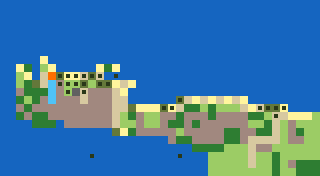

# Topic Doc 24: Crete (Survival)

**Status:** decided and **built (v0)**, 2026-11-24, at the developer's request: the second Survival map (23-survival), after Wake Island. First drafted the same day as a battle map for the empty 1941 slot; the developer moved it to Survival because the real battle was a German win, a siege the defender lost. The developer answered the five open choices (§8). **No new rule**: the waves are arrivals as on Wake, and the paratroops come in Transport Aircraft that arrive loaded and fly home once empty (23-survival §5a, §5c). Built with a new wave pattern set (§4) and two fixes to how the computer lands troops (§6). Tuned by self-play (§7); balance for a person still to check by play.
**Last updated:** 2026-11-24
**Depends on:** 23-survival (the mode and its rules), 01-units (Transport Aircraft, availability rule), 02-terrain (§4a Major Bridge), 05-supply-transport §6 (airborne drops), 09-ai (§4b drops, §4k map plans). **Feeds:** 00-master-design §8 and §19, 23-survival §1 and §11.

---

## 1. Why Crete

Crete was on Survival's list of later maps (23-survival §11). It plays differently from Wake Island:

- **The waves come from the air.** On Wake almost every attack comes from the sea onto the south beaches. On Crete most waves are paratroops in Transport Aircraft, which can drop them beside anything along 140 km of coast. The player sees each lift arrive a turn ahead and has one turn to guess where it will come down.
- **Shooting down a transport kills its paratroops.** A Transport Aircraft destroyed with troops aboard takes them with it (05-supply-transport §4). The player's best defence is anti-aircraft guns placed where the lifts will fly, as the Bofors guns at Heraklion shot down Ju 52s in 1941.
- **The player has no sky.** The UK can't build aircraft (§8, Q1). Its defence against the Luftwaffe is Flak Guns, Mobile AA and its navy. On Wake the game turns on keeping the Fighters alive; here there are none to keep.
- **Many fronts.** Wake is one small atoll. Crete is a long island with three airfields and the HQ far apart, so the player decides what to give up.

The 1941 slot in Skirmish and the Campaign stays empty (00-master-design §19).

## 2. Crete (`crete`)

Green properties are the UK's; the dark marks are the starting units (the two off the south coast are Destroyers).

### The history it follows

After Greece fell in April 1941, the British, New Zealand, Australian and Greek troops evacuated from the mainland joined the garrison of Crete: about 32,000 Commonwealth soldiers and 10,000 Greeks under the New Zealander Bernard Freyberg (Creforce), short of guns, transport and radios. The RAF withdrew its last fighters on 19 May. British codebreakers had read the German plan, Operation Merkur, so Freyberg knew it would come by air, against the three airfields at Maleme, Rethymno and Heraklion.

- **20 May:** the German 7th Air Division dropped in two lifts, in the morning on Maleme and on Prison Valley near Chania, in the afternoon on Rethymno and Heraklion. The paratroops came down among the defenders in the olive groves and were cut to pieces; by evening none of the airfields was taken. That night the 22nd New Zealand Battalion, out of touch with its companies, pulled back from **Hill 107**, which overlooked Maleme.
- **21 May:** Germany crash-landed Ju 52s on Maleme under artillery fire and began flying in the 5th Mountain Division. That night the Royal Navy caught the first seaborne convoy of fishing boats (caiques) north of Crete and scattered it; the second turned back on the 22nd. By day the Luftwaffe hunted the fleet: in a week it sank three cruisers and six destroyers.
- **22–25 May:** the counter-attack on Maleme failed. Reinforced through the airfield, the Germans pushed east. **Galatas** fell on the 25th.
- **27 May:** Chania and Souda Bay were lost, and Creforce began its retreat over the White Mountains to Sphakia. From there and from Heraklion the navy took off about 16,500 men by 1 June. Rethymno, cut off, surrendered on 30 May.

Germany lost about 4,000 dead and more than 200 aircraft, about 150 of them Ju 52s. Hitler never ordered another large airborne operation.

### Area and scale

- **About 40 × 22 squares of about 4 km**, north up: Crete from Kastelli in the west to Heraklion in the east (about 140 km, 35 squares), with about 5 squares of sea to the north and south.
- **The edges stand for** the Greek mainland and its airfields (north and west), the Dodecanese (east), and Egypt and the fleet's base at Alexandria (south).
- A Transport Aircraft or a Bomber arriving on the north edge reaches the coast on its next turn, so a wave gives one turn's warning, as on Wake (23-survival §3). A Landing Craft takes a day longer.

### Places

| | United Kingdom |
|---|---|
| West | **Maleme** (Airfield), Kastelli (City), Galatas (City) |
| Centre | **Chania** (**HQ**, Creforce headquarters), **Souda Bay** (Port, and a **Factory**: the base depot, a liberty so the player can build land units), Georgioupolis (City), Sphakia (City, south coast) |
| East | **Rethymno** (Airfield, and a City for the town), **Heraklion** (Airfield, and a Port for the harbour) |

- 12 properties, all the UK's, earning **half the usual**: 6,000 a day, about what Wake's 6 earn (a `multiply` 0.5 income modifier for the UK). Creforce was cut off and short of everything, and at the full 12,000 a careful player could outbuild every wave. Germany starts with none, and earns nothing from those it captures (23-survival §5d).
- **The airfields** give the UK income, as any property does, and build nothing for it (it has no aircraft to build). An airfield Germany captures gives its aircraft somewhere to land, refuel and stay instead of flying home (23-survival §5c, §5d).
- **If Germany takes Chania**, Crete has fallen.

### Terrain

- **The White Mountains** fill the west-centre of the island and **Mount Ida** the centre: **Hills**, impassable to tanks and wheels. Only the coast road links Maleme, Chania, Rethymno and Heraklion; one track runs south over the mountains from Vrysses to Sphakia.
- **Hill 107**: a single Hills square just south of Maleme airfield. A unit on it overlooks the airfield (foot soldiers on Hills see 3 squares further, 19-fog-of-war §2), and Artillery behind it reaches the airfield square.
- **Olive groves and vineyards** cover the coastal plain round Maleme, Galatas, Rethymno and Heraklion: **Forest**.
- **Prison Valley**, south-west of Galatas: Plains, with the Agia prison as a **Bunker**.
- **The Tavronitis**, a dry riverbed just west of Maleme, is a River; its iron bridge on the coast road is a **Major Bridge** (02-terrain §4a).
- **Roads:** the north coast road, Kastelli–Maleme–Chania–Souda–Georgioupolis–Rethymno–Heraklion; Chania to Alikianos through Prison Valley; Vrysses to Sphakia.
- **Beaches** at Kastelli bay, from Maleme to Platanias (where the caiques were meant to land), at Georgioupolis, east of Heraklion, and at Sphakia; and every other open square of the north coast, the coast road included where it runs along the shore. With a handful of beaches, convoys queued offshore for one and ran out of fuel (§7).

### Starting forces (19 May, the day before the drops)

- **United Kingdom** (no funds), moving first. The New Zealand, Australian and Greek troops are drawn with the UK's art, as the French are at Dunkirk (21-scenarios-dunkirk §1); the briefing names them.
  - **Maleme** (5th New Zealand Brigade): 2 Infantry on Hill 107 and beside it, 1 Infantry on the airfield, a Mobile AA (Bofors), a Medium Tank (two Matildas), an Artillery.
  - **Galatas and Prison Valley** (New Zealand and Greek): 3 Infantry, a Light Tank (3rd Hussars).
  - **Chania and Souda Bay:** 2 Infantry, one on the HQ; a Flak Gun (the 3.7-inch guns at Souda); an Artillery.
  - **Rethymno** (Australian and Greek): 2 Infantry, an Artillery.
  - **Heraklion** (14th Brigade, Australian 2/4th, Greek): 3 Infantry, a Medium Tank, a Mobile AA.
  - **The fleet:** 2 Destroyers south of Crete (the cruiser and destroyer forces) and a Torpedo Boat (10th MTB Flotilla) at Souda Bay.
- **Germany:** nothing. Every German unit comes in a wave.

### Build lists

- **United Kingdom:** every land unit the UK has art for except the Heavy Tank (no Churchill before 1942) and the never-built ones; Destroyer and Torpedo Boat. **No aircraft** (§8, Q1).
- **Germany:** nothing (23-survival §5d).

### Weather, fog and commander

- Clear all game.
- Fog of war is the player's choice, off by default, as on Wake (§8, Q3).
- Germany has no commander (§8, Q4). The player picks one for the UK, or none, as on Wake.

## 3. The waves of the invasion (19–28 May)

The first ten waves follow history. "Arrives" is the start of Germany's turn on that day; the units **can't act that turn**, so the player sees each wave for one turn before it strikes. Day 1 is 19 May.

- **Paratroops arrive in the air, already aboard** their Transport Aircraft (2 foot units each), on the map's edge. They need no German airfield: each Transport drops its troops, then **flies home once empty** (`leavesWhenEmpty`, 23-survival §5c), leaving from the nearest edge. One that lands on an airfield Germany has captured stays there, as any aircraft does.
- **The 5th Mountain Division** was flown in by Ju 52s that landed on Maleme. Here it comes the same way as the paratroops: dropped from Transport Aircraft (§11).
- **Raiders go home:** Bombers and Fighters fly for **2 turns** after they arrive, then turn for home (`sortieTurns: 2`). Landing Craft leave once they've unloaded.

| Wave | Arrives | Strikes | Name | Units | From |
|---|---|---|---|---|---|
| 1 | Day 1 | Day 2 (20 May) | The morning lift | 5 Transport Aircraft carrying 8 Infantry, an Assault Infantry (the glider pioneers) and a Mortar Team; 3 Bombers and a Fighter | North, off Maleme |
| 2 | Day 2 | Day 3 | The afternoon lift | 4 Transport Aircraft carrying 7 Infantry and a Mortar Team; 2 Bombers | North, off Heraklion |
| 3 | Day 3 | Day 4 (22 May) | The first mountain troops | 3 Transport Aircraft carrying 5 Infantry and a Mortar Team | North, off Maleme |
| 4 | Day 3 | Day 5 | The Maleme convoy | 2 Landing Craft carrying 2 Infantry, a Light Tank and an Artillery | North, off Maleme |
| 5 | Day 4 | Day 5 | Mountain troops | 3 Transport Aircraft carrying 5 Infantry and an Assault Infantry | North, off Maleme |
| 6 | Day 4 | Day 5 | Hunting the fleet | 4 Bombers and a Fighter | North, off Rethymno |
| 7 | Day 5 | Day 6 | Mountain troops | 3 Transport Aircraft carrying 5 Infantry and a Mortar Team | North, off Maleme |
| 8 | Day 6 | Day 7 (25 May) | Galatas | 4 Transport Aircraft carrying 6 Infantry, an Assault Infantry and a Mortar Team; 4 Bombers and 2 Fighters | North, off Maleme |
| 9 | Day 7 | Day 8 | The second drop | 5 Transport Aircraft carrying 8 Infantry and 2 Assault Infantry | North, off Rethymno |
| 10 | Day 9 | Day 10 (28 May) | Sitia | 2 Landing Craft carrying 2 Infantry and 2 Light Tanks (the Italian landing, drawn German) | East |

- **No escorts.** The Italian torpedo boats that escorted the caiques are left out: a ship that reaches a port Germany has captured finds a base and stays there for good (23-survival §5c), and an escort parked on Heraklion's port blocked every convoy behind it.
- **Germany's heavy weapons come only by sea.** A Transport Aircraft carries foot soldiers only (01-units §5), so the Light Tanks and Artillery are in the convoys, which the UK's Destroyers can hunt.
- **The relief:** on day 8 (26 May), **Layforce** lands at Souda Bay (2 Assault Infantry, the commandos landed from the fast minelayer Abdiel), and the carrier **Formidable** arrives on the south edge with 2 Fighters aboard (Fulmars). They are the UK's only aircraft, and are there only while the Carrier survives.
- **History's mark:** "Chania fell on 27 May 1941, day 9". Holding the HQ to the start of day 10 is "**Held longer than history**".
- **Numbers are a first guess**, to be tuned by self-play (§7).

## 4. Endless waves (day 11 onwards)

As on Wake (23-survival §4), from the same generator: a new wave every 2 days (days 11, 13, 15 …), the first worth **260,000**, each later one **12% more**. They use a new pattern set, **`aegean`** (data in `src/engine/data/waves.ts`, beside `pacific`). It's data, not a rule:

| Pattern | What it spends the budget on | From |
|---|---|---|
| Parachute drop | Transport Aircraft full of Infantry, Assault Infantry and Mortar Teams (`leavesWhenEmpty`), with a Fighter escort | North or west |
| Raid | Bombers, with Fighters | North, west or east |
| Convoy | Landing Craft with foot soldiers, Light Tanks, Artillery and Mobile AA (`leavesWhenEmpty`). No escorts (§3) | North or east |
| Combined (from wave 15) | A drop with a raid, or a drop with a convoy | Two of the above |

- **Edges:** north, west and east from the start. The south, the fleet's route from Alexandria, opens to Germany from wave 15.
- **UK convoys:** every fourth endless wave (13, 17, 21 …), a UK convoy arrives on the south edge the same day: a Destroyer and a Landing Craft with 2 Infantry, as the navy ran men and supplies in from Alexandria.
- **Unit cap:** Germany has at most **90** units on the map (Wake: 60). The cap counts passengers, so paratroops still in the air count twice over with their transports; at 60, loaded transports filled it and the next waves waited off the map (§7).

## 5. Rules

**No new rule.** Everything is Survival as built (23-survival §5):

- Arrivals, with Transport Aircraft arriving loaded, as Landing Craft already do (§5a).
- `rout` for the UK only, so Germany never loses (§5b). The UK loses when Germany takes Chania or when it has no units left.
- Raiders and empty transports going home (§5c): `leavesWhenEmpty` already works for any transport, not only Landing Craft.
- Germany getting nothing from what it captures (§5d).

## 6. The computer

- **Germany** plays the survival map plan (23-survival §6): land units drive on Chania, raiders prefer Flak Guns, Mobile AA and aircraft, then ships.
- **No drop targets were needed.** The design proposed naming a target for each scripted lift. As built, Greedy's own drops (09-ai §4b) already do it: a paratrooper's goals are the UK properties it could capture, and its transport flies to the nearest. Coming in off Maleme, the morning lift drops round Maleme, Kastelli and Galatas; coming in off Heraklion, the afternoon lift drops there. The troops then drive on Chania with the survival plan.
- **Two fixes to how the computer lands troops** (09-ai §4b), found in self-play here, and in force on every map:
  - A Transport Aircraft flies only to a free square with a free square next to it to drop onto, looking further out when every square round its goal is taken. Before, lifts stopped over the sea beside a town the UK held, with nowhere to drop, and stayed there.
  - A wave's Landing Craft always lands its troops. Before, a loaded craft sat on a beach for good once the nearest UK property was more than about 12 squares' walk away.
- **The UK** can be played by the standard AI with the defender's plan (23-survival §6), for tuning only.

## 7. Tuning

- **Target:** as on Wake (23-survival §8), the standard AI playing the UK falls within a few days of history (Chania on day 9). A careful human should hold longer.
- Measured with `npm run selfplay -- --maps crete`.
- **The levers,** in order: the number of Transport Aircraft in each lift and where they drop; the convoys; the UK's starting funds and units; the first endless wave's budget.
- **Measurements** (2026-11-24, the standard AI as the UK with the defender plan, 30–40 days):
  - First build (UK 5,000 funds and full income, mountain lifts of 2 transports, endless budget 120,000, cap 60), seeds 1–4: Chania fell in 1 game, on day 16; the others held to day 30. Transports hovered loaded off the coast and convoys never landed.
  - With the two landing fixes, bigger mountain lifts, no UK funds and budget 150,000–220,000 (seeds 1–8): Chania fell in 1 to 4 games. Landing Craft queued for the few beaches and filled the unit cap.
  - With more beaches, cap 90 and budget 260,000 (seeds 1–12): 8 of 12 fell, days 19–29.
  - **Chosen**, adding the UK's half income (seeds 1–12): **all 12 fell, on days 17–27; 6 by day 20** (days 25, 20, 23, 25, 24, 27, 20, 21, 18, 20, 17, 19), at waves 13–15. Close to Wake's 11 of 18 by day 20.
- **The computer is a weak guide for the UK here too**, as on Wake: it parks its own units on the Souda depot, so it can't build, and its funds pile up. A person who keeps the depot clear and buys anti-aircraft guns should hold well past history.

## 8. Decisions (the developer, 2026-11-24)

| # | Question | Decided | Notes |
|---|---|---|---|
| Q1 | Can the player build aircraft? | **No** | The Luftwaffe owned the sky. The player answers it with Flak Guns, Mobile AA and ships. Formidable's two Fulmars are the one exception |
| Q2 | Should reinforcements land only at an airfield Germany holds (a new rule)? | **No** | Paratroops arrive already aboard Transport Aircraft, need no airfield, and fly away once empty, using the rules Wake already has. So no new rule. The first draft's "losing an airfield makes the waves bigger" is dropped |
| Q3 | Fog of war? | **The player's choice, off by default**, as on Wake | |
| Q4 | Germany's commander? | **None**, as on Wake | |
| Q5 | Should the record also count units evacuated from Sphakia? | **No** | Survival scores waves and days, the same on every map |

## 9. Build plan

| # | Engine | Presentation |
|---|---|---|
| C1 (**built 2026-11-24**) | The `aegean` pattern set (§4) | — |
| C2 (**built 2026-11-24**) | The Crete map (`tools/maps/crete.mjs` from real longitude and latitude, `docs/maps/crete.png`) and its scripted waves; it joins `SURVIVAL_SCENARIOS` and `src/survival/maps.ts` (history's mark) | The Survival screen lists it, with its terrain sketch and briefing |
| C3 (**built 2026-11-24**) | — | The two landing fixes (§6); self-play tuning (§7) |

### Tests to write

Map tests (`tests/crete.test.ts`, "Crete (24-survival-crete)"), among them:
- "the UK holds all twelve properties: Chania, three airfields, two ports, the depot and five towns; Germany none"
- "the UK earns half the usual income, 6,000 a day, and Germany nothing"
- "the UK can't build aircraft"
- "the UK loses when Germany takes Chania or it has no units left, and Germany never loses"
- "Hill 107 is a Hills square overlooking Maleme airfield, held by New Zealand infantry"
- "a tank can drive from Kastelli to Heraklion along the north coast"
- "paratroops arrive already aboard Transport Aircraft, which fly home once they've dropped them"
- "Germany's tanks and guns come only by sea, since a Transport Aircraft carries foot soldiers"
- "the ten waves of the invasion arrive on history's days"
- "Layforce lands at Souda Bay and Formidable arrives with two Fighters on day 8"
- "the Aegean waves bring no warships: the Royal Navy owned the sea"

AI tests (`tests/survivalAi.test.ts`, 09-ai §4b):
- "a Transport Aircraft over the sea beside a held town flies on to where it can drop its paratroops"
- "a wave's Landing Craft lands its troops even when the nearest target is days away"

## 10. Art

- **Nothing new is needed.** The summer season draws the map. Germany's Transport Aircraft is already a Ju 52, its Landing Craft the 1940 barge (standing for the caiques); its Bomber stands for the Ju 87 and Ju 88.
- **Optional:** German paratroopers (Fallschirmjäger, the rimless helmet and smock) as a variant of the German Infantry for drop waves; a caique for the Landing Craft; a Stuka.
- **The Survival screen picture:** parachutes opening over olive groves below the White Mountains, with Ju 52s overhead. Aircraft carry the Balkenkreuz only; no swastika on the tails (00-master-design §6).

## 11. Known gaps

- **The mountain troops are dropped**, not air-landed on Maleme as they were, so taking an airfield doesn't bring Germany more troops (§8, Q2).
- **No night.** The navy owned the sea by night and ran south before dawn; here every day is the same.
- **Cruisers are Destroyers.** No gliders (01-units §7): the glider landings are drops like the rest.
- **No Greek, New Zealand or Australian nation.** Their troops are drawn British.
- **The Souda Bay factory is a liberty**, like Wake's Camp 2: Creforce couldn't raise new troops.
- **No Italian torpedo-boat escorts** with the convoys (§3).
- **Balance is a first guess**, untested.
